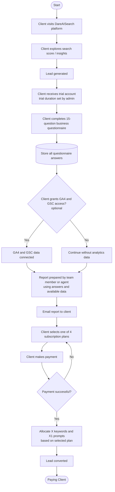

# Client Journey – DareAISearch (Acquisition to Paying Client)

## Steps

1. **Client Acquisition:** The client discovers and visits the DareAISearch platform and uses the platform's search score or related functionality.
2. **Lead Generation:** A lead is generated through the platform.
3. **Trial Account:** The client is given a trial account. The trial duration is decided by the admin. In the trial, the client answers the following 15 questions:
   - a. What are the top products, services, or business categories you want us to prioritise?
   - b. Which markets, countries, cities, or geographies are most important for your business right now?
   - c. Who are your primary target customers? Please describe the key audience segments you want to reach.
   - d. What are the main problems, needs, or use cases for which customers typically discover or consider your brand?
   - e. What actions do you ultimately want users to take after discovering your brand? For example: purchase, submit a lead, book a demo, visit a store, download an app, call, enquire, or sign up.
   - f. What are your most important business objectives from improving visibility across Google and AI platforms such as ChatGPT, Gemini, and Perplexity?
   - g. Which search, AI, social, marketplace, or discovery platforms are most important for your brand today?
   - h. What are the most important topics, customer questions, searches, or AI prompts for which you want your brand to appear?
   - i. Who are the competitors you most closely track, and why are they important competitors for your brand?
   - j. Are there any brands that frequently appear in search results or AI recommendations that you want us to benchmark against, even if they are not direct competitors?
   - k. Which digital properties and channels does your brand currently own or actively manage? For example: website, blog, YouTube, LinkedIn, Instagram, Google Business Profile, mobile app, marketplaces, or other platforms.
   - l. Which external websites, publishers, communities, review platforms, forums, marketplaces, or other third-party sources are important when customers research your category?
   - m. Are there any brand guidelines, legal requirements, regulatory restrictions, prohibited claims, or internal approval processes that we should be aware of?
   - n. How do you currently measure the performance of organic search, AI-driven discovery, website traffic, leads, or revenue? Please mention the tools or metrics you currently use.
   - o. What would success with DareAISearch look like for your brand over the next 6 months? Please mention the outcomes or improvements that would matter most to you.
4. **Answer Storage:** Once the client submits all 15 answers, the responses are stored in the system.
5. **Analytics Access (optional):** The client may provide access to Google Analytics 4 (GA4) and Google Search Console (GSC). This is not compulsory. If the client declines, the process continues without it.
6. **Report and Recommendation Generation:** A team member or an agent prepares a report with recommendations, based on the client's answers (and GA4/GSC data, if provided). The report is emailed to the client while the client waits.
7. **Subscription Selection:** The client selects one of the four subscription plans offered by DareAISearch.
8. **Payment:** After selecting the plan, the client makes the payment.
9. **Subscription Plan Allocation:** Based on the selected plan, the client receives **X keywords** and **X1 prompts**. The four plans differ only in these two numbers. Everything else is the same across all plans.
10. **Lead Conversion:** On successful payment, the lead is converted into a paying client.

**Notation used in both documents:** X = number of keywords, X1 = number of prompts.

## Flowchart

