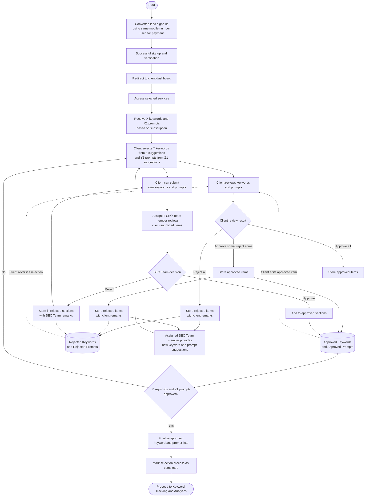

# Client Journey: Keywords and Prompts Selection

**Notation:** X = keywords purchased, X1 = prompts purchased. The client must finalise Y keywords and Y1 prompts, where Y = X and Y1 = X1. Z keyword suggestions and Z1 prompt suggestions are shown to the client to choose from.

**Roles:** the client is assigned an **SEO Team**, and a specific **member of that SEO Team** is the assigned member. The assigned SEO Team member provides suggestions and reviews client-submitted items on the team's behalf. (This replaces the earlier "assigned person" / "assigned admin" role.)

## Steps

1. The converted lead signs up using the same mobile number used during payment.
2. After successful signup and verification, the client is automatically redirected to their dashboard.
3. Inside the product, the client accesses the selected services.
4. Based on the purchased subscription, the client receives:
   - X keywords
   - X1 prompts
5. The client must select:
   - Y keywords (Y = X) out of Z provided keyword suggestions.
   - Y1 prompts (Y1 = X1) out of Z1 provided prompt suggestions.
6. The client reviews the suggestions and approves or rejects each one.
7. **Approve some, reject others:**
   - Approved items are stored immediately in Approved Keywords / Approved Prompts.
   - Rejected items are stored separately in Rejected Keywords / Rejected Prompts.
   - The client gives a reason or remark for each rejected item.
   - The assigned SEO Team member provides new suggestions to replace the rejected ones.
8. **Approve all:** all approved items are saved, and the system checks whether Y keywords and Y1 prompts have been reached.
9. **Reject all:** all items are stored as rejected with the client's remarks, and the assigned SEO Team member provides a new batch of suggestions. This repeats until the required number is approved. There is no limit on the rounds of rejection and re-suggestion.
10. The client can also submit their own keywords and prompts.
11. The assigned SEO Team member reviews client-submitted items:
    - If approved, they are added to Approved Keywords / Approved Prompts and count towards Y and Y1.
    - If rejected, they are stored in Rejected Keywords / Rejected Prompts with the SEO Team member's remarks. The client may submit a different item or choose from the suggestions.
12. Approved items are saved continuously throughout the process.
13. The client may reverse an earlier rejection (moving the item back to review/approved) or edit an approved item. The count of approved items is updated accordingly, and a change to an item that was already approved is re-checked against Y and Y1.
14. Once Y keywords and Y1 prompts are approved, the system finalises the approved lists.
15. The selection process is marked **Completed**.
16. The client proceeds to the next stage: Keyword Tracking and Analytics.

## Flowchart

