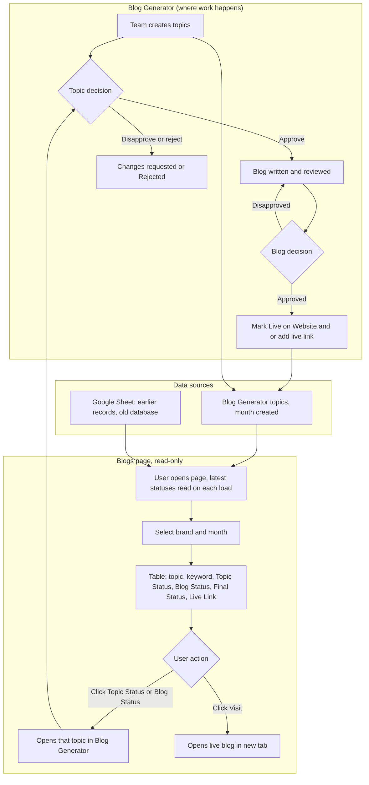
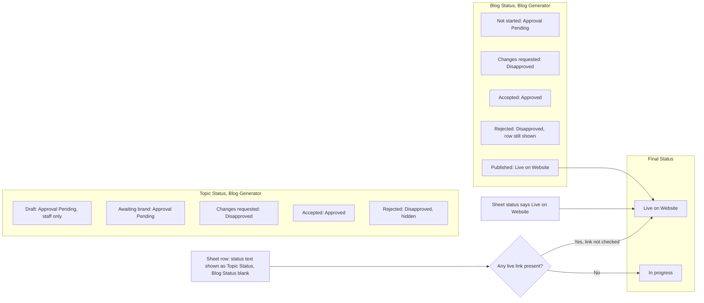

# Blogs – Workflow

A read-only progress board listing each brand's blogs month by month, with topic status, blog status, final status and live link. All work happens in Blog Generator.

## Main workflow

## Status mapping

How Blog Generator labels and the Google Sheet show on the page.

## Key rules

- No upload, add, edit, delete, approval, comments, Notify buttons or emails on this page, for any role.
- Statuses refresh only on the next page load. Topics are placed in the month they were created.
- Draft topics are hidden from brand users; rejected topics are hidden from everyone.
- Earlier sheet records load only for Paid or Lite plans, admins and sub-admins, or the listed allowed brands. The same blog can appear twice because the sources are not merged.
- Any live link, unchecked, is enough to show Live on Website.
- Brand users see only their own brand; internal staff see assigned brands; admins see any brand.
