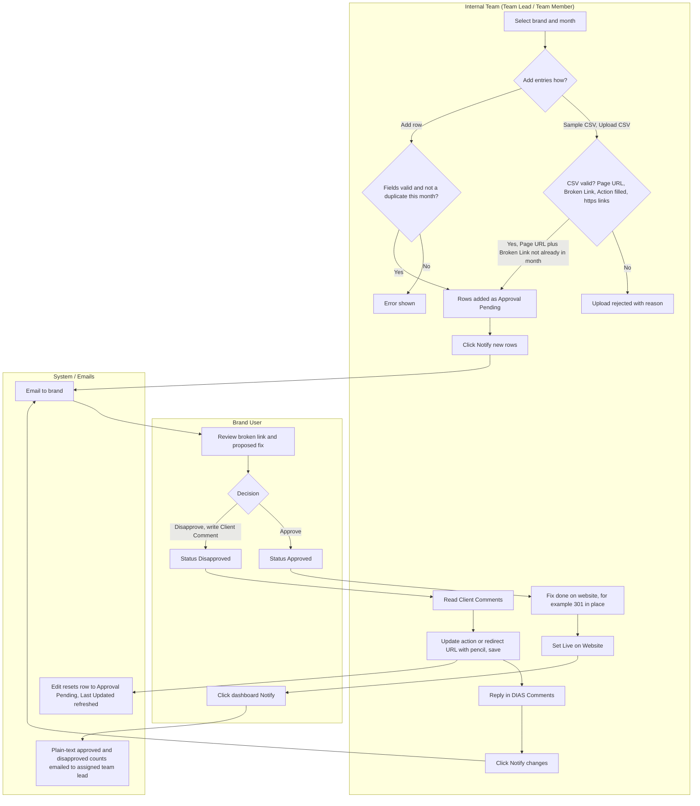
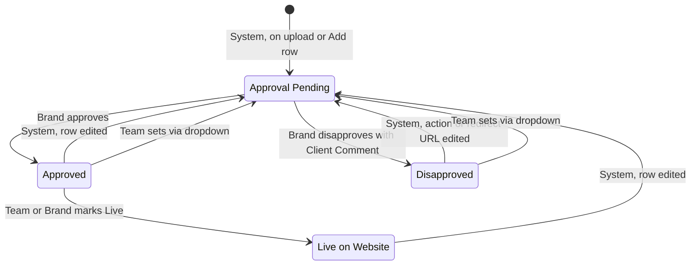

# Broken Links – Workflow

Plans and tracks broken links found for a brand and the fix for each one (for example a 301 redirect), per brand and per month. Each row is one broken link.

## Main workflow

## Status changes

## Key rules

- Fields: Page URL, Broken Link and Action To be Taken are required; Reference Screenshot and URL for Redirection are optional.
- Duplicate means the same Page URL with the same Broken Link in the same brand and month; allowed across months.
- DIAS Comments are the team's and can be added at any time; Client Comments are the brand's and only when disapproving. Comments never change status.
- Only the brand sets Approved or Disapproved; Live on Website needs Approved first. Any edit resets to Approval Pending.
- Last Updated fills in automatically on every add or change and cannot be edited.
- No automatic emails; deleting is permanent, allowed in any status, and not counted in Notify changes.
