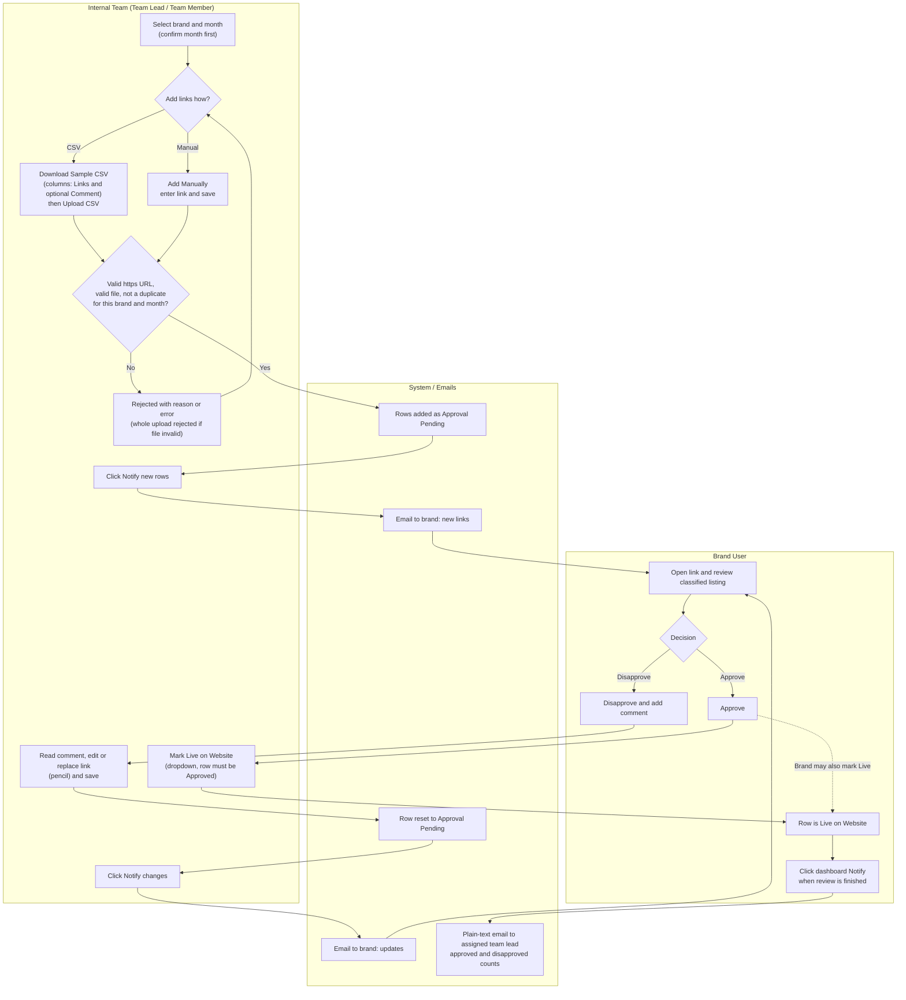
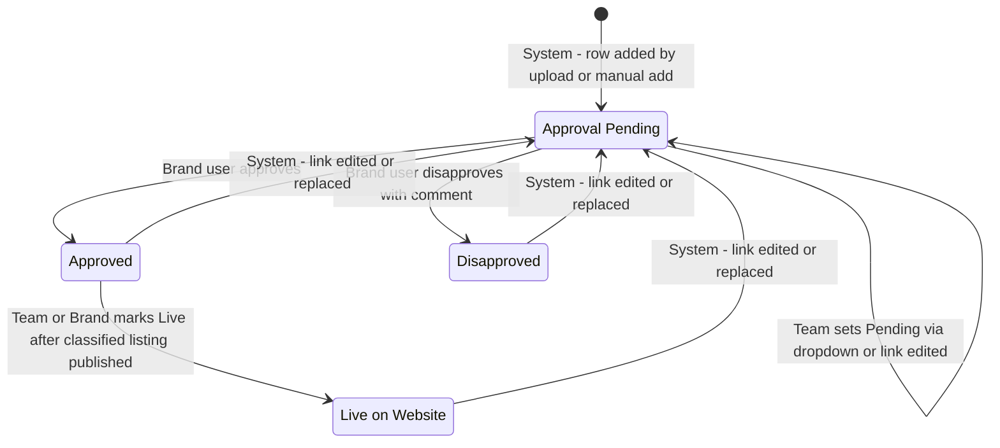

# Classified – Workflow

Plans and tracks classified-ad listings posted for a brand on third-party classified-ad sites, per brand and per month, one Link per row.

## Main workflow

## Status changes

## Key rules

- Only the brand user can set Approved or Disapproved. Team and Admin cannot, even on the brand's behalf.
- The team's status dropdown offers only Approval Pending and Live on Website. Using it does not reset the row; editing or replacing the link does. A row can be marked Live on Website only if it is Approved.
- No emails are automatic. One click of a Notify button sends everything changed since the last click for the selected brand and month; a counter at (0) means nothing is pending.
- The same link cannot be added twice for a brand in the same month, but is allowed in different months.
- The CSV has two columns, Links and an optional Comment. The comment is saved on the row as written by the uploader and never changes the status.
- Team and Admin can add comments at any time; brands only when disapproving. Adding a comment never changes status. Deleting a row is permanent, allowed in any status, and not counted under Notify changes.
