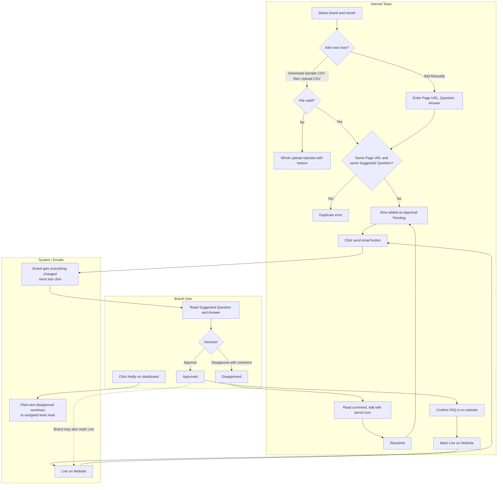
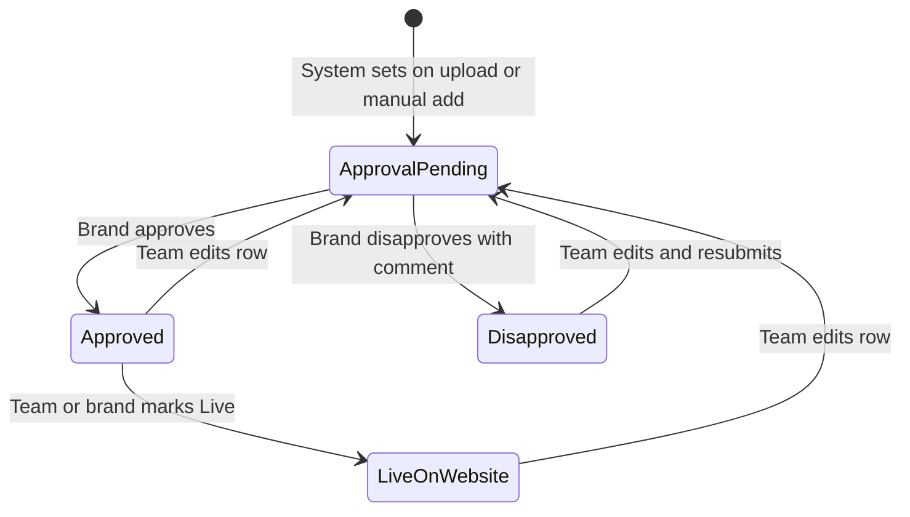

# FAQ Suggestion – Workflow

The FAQ Suggestion page is used to suggest FAQ questions and answers for pages of a brand's website, per brand and per month.

## Main workflow

## Status changes

## Key rules

- No emails are sent automatically; the team must click the send email button.
- Several questions for one URL are allowed; a duplicate is the same Page URL with the same Suggested Question.
- Internal users can delete a row in any status, including Live on Website, after confirmation; it cannot be recovered.
- Team Leads, Team Members and Admins cannot approve or disapprove; only the brand can.
- Any edit resets the row to Approval Pending, and only Approved rows can be marked Live.
- A row can hold several comments, and brand users can comment only when disapproving.
