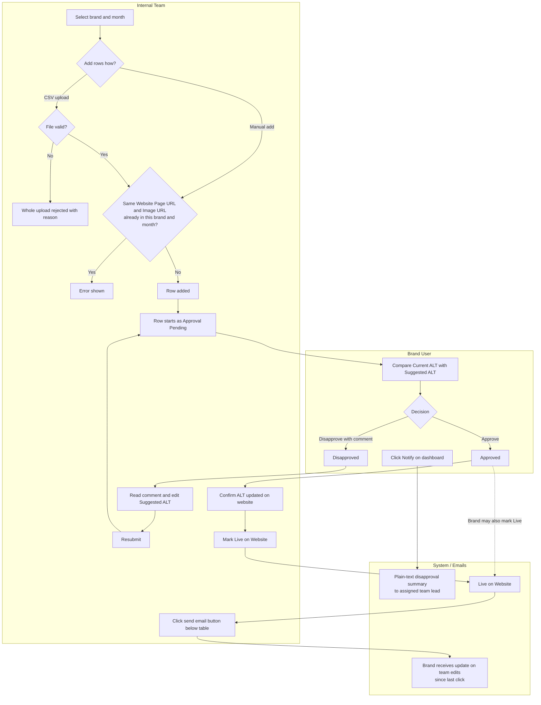
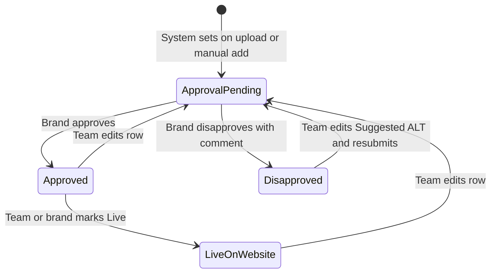

# Image Alt – Workflow

The Image Alt page improves the ALT text of images on a brand's website pages, per brand and per month.

## Main workflow

## Status changes

## Key rules

- Team Leads, Team Members and Admins cannot approve or disapprove; only the brand can.
- A disapproval needs a comment, and brand users can comment only when disapproving.
- Any edit resets the row to Approval Pending, whatever its status.
- Only an Approved row can be marked Live on Website.
- One send email button sends everything changed since the last click for that brand and month.
- The disapproval summary to the team lead comes from the brand's dashboard Notify button, not from the page button.
- The duplicate check applies to both CSV upload and manual add. A row is a duplicate when the same Website Page URL and Image URL already exist in the same brand and month.
