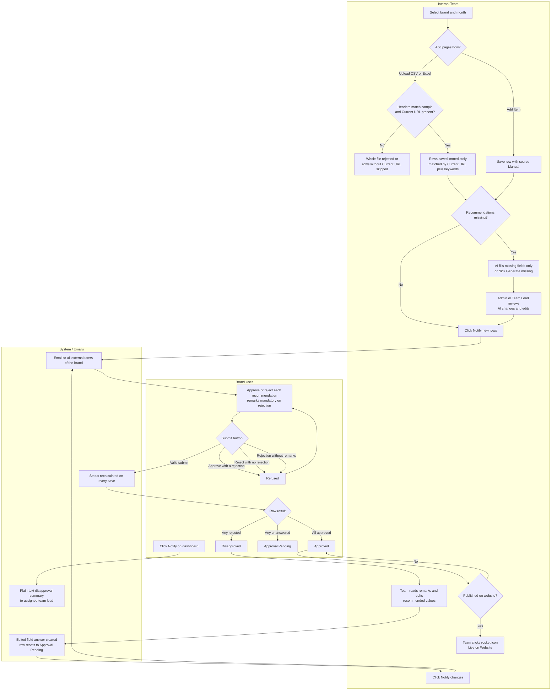
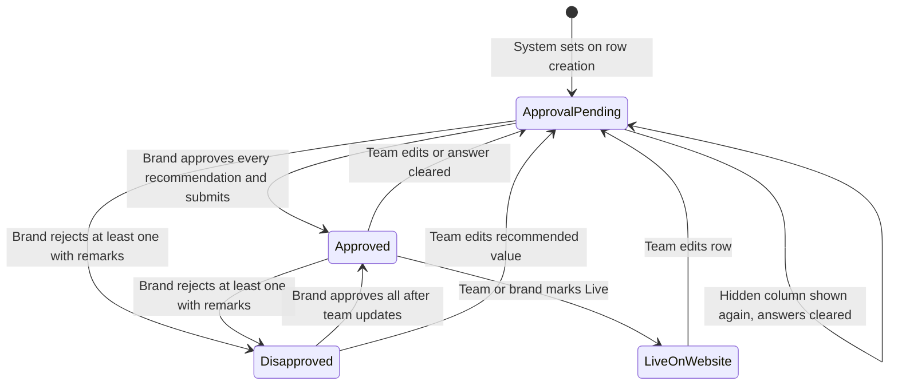

# Meta Tags – Workflow

The Meta Tags page improves the URL, Title, Meta Description and H1 of a brand's website pages, per brand and per month.

## Main workflow

## Status changes

## Key rules

- Status is never typed in; it is recalculated on every save. Live on Website is the only manual status action.
- Only recommendations that have a value and sit in a visible column count towards status.
- Any internal edit resets the row to Approval Pending; if another field is still rejected the row stays Disapproved.
- Blank Recommended cells or blank keywords on re-upload overwrite saved values; blank Current Title, Description and H1 keep them.
- Showing a hidden Recommended column again clears brand answers for that field on all rows of the brand.
- The brand-side Notify button emails the assigned team lead a plain-text count summary covering all pages.
