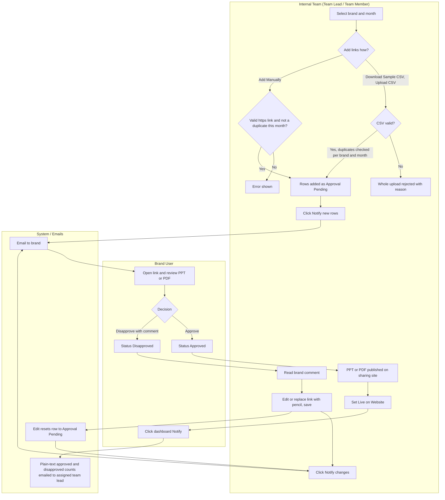
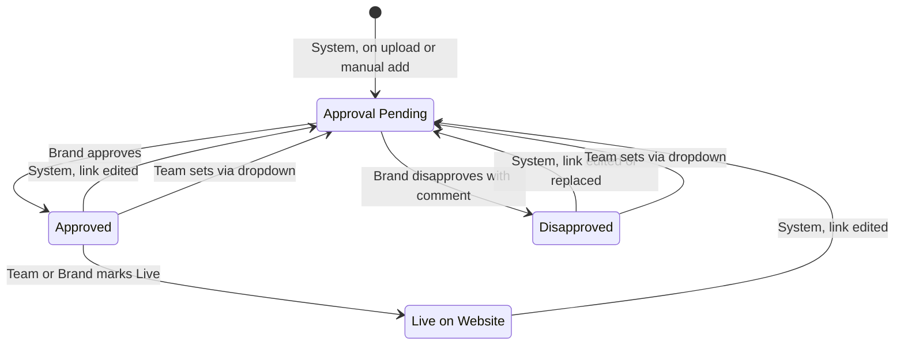

# PPT/PDF Submission – Workflow

Plans and tracks presentations (PPT) and documents (PDF) submitted for a brand to third-party document-sharing sites, per brand and per month.

## Main workflow

## Status changes

## Key rules

- Only the brand can set Approved or Disapproved; the team dropdown offers Approval Pending and Live on Website only.
- A row can be Live on Website only when Approved.
- Editing or replacing the link resets any status to Approval Pending; changing the dropdown or adding a comment does not.
- Same link cannot be added twice for a brand in the same month; the same link in different months is allowed. The CSV has one column, Links.
- No automatic emails. Notify new rows and Notify changes are manual; deleted rows are not counted. Deleting is permanent and allowed in any status.
- Admin cannot approve or disapprove. The brand can comment only when disapproving; the team can comment at any time.
