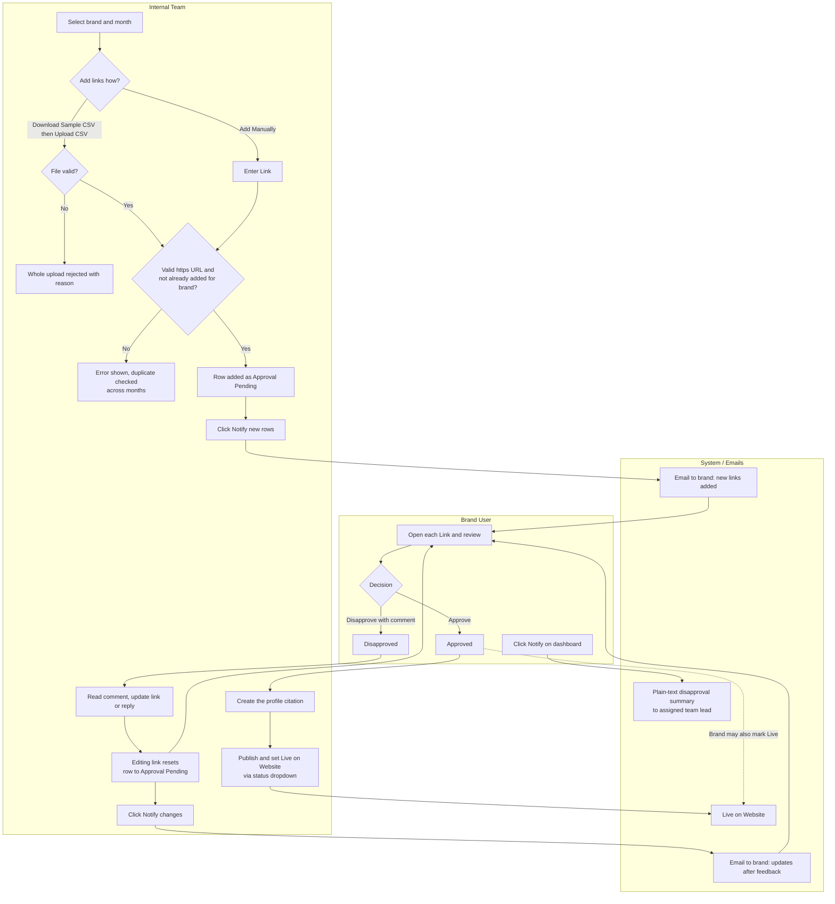
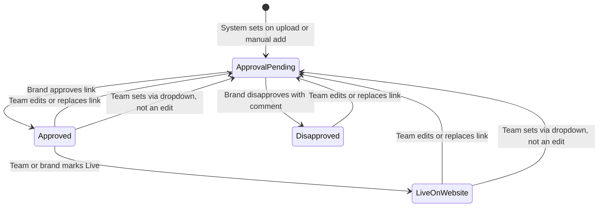

# Profile Citation – Workflow

The Profile Citation page plans and tracks profile pages created for a brand on third-party websites, one Link per row, per brand and per month.

## Main workflow

## Status changes

## Key rules

- Team Leads and Members can set only Approval Pending or Live on Website with the dropdown; Approved and Disapproved are brand-only. Admins cannot approve or disapprove either.
- Using the status dropdown does not reset the row; editing or replacing the link does.
- The same link cannot be added twice for a brand, even across different months.
- Each row has one field only: the Link, which must be a valid https URL.
- No emails are sent automatically; deleted rows are not counted under Notify changes, and delete works in any status.
- Admins, Team Leads and Team Members can add comments; brands can comment only when disapproving.
