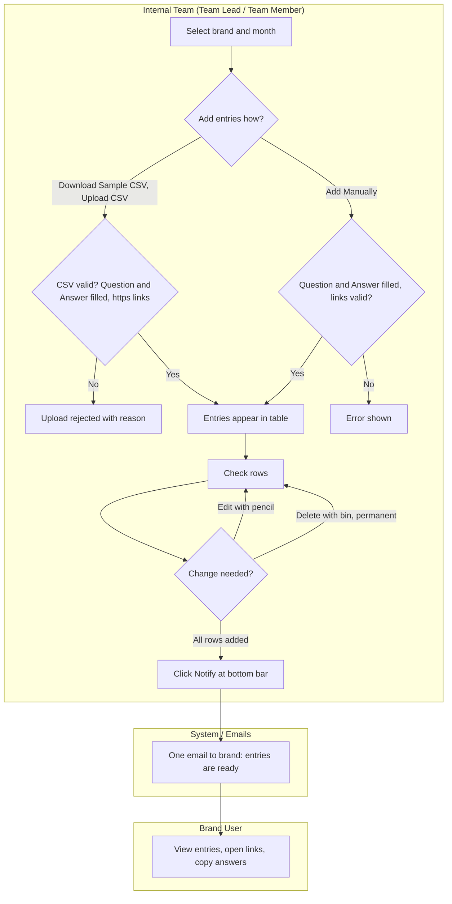
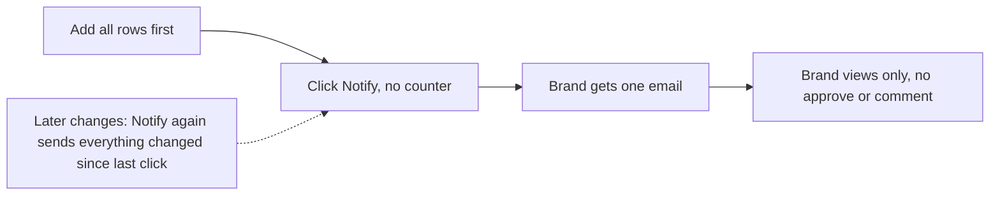

# Reddit/Quora – Workflow

Records answers posted on Reddit and Quora threads for a brand, per brand and per month. There is no approval step: the team adds entries and notifies the brand, who only views them.

## Main workflow

## Notify flow

No status, comments or approval exist on this page. Notify is the only email step.

## Key rules

- Fields: Question (thread link, required), Answer (required), Live Link (optional, shows a dash when empty). CSV headers are Question, Answer and Live Link.
- Links must be valid https URLs; no duplicate check is described.
- Editing a row changes nothing else, because there is no status.
- No automatic emails. Click Notify only after all rows are added, since the page is built to send one email per brand.
- Brand users cannot add, edit, delete, comment or mark Live, and have no Notify button here.
