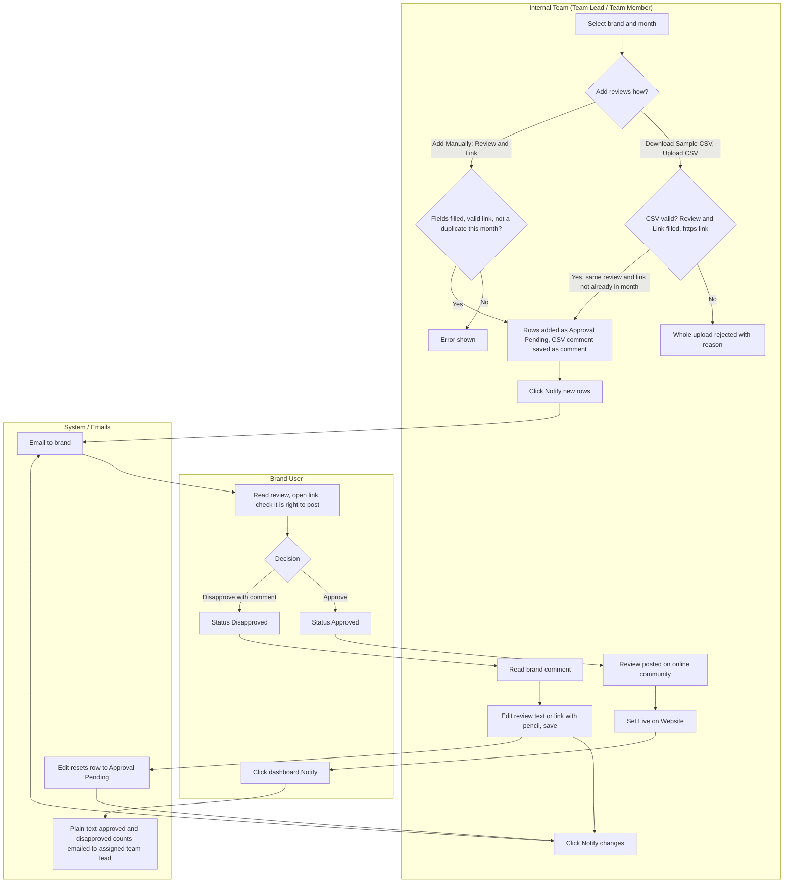
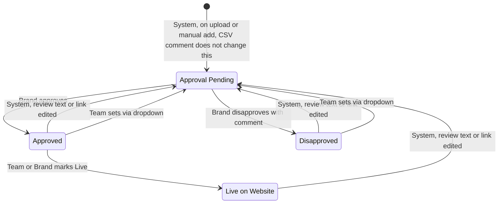

# Reviews on Online Communities – Workflow

Prepares and tracks reviews written about a brand for posting on third-party community and business-listing sites, per brand and per month.

## Main workflow

## Status changes

## Key rules

- Each row has two mandatory fields, Review and Link. The CSV has three columns: Review, Link and optional Comment.
- A CSV comment is saved as a comment by the uploader and never changes the status.
- Duplicate means the same review with the same link in the same brand and month; allowed across months.
- Only the brand can set Approved or Disapproved; a row can be Live on Website only when Approved.
- Editing the review text or link resets to Approval Pending; the dropdown and comments do not.
- No automatic emails; brand comments only when disapproving; deleting is permanent and not counted in Notify changes.
