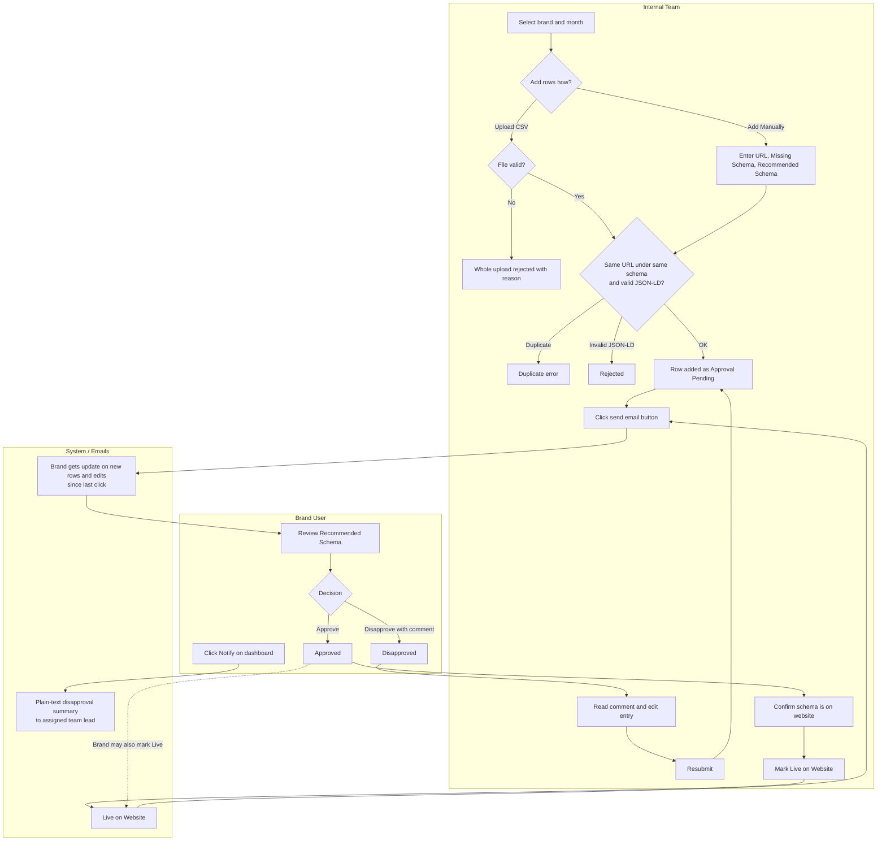
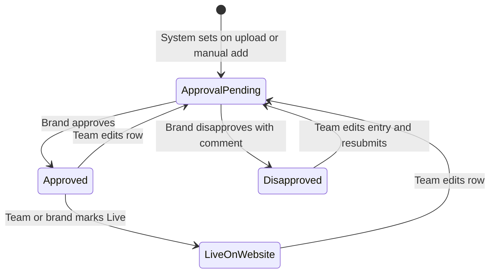

# Schema Markup – Workflow

The Schema Markup page plans, reviews and tracks structured data (JSON-LD) for pages of a brand's website, per brand and per month.

## Main workflow

## Status changes

## Key rules

- Each URL and Missing Schema pair is its own row with its own status; one URL can have several schemas.
- No emails are sent automatically; the team must click the send email button.
- Recommended Schema must be valid JSON-LD for both CSV and manual entries.
- Team Leads, Team Members and Admins cannot approve or disapprove; only the brand can.
- Any edit resets the row to Approval Pending, and only Approved rows can be marked Live.
- A row can hold several comments, and brand users can comment only when disapproving.
