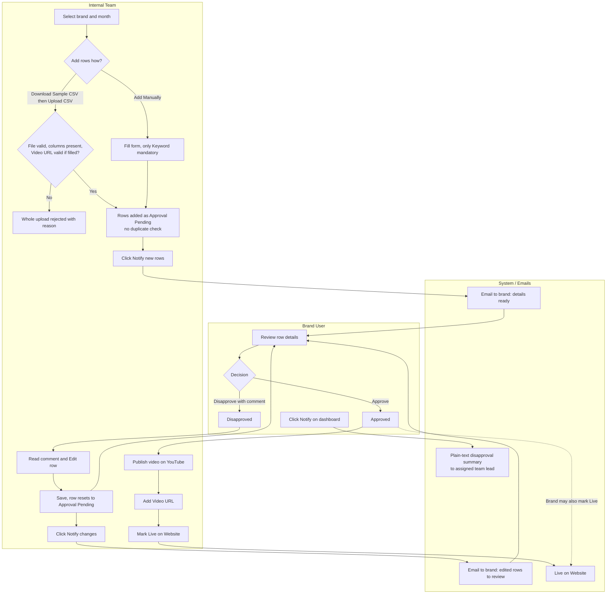
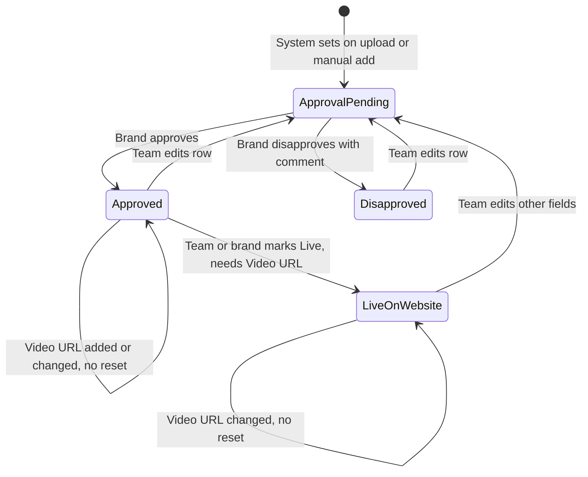

# YouTube – Workflow

The YouTube page prepares the YouTube details (title, description, tags, file name, thumbnail name, first comment, playlist) for each brand video, per brand and per month.

## Main workflow

## Status changes

## Key rules

- Exception to the reset rule: adding or changing the Video URL, or marking the row Live on Website, keeps the current status.
- Live on Website needs the row to be Approved and the Video URL filled with a valid YouTube link.
- Only Keyword is mandatory; there is no duplicate check for now.
- No emails are sent automatically; Notify new rows counts added rows and Notify changes counts edited rows, never deleted rows.
- Admin, Team Lead and Team Member cannot approve or disapprove; only the brand can. Team Leads and Members see assigned brands only.
- Delete needs confirmation, works in any status including Live on Website, and cannot be undone.
