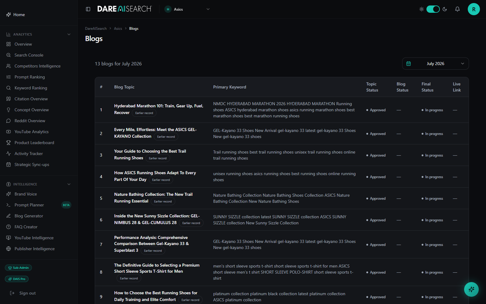
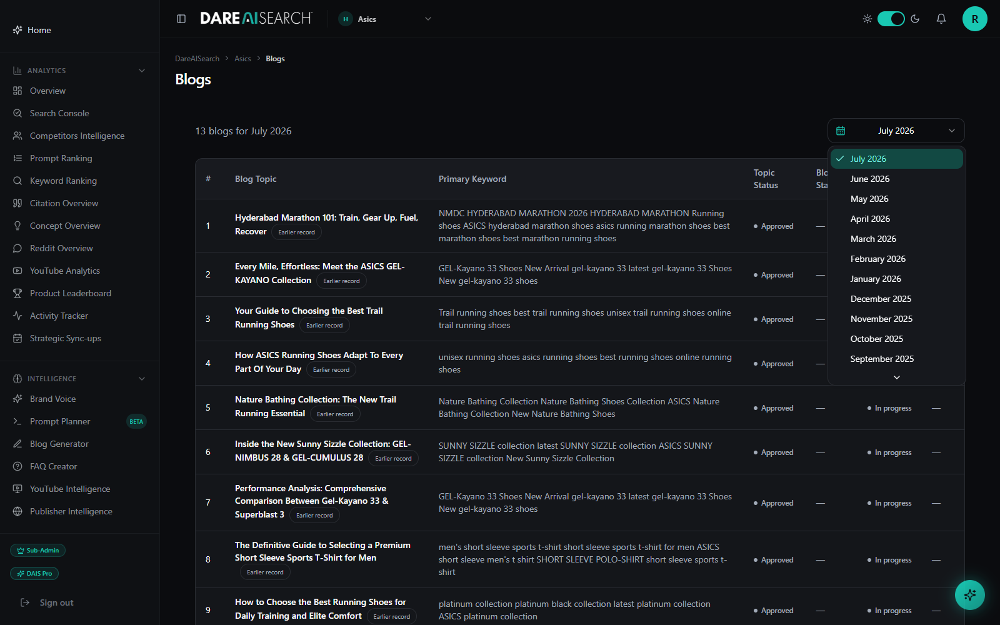
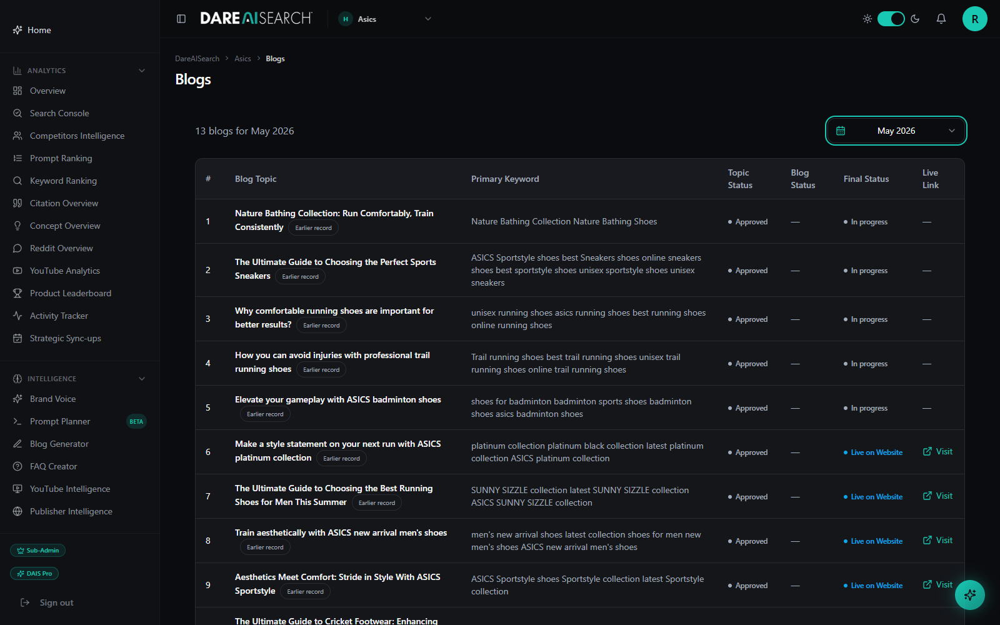
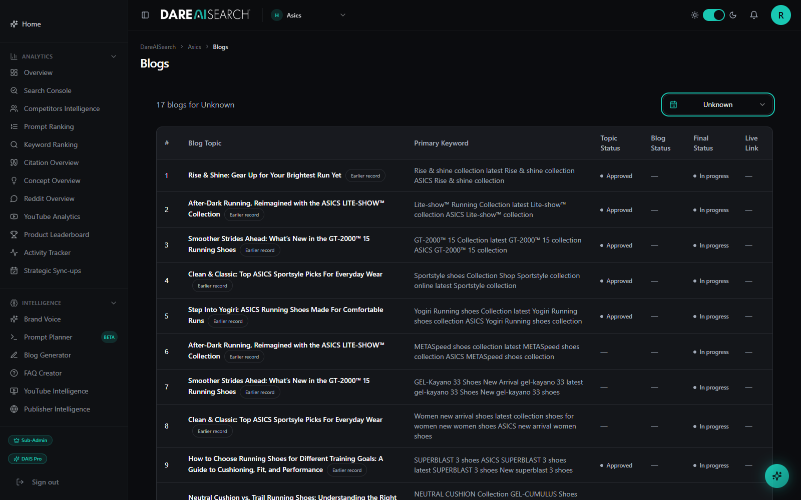

# Blogs

> Path in the platform: **Execution → Owned Channels → Blogs** (`/execution/blogs`)
> Note: you described this as "Controlled Channels / Blogs". In the sidebar, Blogs is listed under **Owned Channels**. The **Controlled Channels** group contains only YouTube.

## 1. Overview

The **Blogs** page is a read-only monthly tracker of the blog articles planned and published for a brand. For each month it lists every blog topic with its target keywords and its progress: whether the topic is approved, how the blog is progressing, and whether it is live on the website (with a link to it).

It helps the team answer:

- Which blogs are planned for this month?
- Which keywords does each blog target?
- Has the topic been approved, and is the blog still in progress or already live?
- Where can I open the published blog?

## 2. Page Layout

From top to bottom:

| # | Section | What it shows |
|---|---------|---------------|
| 1 | **Breadcrumb** | `DareAISearch > {brand names} > Blogs` (brand name follows the selected brand). |
| 2 | **Page title** | "Blogs". There is no subtitle. |
| 3 | **Count label** (left) | e.g. "13 blogs for July 2026". |
| 4 | **Month selector** (right) | Drop-down showing the selected month (default: July 2026 at the time of exploring). |
| 5 | **Blogs table** | One row per blog for the selected month, with 7 columns. |

The page has no summary cards, no search box, no filters, no sorting controls and no action buttons (Add, Edit, Delete, Upload). Other items on screen belong to the platform shell: sidebar, brand switcher, theme toggle, notifications bell, user menu and the **Ask Miss Daring** floating button (not explored).

## 3. Features and Functionality

### 3.1 Month selector

- Lists months from the latest month.
- Choosing a month reloads the count label and the table for that month.
- This is a view filter only. It changes no data.

### 3.2 Blogs table

- Rows are shown in a fixed order (numbered 1, 2, 3…). Column headers cannot be clicked, sorted or reordered.
- Clicking a row does nothing (no page change and no pop-up).

### 3.3 Live Link — "Visit"

When a blog is live, the **Live Link** column shows a **Visit** link with an "open in new tab" icon. It opens the published blog. This is the only clickable action on the page. (I observed it but did not follow it.)

## 4. Data Fields and Columns

| Column | What it shows |
|--------|---------------|
| **#** | Row number within the month. |
| **Blog Topic** | Title of the blog. A small grey **Earlier record** tag appears next to it on the rows observed. |
| **Primary Keyword** | One or more target keywords for the blog, shown as plain text (several keywords are listed together in one cell). |
| **Topic Status** | Approval state of the topic (observed: **Approved**). |
| **Blog Status** | Progress of the blog writing. Shows "—" (empty) on every row observed. |
| **Final Status** | Overall progress of the blog (observed: **In progress** or **Live on Website**). |
| **Live Link** | **Visit** link to the live blog, or "—" when the blog is not live. |

How the data is organised:

- Data is grouped by **month**.
- Observed counts: January 2025: 17; February 2025: 11; March 2025: 12; April–June 2025: 11 each; July–August 2025: 3 each; September–November 2025: 4 each; December 2025–February 2026: 3 each; March–July 2026: 13 each; Unknown: 17.
- Across all 182 rows seen: Topic Status "Approved" 169 times (13 rows were empty); Blog Status empty in all rows; Final Status "In progress" 166 times and "Live on Website" 16 times.
- Live blogs appeared only in April and May 2026 (in the months checked).

## 5. Available Statuses

| Column | Value | Colour / look | Meaning |
|--------|-------|---------------|---------|
| Topic Status | **Approved** | Grey dot | The blog topic has been approved. |
| Topic Status | — | Dash | No topic status recorded. |
| Blog Status | — | Dash | No value was shown for any row. Other values were not seen. |
| Final Status | **In progress** | Grey dot | The blog is not yet live on the website. |
| Final Status | **Live on Website** | Blue dot | The blog has been published; a **Visit** link is available. |

Other statuses may exist, but only these appeared in the data.

## 6. User Workflow

1. Sign in and select the brand in the top bar.
2. In the sidebar, open **Execution → Owned Channels → Blogs**.
3. Read the count label to see how many blogs are planned for the displayed month.
4. Use the **month selector** to change the month. Choose **Unknown** to see blogs with no month.
5. Scan the table: read the topic, check the target keywords, and check Topic Status and Final Status.
6. For a blog marked **Live on Website**, click **Visit** in the Live Link column to open it.
7. To work on blog content (creating or generating blogs), the sidebar has separate items such as **Blog Generator**. These are different pages and are not covered here.

## 7. Important Notes and Dependencies

- The page is **view-only**: no create, edit, delete or upload controls are available.
- Data is **per brand and per month**. Changing the brand in the top bar changes the list.
- **Live Link** is filled only when Final Status is **Live on Website**.
- **Blog Status** was empty on every row, so its use cannot be confirmed.
- Topic Status was empty on 13 rows (all in the months and Unknown group scanned), so it is not always filled.
- A blog moving from Approved to Live is not done on this page; it happens on another page. This page only shows the resulting status.
- The month list starts from the current month and goes back to January 2025.
- **Not tested**: clicking **Visit** links, the **Ask Miss Daring** button, and any behaviour when the screen is narrow.

## 8. Screenshots

| Screenshot | Description |
|------------|-------------|
|  | Default view: count label, month selector and blogs table (July 2026). |
|  | Month selector list. |
|  | May 2026 with **Live on Website** rows and **Visit** links. |
|  | The **Unknown** group of blogs. |
