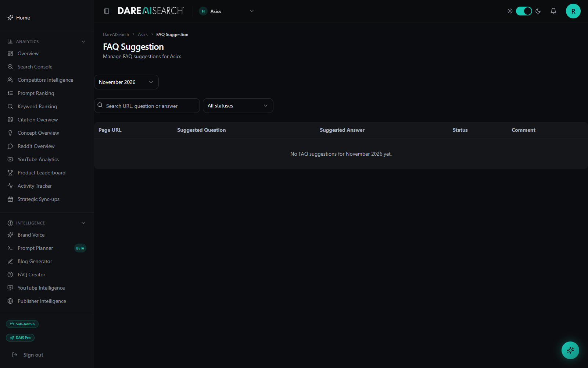
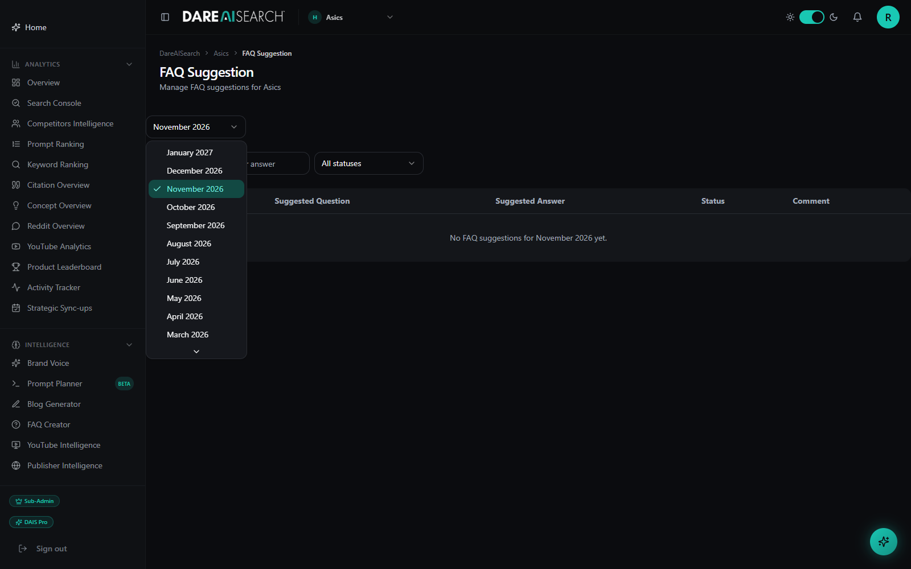
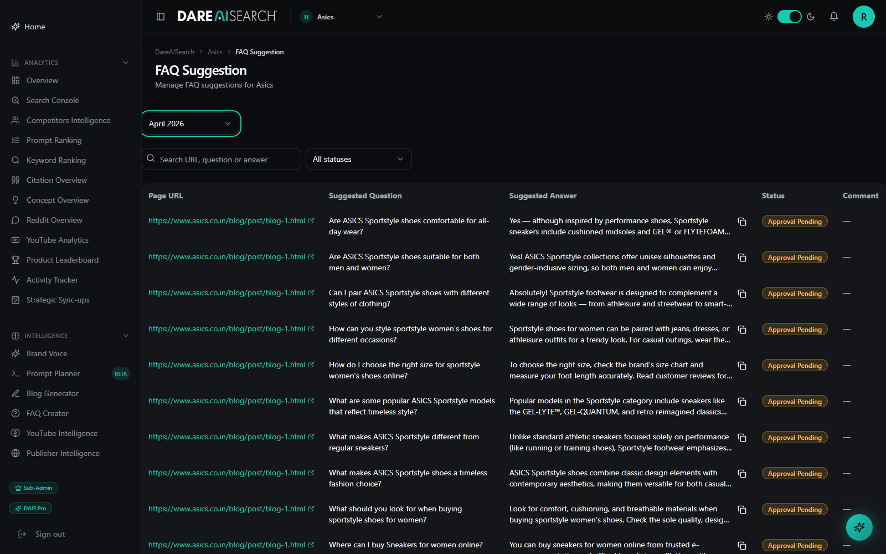
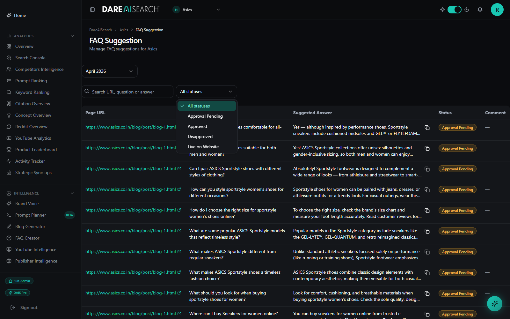
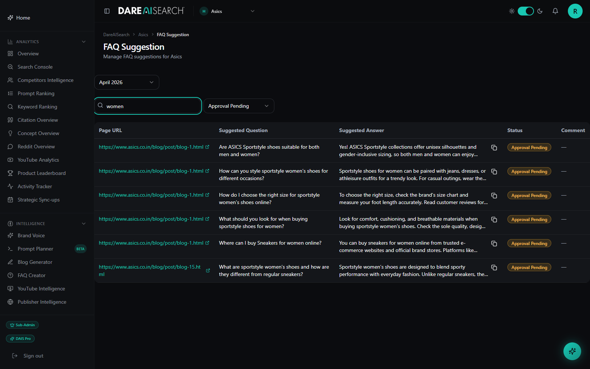

# FAQ Suggestion

> Path in the platform: **Execution → Owned Channels → FAQ Suggestion** (`/execution/faq-suggestion`)
> Explored with the brand **Asics** selected, using a Sub-Admin account. Only observed behaviour is documented. Nothing was created, edited, deleted or submitted.

## 1. Overview

The **FAQ Suggestion** page is a read-only monthly list of **frequently asked questions (FAQs)** suggested for pages of a brand's website, together with a suggested answer for each question. The page subtitle reads: *"Manage FAQ suggestions for Asics"* (the brand name follows the selected brand).

For each suggestion the page shows:

- The website page the FAQ is meant for.
- The suggested question and the suggested answer.
- The approval status of the suggestion.
- A comment field.

It helps the team review which FAQs are proposed for each page and where each one stands.

## 2. Page Layout

From top to bottom:

| # | Section | What it shows |
|---|---------|---------------|
| 1 | **Breadcrumb** | `DareAISearch > Asics > FAQ Suggestion`. |
| 2 | **Page header** | Title "FAQ Suggestion" and the subtitle. |
| 3 | **Month selector** | Drop-down showing the selected month (default: current month, e.g. *November 2026*). |
| 4 | **Search box** | "Search URL, question or answer". |
| 5 | **Status filter** | Drop-down, default **All statuses**. |
| 6 | **Table** | One row per suggested FAQ, with 5 columns. |
| 7 | **Empty state** | If nothing matches: "No FAQ suggestions for *Month Year* yet." |

The page has no summary cards and no Add, Edit, Delete or Upload buttons. Other items on screen belong to the platform shell: sidebar, brand switcher, theme toggle, notifications bell, user menu and the **Ask Miss Daring** floating button (not explored).

## 3. Features and Functionality

### 3.1 Month selector

- Lists 15 months, from **January 2027** back to **November 2025**.
- Choosing a month reloads the table. It is a view filter only.
- Months with rows (Asics): **April 2026** (12 rows) and **May 2026** (5 rows). All other months, including the current month, were empty.

### 3.2 Search box

- Placeholder: **Search URL, question or answer**.
- It searches page addresses, questions and answers. Examples in April 2026: `women` left 6 rows; `blog-1.html` left 11 rows.
- A search with no match shows the empty-state message. Clearing the box restores all rows.

### 3.3 Status filter

Options: **All statuses**, **Approval Pending**, **Approved**, **Disapproved**, **Live on Website**.

- Choosing a status shows only rows with that status for the selected month.
- In April 2026, *Approval Pending* showed all 12 rows. *Approved* showed none and displayed the empty-state message.
- The month, search and status filters work together.

### 3.4 Page URL link

The Page URL is a clickable link with an "open in new tab" icon. It opens the live page.

### 3.5 Copy answer button

Next to each suggested answer is a small copy icon. Its tooltip is **Copy answer**. It copies the answer text so it can be pasted elsewhere (for example into the website or a document). I clicked it once on the first row. It changed nothing on the platform and showed no message in the automated browser, so I did not observe a visible confirmation.

### 3.6 Long answers

Answers longer than two lines are shortened with "…" in the table. The full text appears when you hover over the answer (it is the tooltip of the text). Clicking the answer does nothing.

### 3.7 What is not available

- The **Comment** column showed only "—" on every row. Unlike the Schema Markup page, no **Add comment** link appeared, so comments cannot be added from here.
- The Status badge is plain text. It cannot be changed here. Clicking a row does nothing.

## 4. Data Fields and Columns

| Column | What it shows |
|--------|---------------|
| **Page URL** | The website page the FAQ belongs to. Opens in a new tab. |
| **Suggested Question** | The proposed FAQ question, e.g. "Are ASICS Sportstyle shoes comfortable for all-day wear?". |
| **Suggested Answer** | The proposed answer (shortened to two lines) with a **Copy answer** icon. |
| **Status** | Approval state of the suggestion, shown as a coloured badge. |
| **Comment** | Free-text comment. Shows "—" when empty (empty on all rows seen). |

How the data is organised:

- Data is grouped by **month** and by **brand**.
- Several questions can belong to the same page. In April 2026, 11 of the 12 rows are for one blog page (`blog-1.html`) and 1 for another (`blog-15.html`). The 5 rows in May 2026 are about lightweight versus cushioned running shoes, for page `blog-15.html`.
- The questions are about ASICS products (for example Sportstyle shoes, sizing, and running shoes).
- There is no paging; all rows for the month appear in one list.

## 5. Available Statuses

| Status | Meaning (from its name) | Seen in data? |
|--------|-------------------------|---------------|
| **Approval Pending** | The suggestion is waiting for approval. Shown as an orange/yellow badge. | Yes, on all 17 rows |
| **Approved** | The suggestion has been approved. | Filter option only; no rows seen |
| **Disapproved** | The suggestion was not approved. | Filter option only; no rows seen |
| **Live on Website** | The FAQ has been published on the website. | Filter option only; no rows seen |

The meanings of Approved, Disapproved and Live on Website come from their names, because no rows with those statuses were available.

## 6. User Workflow

1. Sign in and select the brand in the top bar.
2. In the sidebar, open **Execution → Owned Channels → FAQ Suggestion**.
3. Choose a month in the **month selector**. If you see "No FAQ suggestions for *Month* yet", choose another month.
4. Optionally use the **status filter** (for example *Approval Pending*).
5. Optionally type a page address, question or answer text in the **search box**.
6. Read each suggested question and answer. Hover over a shortened answer to read it in full.
7. Click the **Page URL** to open the live page in a new tab and check where the FAQ would go.
8. Use the **Copy answer** icon if you need the answer text for another document.
9. Check the **Status** column to see where each suggestion stands.

## 7. Important Notes and Dependencies

- The page is **view-only**: no create, edit, delete, upload, approve or comment controls were available.
- Data is **per brand and per month**. Changing the brand in the top bar changes the list. The brand switcher lists Asics, Dorset and Herbal Chakra; only Asics was explored.
- The default month (current month) was empty at the time of exploring, so a user may need to move to an earlier month.
- Status and comment fields could not be changed here; approvals happen elsewhere or outside this page.
- Rows with the status Approved, Disapproved or Live on Website were not available, so how they look is not documented.
- **Not tested**: following the page links, other brands, and the **Ask Miss Daring** button.

## 8. Screenshots

| Screenshot | Description |
|------------|-------------|
|  | Empty state (November 2026) with the search box and status filter. |
|  | Month selector list. |
|  | April 2026 with suggested questions, answers, statuses and Copy answer icons. |
|  | Status filter options. |
|  | Search example (`women`). |
