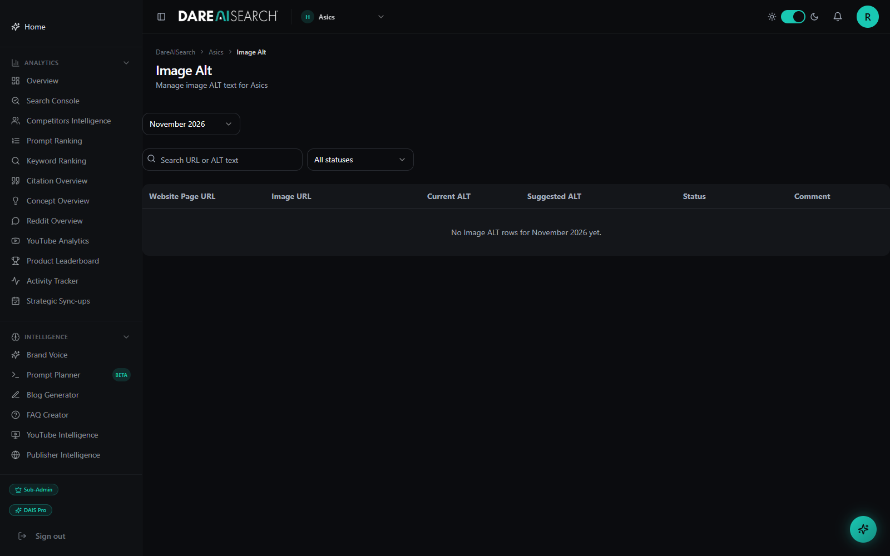
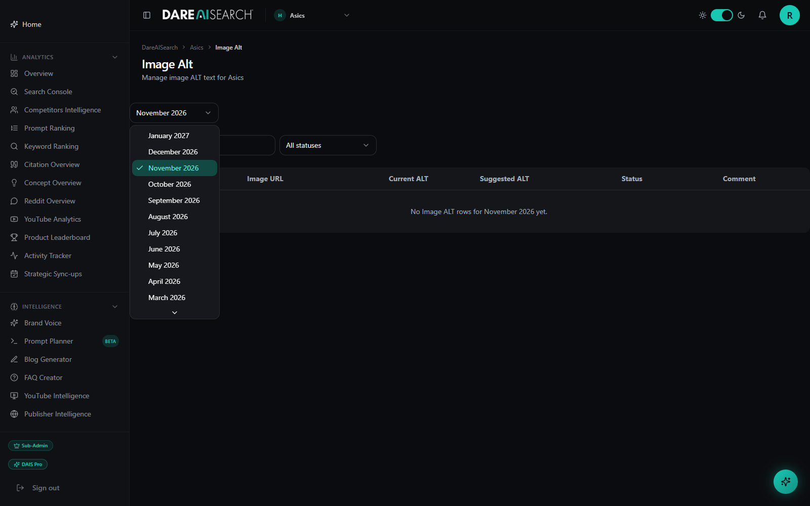
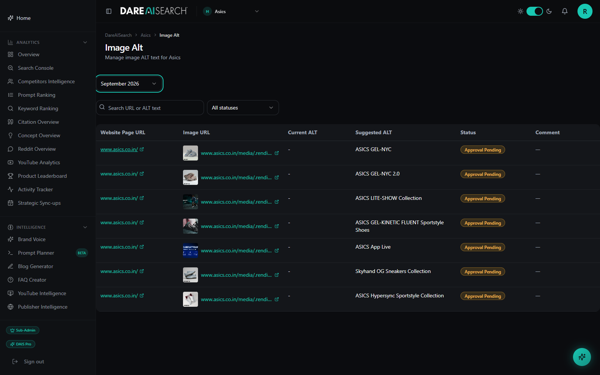
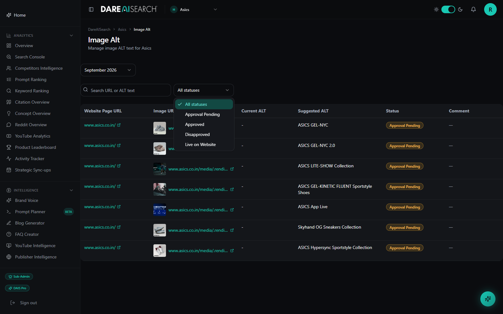
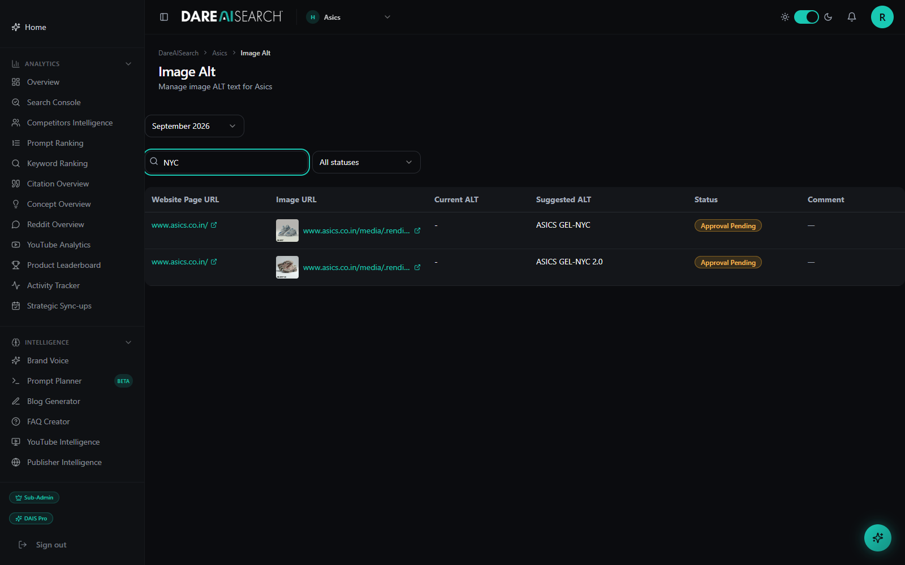
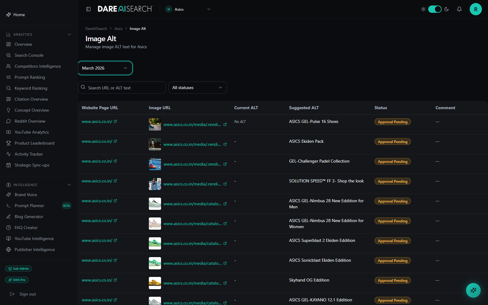
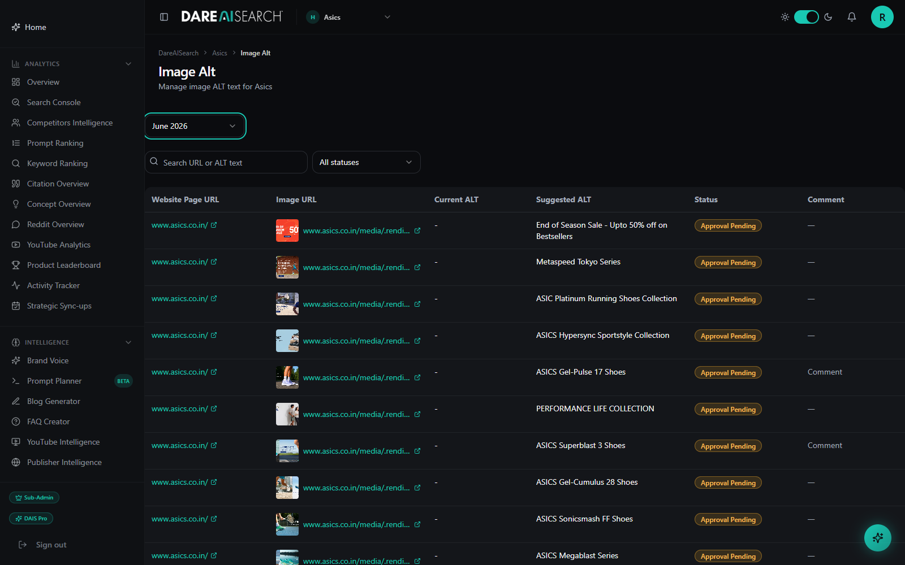

# Image Alt

> Path in the platform: **Execution → Owned Channels → Image Alt** (`/execution/image-alt`)

## 1. Overview

The **Image Alt** page is a read-only monthly list of website images together with the **ALT text** (the short description of an image used by screen readers and search engines) that is currently on the site and the ALT text that is **suggested**. The page subtitle reads: *"Manage image ALT text for {brand name}"* .

For each image the page shows:

- The website page where the image appears.
- The image itself (small preview) and its address.
- The current ALT text and the suggested ALT text.
- The approval status of the suggestion and any comment.

It helps the team see which images need ALT text, what has been suggested, and where each suggestion stands.

## 2. Page Layout

From top to bottom:

| # | Section | What it shows |
|---|---------|---------------|
| 1 | **Breadcrumb** | `DareAISearch > {brand name} > Image Alt`. |
| 2 | **Page header** | Title "Image Alt" and the subtitle "Manage image ALT text for *Brand*". |
| 3 | **Month selector** | Drop-down showing the selected month (default: current month, e.g. *November 2026*). |
| 4 | **Search box** | "Search URL or ALT text". |
| 5 | **Status filter** | Drop-down, default **All statuses**. |
| 6 | **Table** | One row per image for the selected month, with 6 columns. |
| 7 | **Empty state** | If nothing matches: "No Image ALT rows for *Month Year* yet." |

The page has no summary cards and no action buttons (no Add, Edit, Delete or Upload). Other items on screen belong to the platform shell: sidebar, brand switcher, theme toggle, notifications bell, user menu and the **Ask Miss Daring** floating button (not explored).

## 3. Features and Functionality

### 3.1 Month selector

- Lists all months from latest month.
- Choosing a month reloads the table for that month. It is a view filter only.
- Months with rows : March, April, May, June, August and September 2026. All other months, including the current month (November 2026), were empty.

### 3.2 Search box

- Placeholder: **Search URL or ALT text**.
- Typing narrows the table to rows that match. Example: searching `NYC` in September 2026 left 2 rows (the two GEL-NYC suggestions).
- A search with no matches shows the empty-state message. Clearing the box restores all rows.

### 3.3 Status filter

Options: **All statuses**, **Approval Pending**, **Approved**, **Disapproved**, **Live on Website**.

- Choosing a status shows only rows with that status for the selected month.
- If no rows have that status, the empty-state message is shown. In September 2026, *Approval Pending* showed all 7 rows, while *Approved*, *Disapproved* and *Live on Website* showed none.
- The month, search and status filters work together.

### 3.4 Table links

- **Website Page URL**: a clickable link that opens the page in a new tab.
- **Image URL**: a small image preview and a clickable link that opens the image in a new tab. Long addresses are shortened in the cell; the full address appears when you hover over the link.

### 3.5 What is not available

Clicking a row, the Suggested ALT cell or the Comment cell does nothing (no pop-up, no edit box). Status changes and comment entry are not possible from this page.

## 4. Data Fields and Columns

| Column | What it shows |
|--------|---------------|
| **Website Page URL** | The page of the website where the image appears (all observed rows showed the site's home page). Opens in a new tab. |
| **Image URL** | Thumbnail of the image and its link. Opens the image in a new tab. |
| **Current ALT** | ALT text currently on the site. Observed values: **-** (nothing shown) on 52 rows and **No ALT** (in grey italics) on 1 row. |
| **Suggested ALT** | The recommended ALT text, e.g. "ASICS GEL-NYC". Long text is shortened to two lines. Filled on every row seen. |
| **Status** | Approval state of the suggestion, shown as a coloured badge. |
| **Comment** | A free-text comment. Shows "—" when empty. Two rows in June 2026 contained the text "Comment". |

How the data is organised:

- Data is grouped by **month** and by **brand**.
- Rows seen : March 2026: 10; April 2026: 10; May 2026: 6; June 2026: 10; August 2026: 10; September 2026: 7. Total 53.
- All 53 rows had the status **Approval Pending**.
- There is no paging; all rows for the month appear in one list.

## 5. Available Statuses

| Status | Meaning (from its name) | Seen in data? |
|--------|-------------------------|---------------|
| **Approval Pending** | The suggested ALT text is waiting for approval. Shown as an orange badge. | Yes, on all 53 rows |
| **Approved** | The suggestion has been approved. | Filter option only; no rows seen |
| **Disapproved** | The suggestion was not approved. | Filter option only; no rows seen |
| **Live on Website** | The ALT text has been applied on the website. | Filter option only; no rows seen |

The meanings of Approved, Disapproved and Live on Website come from their names, because no rows with those statuses were available to confirm them.

## 6. User Workflow

1. Sign in and select the brand in the top bar.
2. In the sidebar, open **Execution → Owned Channels → Image Alt**.
3. Choose the month in the **month selector**. If you see "No Image ALT rows for *Month* yet", pick another month.
4. Optionally use the **status filter** (for example *Approval Pending*) to see only rows in that state.
5. Optionally type a page address, image address or ALT text in the **search box** to find a specific row.
6. For each row, compare **Current ALT** with **Suggested ALT**.
7. Click the **Website Page URL** or **Image URL** link to open the page or image in a new tab and check it.
8. Read the **Status** and **Comment** columns to see where the suggestion stands.

## 7. Important Notes and Dependencies

- The page is **view-only**. Approving, disapproving, commenting and publishing are not done here.
- Data is **per brand and per month**.
- The filter, search and month selector work together, so an empty table may just mean the combination has no match.
- The default month (current month) was empty at the time of exploring, so a user may need to move to an earlier month to find data.
- Current ALT shows "-" for most rows. The page does not explain the difference between "-" and "No ALT".
- Rows with the status Approved, Disapproved or Live on Website were not available, so how those rows look is not documented.
- **Not tested**: the **Ask Miss Daring** button, following the page and image links, and other brands.

## 8. Screenshots

| Screenshot | Description |
|------------|-------------|
|  | Empty state for a month with no rows (November 2026), with the search box and status filter. |
|  | Month selector list. |
|  | Table with rows (September 2026). |
|  | Status filter options. |
|  | Search example (`NYC`). |
|  | March 2026 with image previews and a "No ALT" current value. |
|  | June 2026 with a row that has a comment. |
