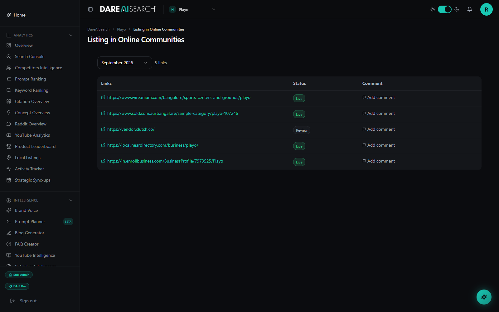
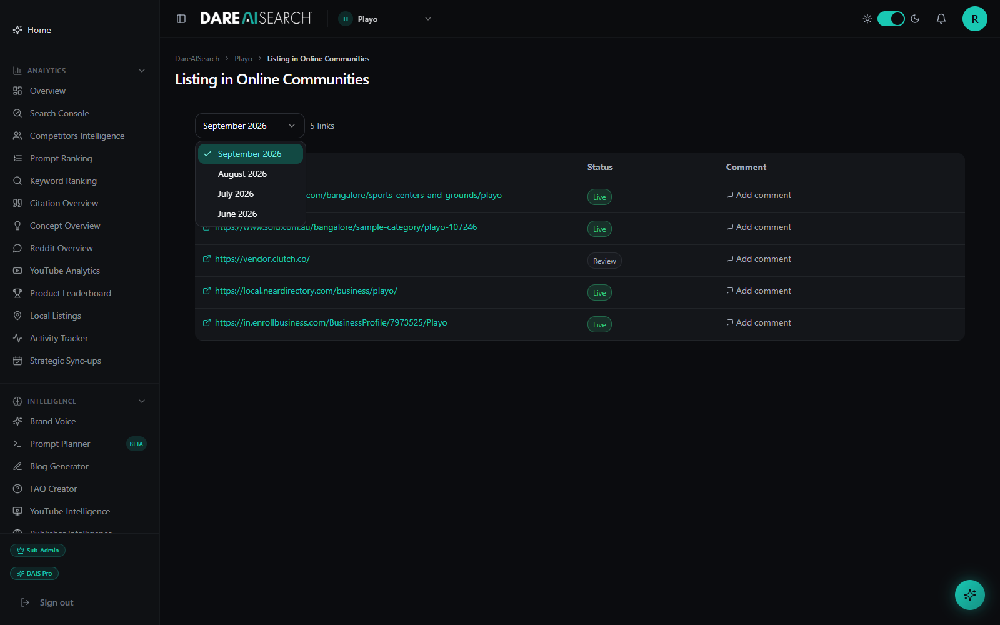
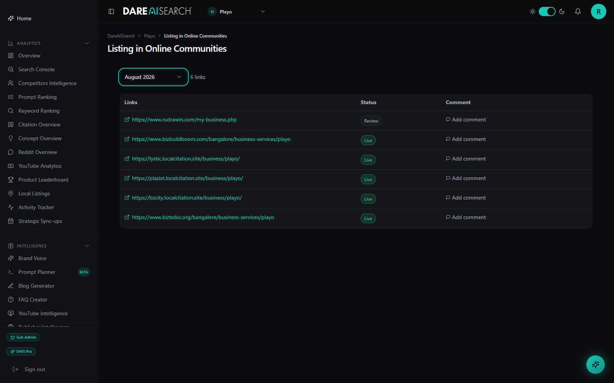
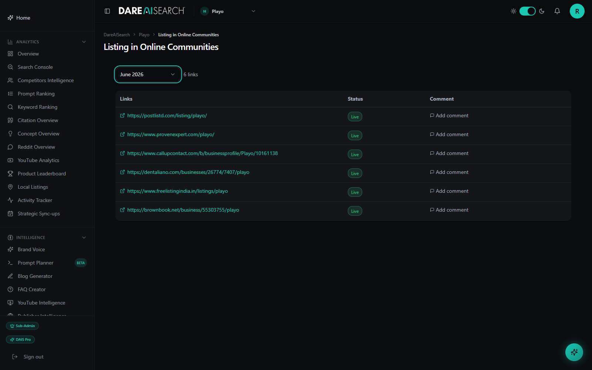
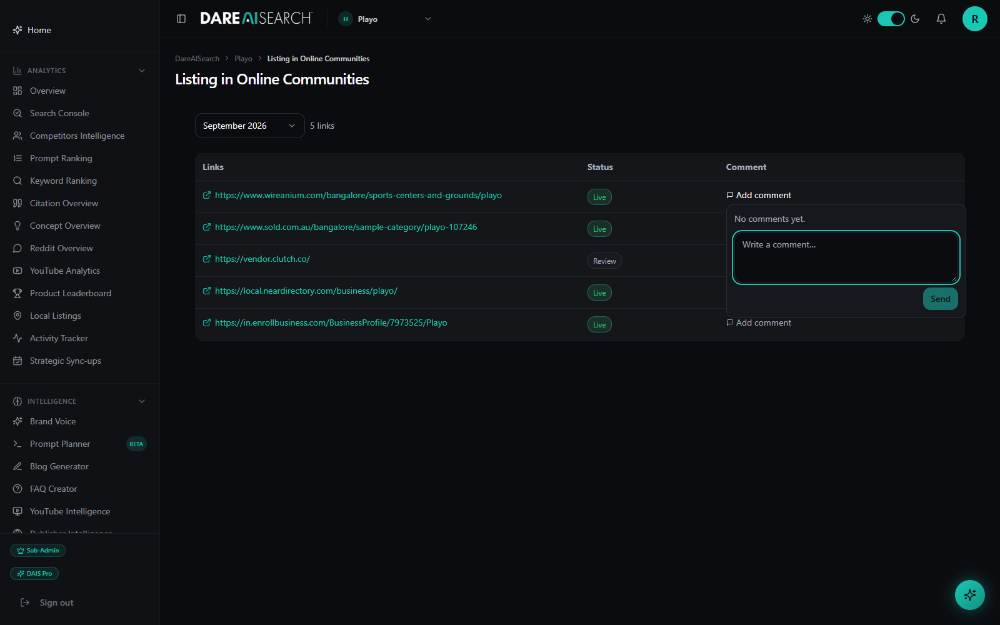

# Listing in Online Communities

> Path in the platform: **Execution → Third Party Channels → Listing in Online Communities** (`/execution/online-communities`)
> In this document, **{brand name}** stands for the brand selected in the platform.
> **This page is not in every brand's sidebar.** It appeared only after switching to one particular brand; the brand used for the first pages in this set did not show it. The same applies to the Directories page.
> Explored with a Sub-Admin account. Only observed behaviour is documented. Nothing was created, edited, deleted or submitted. No link was opened.
> The screenshots are unchanged and show the real brand name and real links.

## 1. Overview

The **Listing in Online Communities** page is a monthly list of **business listings and profiles created for {brand name} on third-party online community and business-listing websites**. Each listing is an online mention of the brand (its name, category and a link to its website) that can help search engines and AI search engines recognise the brand.

For each listing, the page shows:

- The link to the listing.
- Its status (**Live** or **Review**).
- An **Add comment** link.

It helps the team see which listings were created each month, which are live and which are still in progress, and lets users leave comments on them.

## 2. Page Layout

From top to bottom:

| # | Section | What it shows |
|---|---------|---------------|
| 1 | **Breadcrumb** | `DareAISearch > {brand name} > Listing in Online Communities`. |
| 2 | **Page header** | Title "Listing in Online Communities". There is no subtitle. |
| 3 | **Month selector** (left) | Drop-down showing the selected month. |
| 4 | **Count label** (next to the selector) | e.g. "5 links". |
| 5 | **Table** | One row per listing, with 3 columns: Links, Status, Comment. |

The page has no summary cards, search box, status filter or action buttons (no Add, Edit, Delete or Upload). Other items on screen belong to the platform shell: sidebar, brand switcher, theme toggle, notifications bell, user menu and the **Ask Miss Daring** floating button (not explored).

## 3. Features and Functionality

### 3.1 Month selector

- The list is short. It had only **four months**: **September 2026**, **August 2026**, **July 2026** and **June 2026**.
- The page opens on **September 2026**, the latest month with data. It does not open on the current calendar month.
- Choosing a month reloads the table and the count label. It is a view filter only.

### 3.2 Links

- Each row's link opens the listing in a new tab. It has a small "open in new tab" icon in front of it.
- I did not open any link.

### 3.3 Add comment

- Each row has an **Add comment** link with a speech-bubble icon.
- Clicking it opens a small box that lists existing comments (here: "No comments yet."), a text area labelled **Write a comment…** and a **Send** button.
- I did not click **Send**, because it would add a real comment. Closing the box with Esc leaves nothing saved.
- This is the same as on the Profile Citation, Guest Post and Web 2.0 pages. On the Directories, Social Citation, Classified, Image Submission and PPT/PDF Submission pages, the comment box is read-only.

### 3.4 What is not available

There is no search, no filter, no sorting and no paging. The status badge is plain text and cannot be changed here. Clicking a row does nothing.

## 4. Data Fields and Columns

| Column | What it shows |
|--------|---------------|
| **Links** | The address of the listing on a third-party site. Opens in a new tab. |
| **Status** | A badge showing the state of the listing (**Live** in green or **Review** in grey). |
| **Comment** | **Add comment** link that opens the comment box. |

How the data is organised:

- Data is grouped by **month** and by **brand**.
- Counts by month:

| Month | Rows | Live | Review | Note |
|-------|------|------|--------|------|
| September 2026 | 5 | 4 | 1 | |
| August 2026 | 6 | 5 | 1 | 6 links on 4 different sites |
| July 2026 | 6 | 5 | 1 | 1 link repeats |
| June 2026 | 6 | 6 | 0 | |

- Altogether there are 23 rows and **22 different links**. The months **do not share any links**, so each month holds new listings.
- Observation from the link addresses: rows marked **Live** point to the brand's profile or business page on the site. Rows marked **Review** (one per month in the three latest months) point to an account, dashboard or vendor page of the site, not a profile page. The page does not state this.

## 5. Available Statuses

| Status | Look | Meaning (inferred) | Seen in data? |
|--------|------|--------------------|---------------|
| **Live** | Green badge | The listing is published and available on the site. | Yes, on 20 of 23 rows |
| **Review** | Grey badge | The listing has been submitted and is not yet live, so it appears to be waiting for review or approval. | Yes, on 3 of 23 rows |

The meanings come from the names and the link patterns. The page gives no explanation. Other statuses may exist but did not appear.

## 6. User Workflow

1. Sign in and select the brand in the top bar. (Check that **Listing in Online Communities** appears in the sidebar for that brand.)
2. In the sidebar, open **Execution → Third Party Channels → Listing in Online Communities**.
3. Read the count label to see how many links are listed for the month.
4. Use the **month selector** to move between the four available months.
5. Check the **Status** of each row: **Live** means the listing is done; **Review** means it is still in progress.
6. Click a **link** to open the listing in a new tab and check it.
7. To leave a note on a row, click **Add comment**, write the comment and click **Send**.

## 7. Important Notes and Dependencies

- The page is **view-only**, apart from **Add comment** → **Send**, which adds a comment.
- The page is **brand-specific**: it is available in the sidebar for some brands only.
- Data is **per brand and per month**. Changing the brand in the top bar changes the list.
- The month list contains only months that have data (four months were available). The page opens on the latest of them.
- Listing sites are **third-party websites**, which the platform does not control. A listing may be rejected, removed or take time to appear.
- Every month seen has one **Review** row except June, which is all Live.
- No existing comments were seen, so how comments are displayed once added is not documented.
- **Not tested**: opening the links, **Send**, other brands and the **Ask Miss Daring** button.

## 8. Screenshots

| Screenshot | Description |
|------------|-------------|
|  | Default view: month selector, count label and table with Live and Review rows (September 2026). |
|  | Month selector list (four months). |
|  | August 2026 with 6 links, one in Review. |
|  | June 2026, where every row is Live. |
|  | Comment box with text area and **Send** button. |
