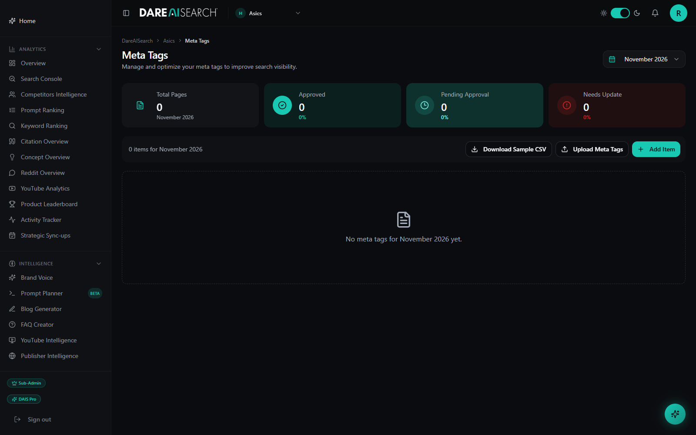
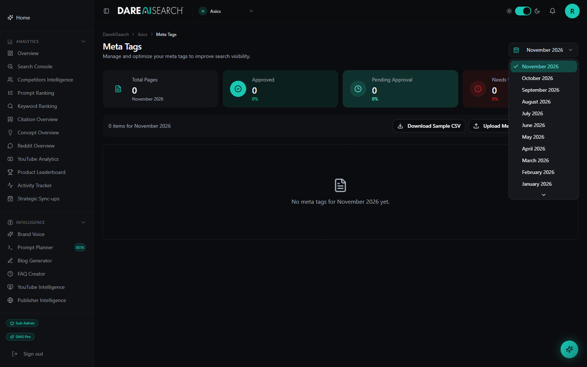
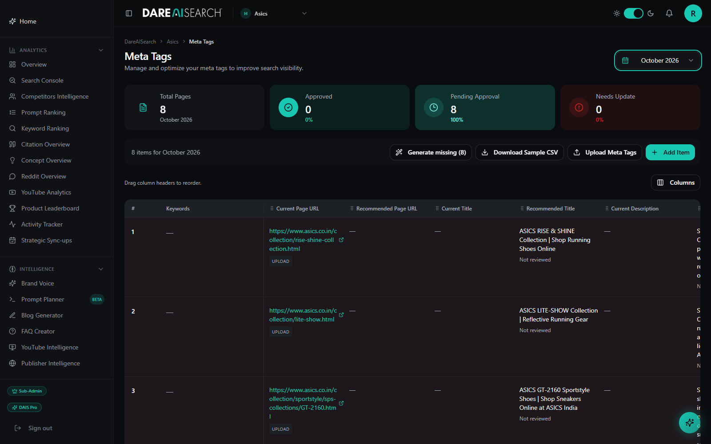
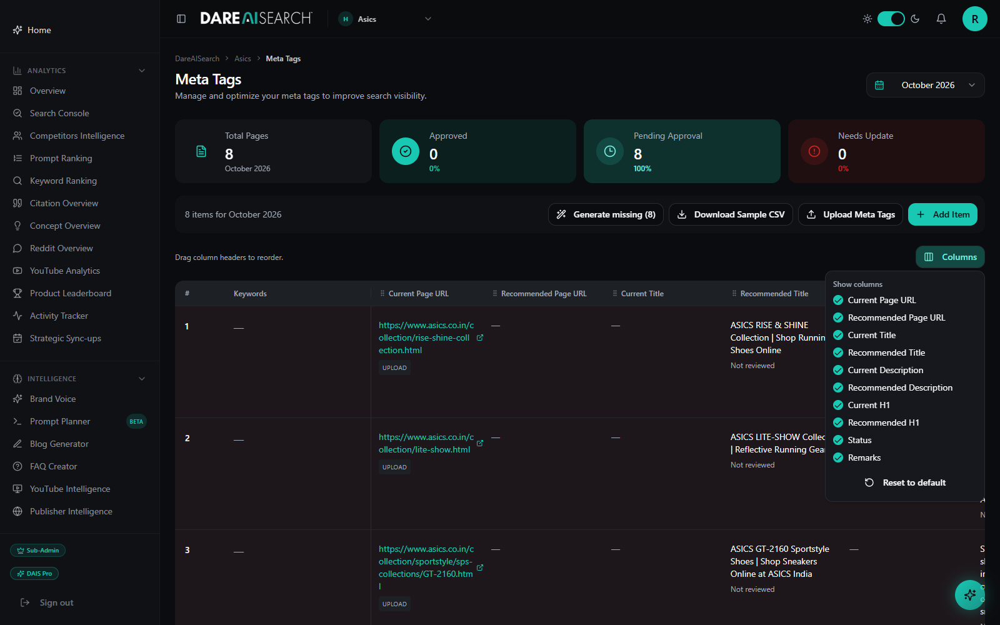
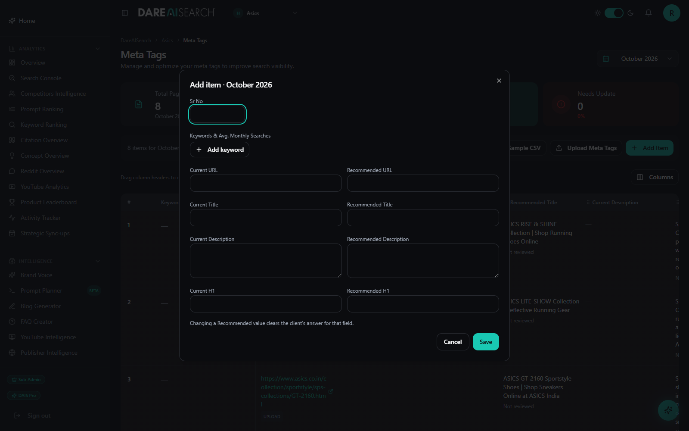
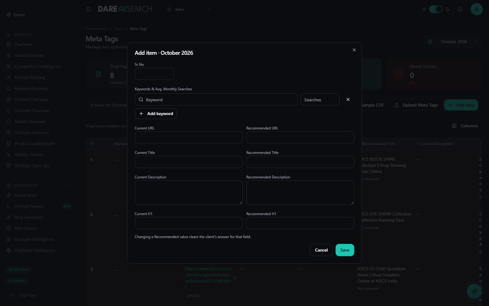
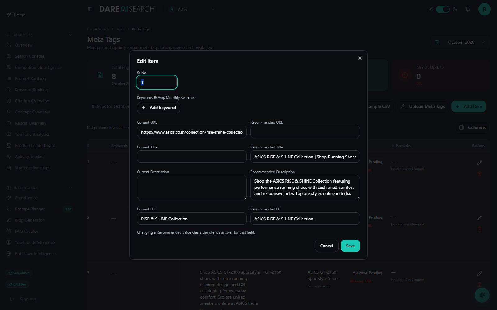
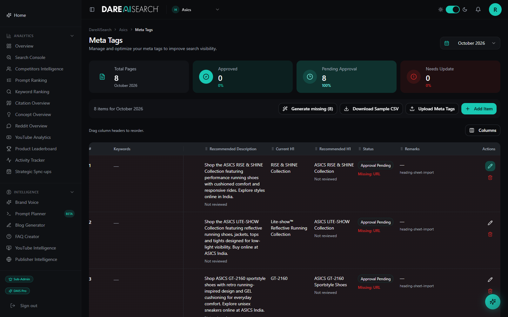

# Meta Tags

> Path in the platform: **Execution → Owned Channels → Meta Tags** (`/execution/meta-tags`)

## 1. Overview

The **Meta Tags** page is a monthly work list of web pages whose search-related text (URL, title, meta description and H1 heading) is being improved. The page subtitle reads: *"Manage and optimize your meta tags to improve search visibility."*

For each page, the table shows the **current** values on the live website next to the **recommended** values, so the team can compare them, add or correct entries, and track whether the recommendation has been approved.

The page provides:

- A monthly summary (total pages, approved, pending approval, needs update).
- A table of pages for the selected month with Current vs Recommended values.
- Tools to add, edit and delete items, and to bulk-upload items from a spreadsheet.

## 2. Page Layout

From top to bottom:

| # | Section | What it shows |
|---|---------|---------------|
| 1 | **Breadcrumb** | `DareAISearch > {brand name} > Meta Tags` (the brand name changes with the brand selected at the top). |
| 2 | **Page header** | Title "Meta Tags" and the one-line description. |
| 3 | **Month selector** (top right) | Drop-down showing the selected month (default: current month, e.g. *November 2026*). |
| 4 | **Summary cards** (4) | Total Pages, Approved, Pending Approval, Needs Update. |
| 5 | **Action bar** | Item count for the month (e.g. "8 items for October 2026") plus action buttons. |
| 6 | **Table toolbar** | Hint "Drag column headers to reorder." and a **Columns** button. |
| 7 | **Data table** | One row per page, with 13 columns. It scrolls sideways because it is wide. |
| 8 | **Empty state** | If the month has no data: "No meta tags for *Month Year* yet." |

Other items on screen (not part of this page): left sidebar navigation, brand switcher, light/dark theme toggle, notifications bell, user menu and an **Ask Miss Daring** floating button (bottom right; not explored).

## 3. Features and Functionality

### 3.1 Month selector

Lists the last 12 months (observed: *November 2026* back to *December 2025*). Choosing a month reloads the cards and table for that month. It is a view filter only.

### 3.2 Summary cards

| Card | Shows |
|------|-------|
| **Total Pages** | Number of meta-tag items in the selected month. |
| **Approved** | Count of items with Approved status and its percentage of the total. |
| **Pending Approval** | Count of items awaiting approval and its percentage. |
| **Needs Update** | Count of items that need an update and its percentage. |

### 3.3 Action buttons

| Button | Visible when | Purpose (as observed) |
|--------|--------------|-----------------------|
| **Generate missing (N)** | The month has items. *N* = number of items (8 in October 2026). | Appears to generate missing recommended values. |
| **Download Sample CSV** | Always | Visible purpose: gives a sample file showing the upload format.|
| **Upload Meta Tags** | Always | Opens a file picker that accepts **.csv, .xlsx, .xls** (one file). Opened and cancelled; no file was uploaded. What happens after upload was not tested. |
| **Add Item** | Always | Opens the **Add item** dialog for the selected month (see 3.5). |
| **Columns** | Always | Opens a "Show columns" menu to show or hide columns (see 3.4). |

### 3.4 Columns menu and column reordering

- The **Columns** menu has a tick-list: Current Page URL, Recommended Page URL, Current Title, Recommended Title, Current Description, Recommended Description, Current H1, Recommended H1, Status, Remarks. All are ticked by default.
- **Reset to default** restores the default set of columns.
- Column headers can be dragged to change their order ("Drag column headers to reorder"). This was not exercised.
- The `#`, `Keywords` and `Actions` columns are not in the menu.

### 3.5 Add item dialog

Title: **Add item · *Month Year***. Fields:

| Field | Type |
|-------|------|
| Sr No | Short text box |
| Keywords & Avg. Monthly Searches | **Add keyword** button; each click adds a row with *Keyword* and *Searches* text boxes |
| Current URL / Recommended URL | Text boxes |
| Current Title / Recommended Title | Text boxes |
| Current Description / Recommended Description | Multi-line text boxes |
| Current H1 / Recommended H1 | Text boxes |

Buttons: **Cancel**, **Save**, and **X** (close). A note at the bottom reads: *"Changing a Recommended value clears the client's answer for that field."* Save was not used.

### 3.6 Edit item (pencil icon, Actions column)

Opens an **Edit item** dialog with the same fields as Add item, pre-filled with that row's values. Buttons: Cancel, Save, close. Opened and closed without saving.

### 3.7 Delete item (red bin icon, Actions column)

Visible on every row to delete that particular row.

### 3.8 Links in the table

The Current Page URL is a clickable link with an "open in new tab" icon, pointing to the live page.

## 4. Data Fields and Columns

| Column | What it shows |
|--------|---------------|
| **#** | Serial number (Sr No) of the row. |
| **Keywords** | Target keywords and their average monthly searches. Shows "—" when none are entered (all observed rows were empty). |
| **Current Page URL** | The live page address. A small tag appeared under it (observed value: **UPLOAD**). Its exact meaning is not documented on the page; it may indicate how the row was added. |
| **Recommended Page URL** | Suggested new URL. "—" when not provided. |
| **Current Title** | Page title currently on the website. "—" when empty. |
| **Recommended Title** | Suggested title. A line below it shows a review state (observed: *Not reviewed*). |
| **Current Description** | Current meta description. "—" when empty. |
| **Recommended Description** | Suggested meta description, with a review-state line (*Not reviewed*). |
| **Current H1** | Current main heading on the page. |
| **Recommended H1** | Suggested H1, with a review-state line (*Not reviewed*). |
| **Status** | Approval status badge, plus a red note listing what is missing (observed: **Missing: URL**). |
| **Remarks** | Free-text note or source label (observed: *heading-sheet-import*). |
| **Actions** | Edit (pencil) and Delete (bin) icons. |

Observations on the data:

- Data is organised **by month**; each month has its own list (observed: March–October 2026 had 6–16 items; December 2025–February 2026 and November 2026 had none).
- Each row is one website page. Current values come first and Recommended values come after them.
- In the sample rows, **Recommended Page URL** was empty, **Current Title** and **Current Description** were empty, and Recommended Title, Description and H1 were filled.

## 5. Available Statuses

| Status | Where shown | Meaning |
|--------|-------------|---------|
| **Approval Pending** | Status column (all observed rows) | The item is waiting for approval. Counts in the **Pending Approval** card. |
| **Approved** | Summary card | Items that have been approved. No row with this status was seen. |
| **Needs Update** | Summary card | Items that need changes. No row with this status was seen. |
| **Missing: URL** | Red note under the status badge | A required value (the Recommended URL) is missing for this row. Other "Missing: …" values may exist but were not seen. |
| **Not reviewed** | Under each Recommended Title/Description/H1 | The recommended value has not yet been reviewed. Other review states were not seen. |

Meanings of Approved and Needs Update come from the card names only; no row in those states was available to confirm.

## 6. User Workflow

1. Sign in and select the brand in the top bar.
2. In the sidebar, open **Execution → Owned Channels → Meta Tags**.
3. Use the **month selector** to choose the month to work on.
4. Read the **summary cards** to see how many pages are approved, pending or need updates.
5. Add pages in one of two ways:
   - **Add Item**: fill in the dialog and click **Save**, or
   - **Upload Meta Tags**: upload a .csv/.xlsx/.xls file. Use **Download Sample CSV** first for the format.
6. Review each row: compare Current vs Recommended values. Use **Columns** to hide columns you do not need.
7. Correct a row with the **pencil** icon. Remove one with the **bin** icon.
8. Check the **Status** and **Remarks** columns to see what is pending or missing (e.g. "Missing: URL").
9. Optionally use **Generate missing (N)** to fill missing recommendations. Its exact effect should be confirmed with the product team.

## 7. Important Notes and Dependencies

- A **brand must be selected**. The page and its data are per brand and per month.
- Items belong to a **month**. Add Item and uploads apply to the month currently selected.
- Editing a **Recommended** value clears the client's answer for that field. So a client review step exists, and editing recommendations resets it.
- **Generate missing (N)** only shows when the month has items.
- Upload accepts only .csv, .xlsx and .xls files.
- The table is wide. Scroll sideways to see Status, Remarks and Actions.
- There is no search box, status filter or sort control on this page.
- No approve or reject buttons were visible on this page. How items move to Approved or Needs Update is unknown; it may happen elsewhere (for example, a client review).
- **Not tested** (to avoid changing production data): Save in Add/Edit, Delete, Generate missing, an actual upload, column drag-and-drop, and the Download Sample CSV file contents.
- The tag "UPLOAD", the "Remarks" source label and any other status values are documented as seen. Further meanings need confirmation.

## 8. Screenshots

| Screenshot | Description |
|------------|-------------|
|  | Empty state for a month with no data (November 2026). |
|  | Month selector list. |
|  | Cards, action buttons and the left side of the table (October 2026). |
|  | "Show columns" menu with Reset to default. |
|  | Add item dialog. |
|  | Add item dialog after clicking "Add keyword". |
|  | Edit item dialog pre-filled for row 1. |
|  | Status, Remarks and Actions columns. |
