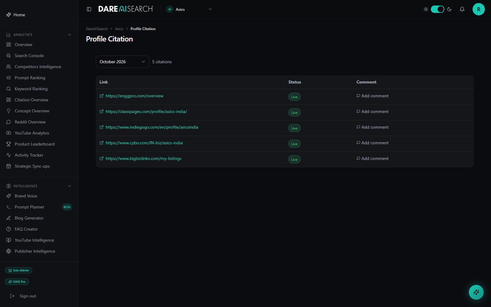
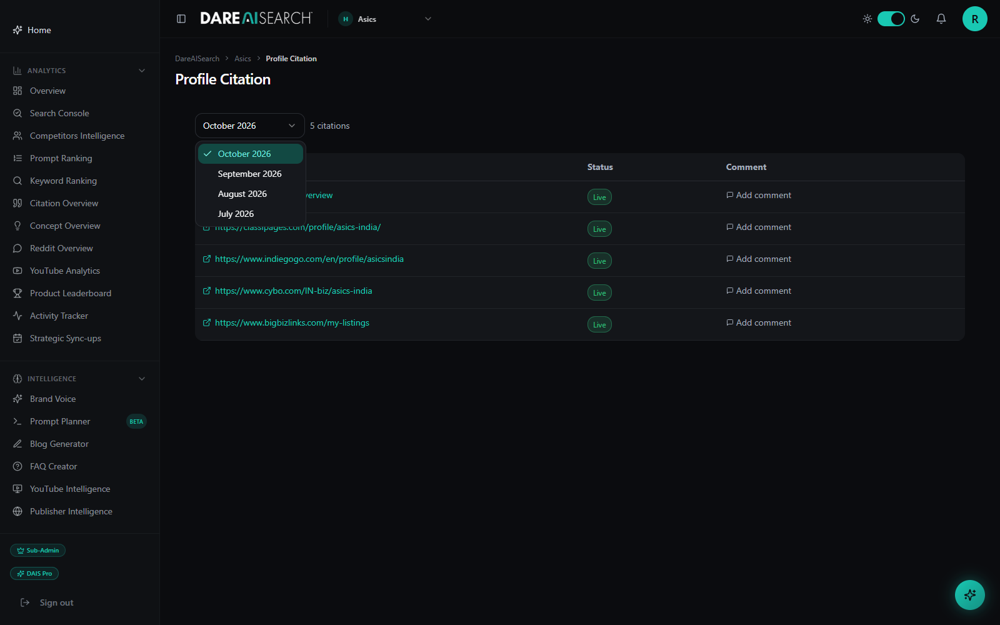
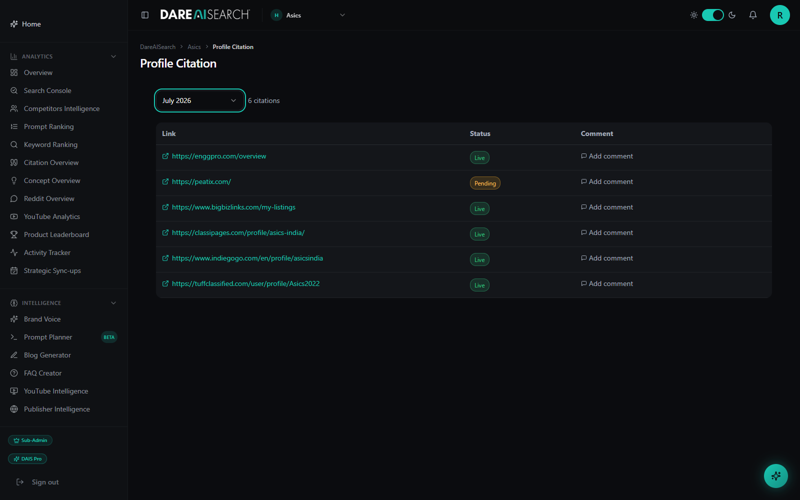
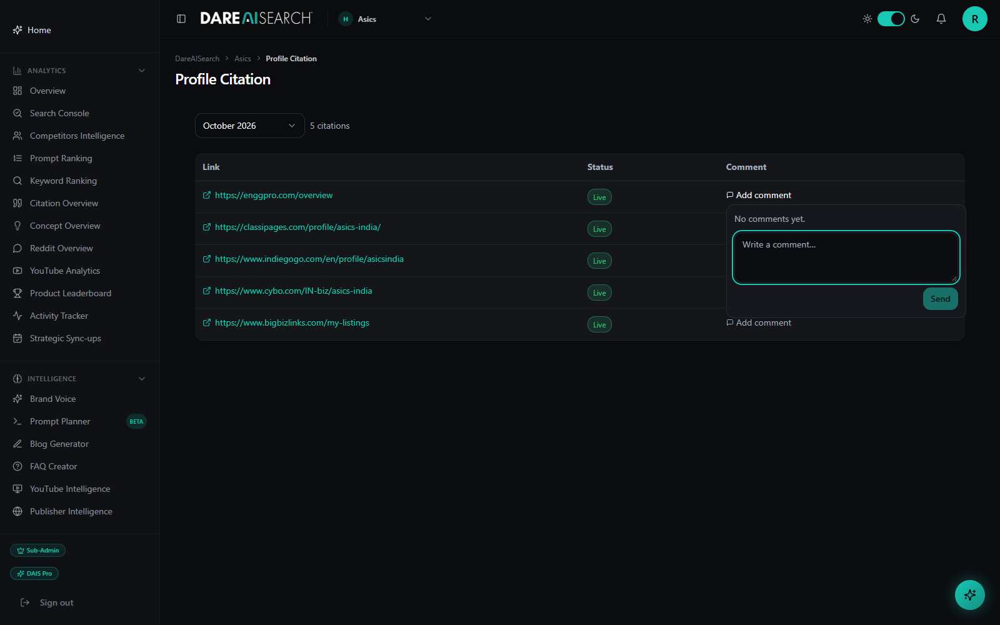

# Profile Citation

> Path in the platform: **Execution → Third Party Channels → Profile Citation** (`/execution/profile-citation`)
> In this document, **{brand name}** stands for the brand selected in the platform and **{brand website}** for that brand's own website.
> Explored with a Sub-Admin account. Only observed behaviour is documented. Nothing was created, edited, deleted or submitted. No profile link was opened.

## 1. Overview

The **Profile Citation** page is a read-only monthly list of **profile pages created for {brand name} on third-party websites** (such as business directories and listing sites). Each of these profile pages is a "citation": an online mention of the brand that can link back to its website and help search engines and AI search engines recognise the brand.

For each citation, the page shows:

- The link to the profile page.
- Its status (for example **Live**).
- A comment field.

It helps the team see which profiles were created each month and whether they are live.

## 2. Page Layout

From top to bottom:

| # | Section | What it shows |
|---|---------|---------------|
| 1 | **Breadcrumb** | `DareAISearch > {brand name} > Profile Citation`. |
| 2 | **Page header** | Title "Profile Citation". There is no subtitle. |
| 3 | **Month selector** (left) | Drop-down showing the selected month. |
| 4 | **Count label** (next to the selector) | e.g. "5 citations". |
| 5 | **Table** | One row per citation, with 3 columns: Link, Status, Comment. |

The page has no summary cards, search box, status filter or action buttons (no Add, Edit, Delete or Upload). Other items on screen belong to the platform shell: sidebar, brand switcher, theme toggle, notifications bell, user menu and the **Ask Miss Daring** floating button (not explored).

## 3. Features and Functionality

### 3.1 Month selector

- The list is short. It had only **four months**: **October 2026**, **September 2026**, **August 2026** and **July 2026**.
- The page opens on **October 2026**, the latest month with data. It does not open on the current calendar month.
- Choosing a month reloads the table and the count label. It is a view filter only.

### 3.2 Link

- Each row's link opens the profile page in a new tab. It has a small "open in new tab" icon in front of it.
- The links point to third-party websites, for example a directory profile such as `https://{third-party site}/profile/{brand name}`. I did not open them.

### 3.3 Add comment

- Each row has an **Add comment** link with a speech-bubble icon.
- Clicking it opens a small box that lists existing comments (here: "No comments yet."), a text area labelled **Write a comment…** and a **Send** button.
- I did not click **Send**, because it would add a real comment. Closing the box with Esc leaves nothing saved.

### 3.4 What is not available

There is no search, no filter, no sorting and no paging. The status badge is plain text and cannot be changed here. Clicking a row does nothing.

## 4. Data Fields and Columns

| Column | What it shows |
|--------|---------------|
| **Link** | The address of the profile page on a third-party site. Opens in a new tab. |
| **Status** | A coloured badge showing whether the profile is live or pending. |
| **Comment** | **Add comment** link that opens the comment box. |

How the data is organised:

- Data is grouped by **month** and by **brand**.
- Rows seen: July 2026: 6; August 2026: 6; September 2026: 6; October 2026: 5. Total 23.
- The same third-party sites appear in several months (for example the same directory listing in different months), so a month's list may repeat a site that was in an earlier month. The page does not explain this.

## 5. Available Statuses

| Status | Look | Meaning (from its name) | Seen in data? |
|--------|------|-------------------------|---------------|
| **Live** | Green badge | The profile page is published and available online. | Yes, on 22 of 23 rows |
| **Pending** | Orange badge | The profile page has been created or submitted but is not yet live. | Yes, on 1 row (July 2026) |

Other statuses may exist, but only these two appeared. Their meanings come from the names, because the page gives no explanation.

## 6. User Workflow

1. Sign in and select the brand in the top bar.
2. In the sidebar, open **Execution → Third Party Channels → Profile Citation**.
3. Read the count label to see how many citations are listed for the month shown.
4. Use the **month selector** to move between months.
5. Check the **Status** of each row (Live or Pending).
6. Click a **Link** to open the profile page in a new tab and check it.
7. To leave a note on a row, click **Add comment**, write the comment and click **Send**.

## 7. Important Notes and Dependencies

- The page is **view-only**. The only action that adds anything is **Add comment** → **Send**.
- Data is **per brand and per month**. Changing the brand in the top bar changes the list. The brand switcher lists more than one brand; only one was explored.
- The month list contains only months that have data (four months were available). The page opens on the latest of them.
- Profile pages are on **third-party sites**, which the platform does not control. A link may stop working if the site changes it.
- Status and approval changes cannot be made here.
- No existing comments were seen, so how comments are displayed once added is not documented.
- **Not tested**: opening the links, **Send**, other brands and the **Ask Miss Daring** button.

## 8. Screenshots

| Screenshot | Description |
|------------|-------------|
|  | Default view: month selector, count label and table (October 2026). |
|  | Month selector list (four months). |
|  | July 2026, including a row with the **Pending** status. |
|  | Comment box with text area and **Send** button. |
