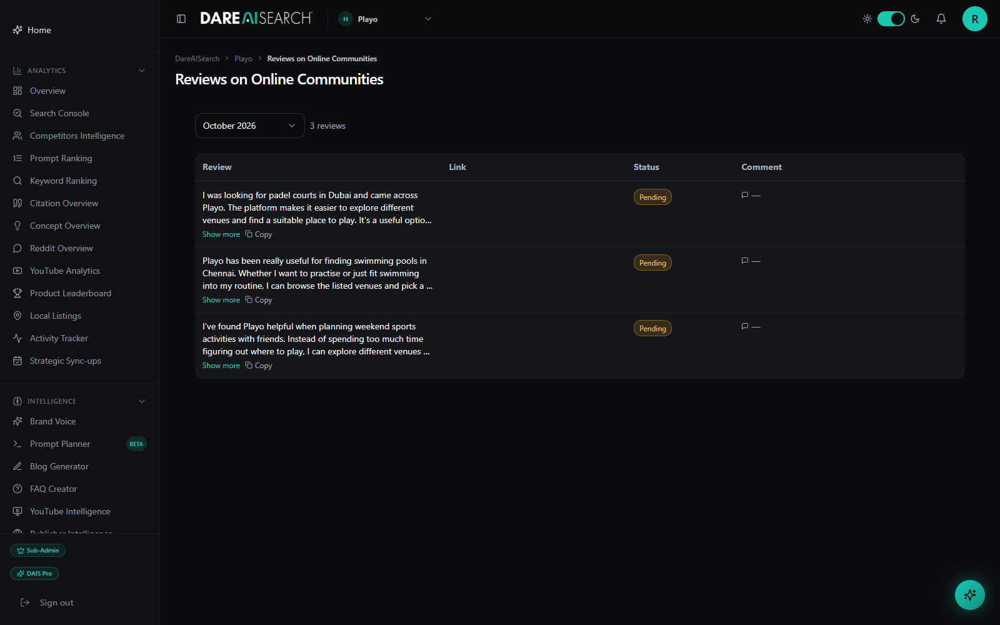
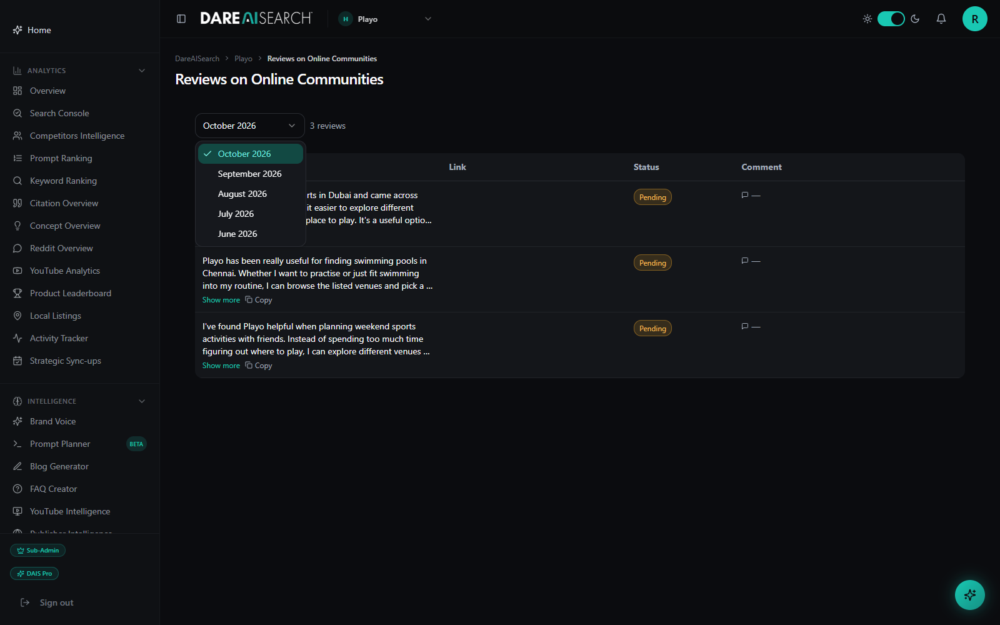
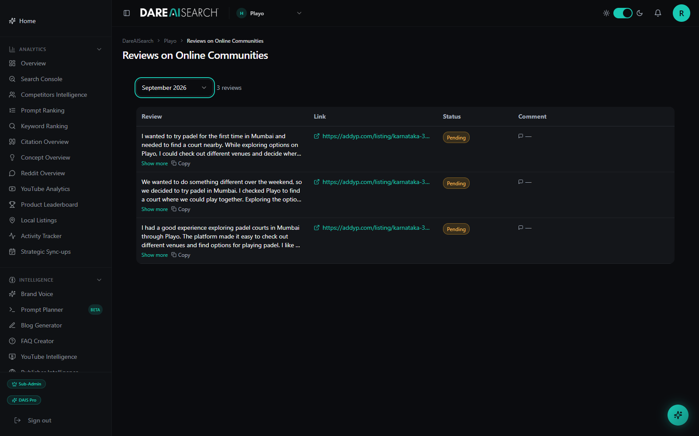
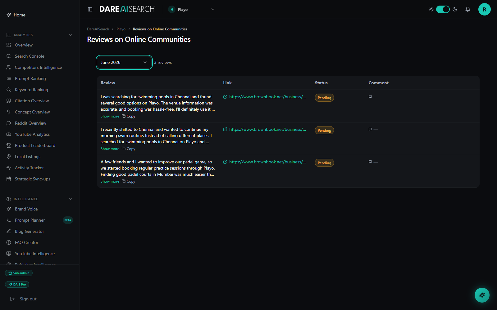
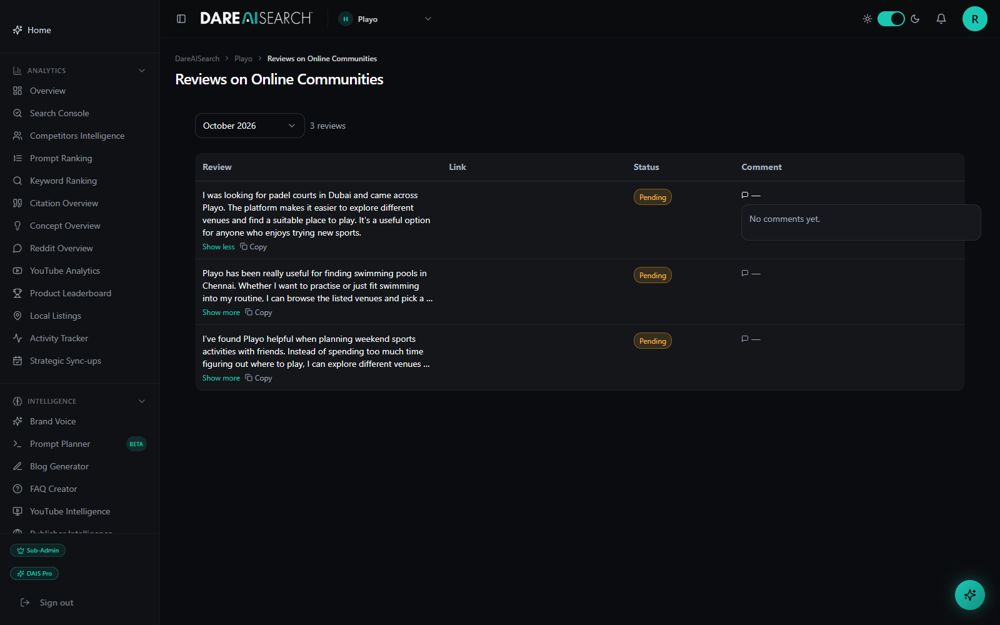

# Reviews on Online Communities

> Path in the platform: **Execution → Third Party Channels → Reviews on Online Communities** (`/execution/community-reviews`)
> In this document, **{brand name}** stands for the brand selected in the platform.
> **This page is not in every brand's sidebar.** It appeared only after switching to one particular brand; the brand used for the first pages in this set did not show it. The same applies to the Directories and Listing in Online Communities pages.
> Explored with a Sub-Admin account. Only observed behaviour is documented. Nothing was created, edited, deleted or submitted. No link was opened and the **Copy** button was not used.
> The screenshots are unchanged and show the real brand name, real review text and real links.

## 1. Overview

The **Reviews on Online Communities** page is a read-only monthly list of **customer-style reviews written about {brand name} for posting on third-party online community and business-listing websites**. Each review is a short first-person text that mentions the brand and what it is useful for. Posted on a listing page, it can help search engines and AI search engines recognise the brand.

For each review, the page shows:

- The review text.
- The link to the listing page where the review belongs.
- Its status (**Pending** in all data seen).
- A comment button.

It helps the team see which reviews were prepared each month, copy the text for posting, and check where each one goes.

## 2. Page Layout

From top to bottom:

| # | Section | What it shows |
|---|---------|---------------|
| 1 | **Breadcrumb** | `DareAISearch > {brand name} > Reviews on Online Communities`. |
| 2 | **Page header** | Title "Reviews on Online Communities". There is no subtitle. |
| 3 | **Month selector** (left) | Drop-down showing the selected month. |
| 4 | **Count label** (next to the selector) | e.g. "3 reviews". |
| 5 | **Table** | One row per review, with 4 columns: Review, Link, Status, Comment. |

The page has no summary cards, search box, status filter or action buttons (no Add, Edit, Delete or Upload). Other items on screen belong to the platform shell: sidebar, brand switcher, theme toggle, notifications bell, user menu and the **Ask Miss Daring** floating button (not explored).

## 3. Features and Functionality

### 3.1 Month selector

- The list is short. It had only **five months**: **October 2026**, **September 2026**, **August 2026**, **July 2026** and **June 2026**.
- The page opens on **October 2026**, the latest month with data. It does not open on the current calendar month.
- Choosing a month reloads the table and the count label. It is a view filter only.

### 3.2 Review text — Show more / Show less

- Each review is shortened to about four lines with "…".
- Clicking **Show more** (a green link under the text) expands the review to its full text, and the link then changes to **Show less**. Clicking **Show less** shortens it again. This only changes what is displayed.

### 3.3 Copy button

- Next to **Show more** there is a **Copy** button with a small copy icon.
- Its visible purpose is to copy the review text so it can be pasted into the listing website.
- I did not click it, so I did not observe any confirmation message.

### 3.4 Link

- When a link is present, it opens the listing page in a new tab. It has a small "open in new tab" icon in front of it. Long links are shortened with "…".
- I did not open any link.
- In the latest month (October 2026) the **Link** cell is **empty** for all three reviews.

### 3.5 Comment button

- The **Comment** column shows a small speech-bubble icon followed by "—".
- Clicking it opens a small box that reads **No comments yet.** (observed on the first row).
- The box has **no text area and no Send button**, so comments cannot be written from this page. This is the same as on the Directories, Social Citation, Classified, Image Submission and PPT/PDF Submission pages.
- I did not check whether other rows have existing comments.

### 3.6 What is not available

There is no search, no filter, no sorting and no paging. The status badge is plain text and cannot be changed here. Clicking a row does nothing.

## 4. Data Fields and Columns

| Column | What it shows |
|--------|---------------|
| **Review** | The review text, shortened, with **Show more** and **Copy**. |
| **Link** | The address of the listing page where the review is meant to be posted. Empty in October 2026. |
| **Status** | A badge showing the state of the review (observed: **Pending**, orange). |
| **Comment** | A comment button (icon and "—") that opens the comments box. |

How the data is organised:

- Data is grouped by **month** and by **brand**.
- Each of the five months has **3 reviews**, 15 reviews in total. All 15 texts are different.
- The reviews are written in the first person and talk about finding and booking places to play sports and trying new activities in different cities. They do not show a reviewer name, a star rating or a date.
- For August, July and June 2026, all three reviews of a month point to the **same listing page** (in July, one link ends with a section marker). In September 2026, the three links start with the same address. In October 2026, the links are empty.
- Each month uses a different listing website.

## 5. Available Statuses

| Status | Look | Meaning (inferred) | Seen in data? |
|--------|------|--------------------|---------------|
| **Pending** | Orange badge | The review has been prepared but not yet confirmed as posted, so it appears to be waiting to go live or to be approved. | Yes, on all 15 reviews |

The meaning comes from the name only; the page gives no explanation. Other statuses (such as **Live** or **Review**, as on the Directories and Listing pages) may exist, but none appeared here.

## 6. User Workflow

1. Sign in and select the brand in the top bar. (Check that **Reviews on Online Communities** appears in the sidebar for that brand.)
2. In the sidebar, open **Execution → Third Party Channels → Reviews on Online Communities**.
3. Read the count label to see how many reviews are listed for the month.
4. Use the **month selector** to move between the five available months.
5. Click **Show more** to read a full review.
6. Click **Copy** to copy the review text for posting on the listing site (not tested).
7. Click the **Link** to open the listing page in a new tab (when a link is shown).
8. Check the **Status**, and click the comment button to see comments, if any.

## 7. Important Notes and Dependencies

- The page is **view-only**. No control on it adds or changes data. **Copy** only copies text, and **Show more** only changes the display.
- The page is **brand-specific**: it is available in the sidebar for some brands only.
- Data is **per brand and per month**. Changing the brand in the top bar changes the list.
- The month list contains only months that have data (five months were available). The page opens on the latest of them.
- All reviews seen are **Pending**, so nothing on the page shows a review that is already posted.
- The latest month has no links yet, so the target listing page is not known for those reviews.
- Posting the review on the listing site is done outside this page, on the third-party website.
- No existing comments were seen, so how comments are displayed once added is not documented. Comments seem to be added elsewhere.
- **Not tested**: **Copy**, opening the links, other brands and the **Ask Miss Daring** button.

## 8. Screenshots

| Screenshot | Description |
|------------|-------------|
|  | Default view: month selector, count label and three reviews with empty links (October 2026). |
|  | Month selector list (five months). |
|  | September 2026, where each review has a link. |
|  | June 2026, the earliest month. |
|  | First review expanded after clicking **Show more**. |
|  | Comment box showing "No comments yet." with no text area or Send button. |
