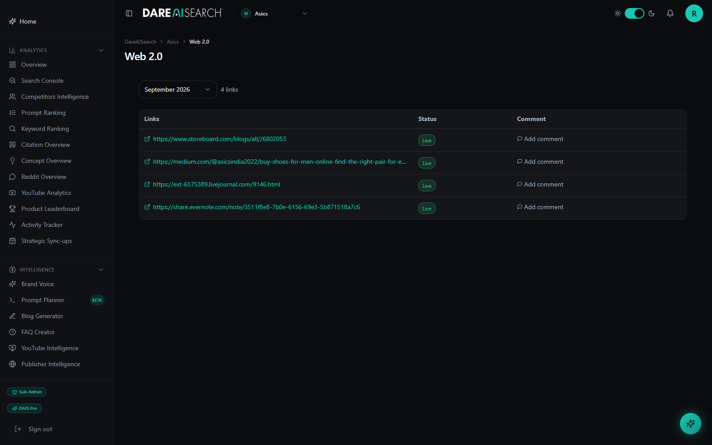
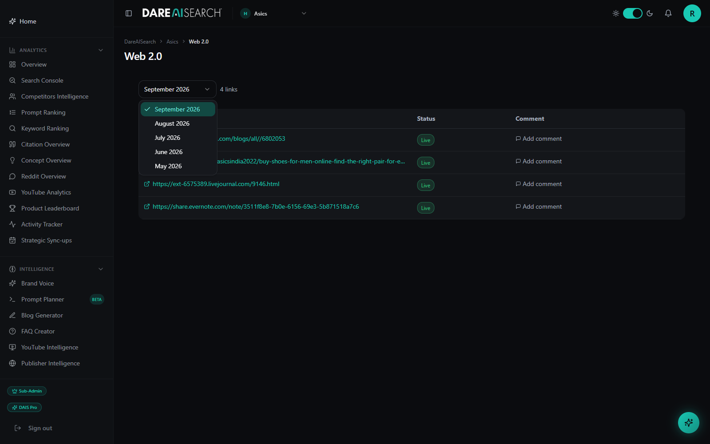
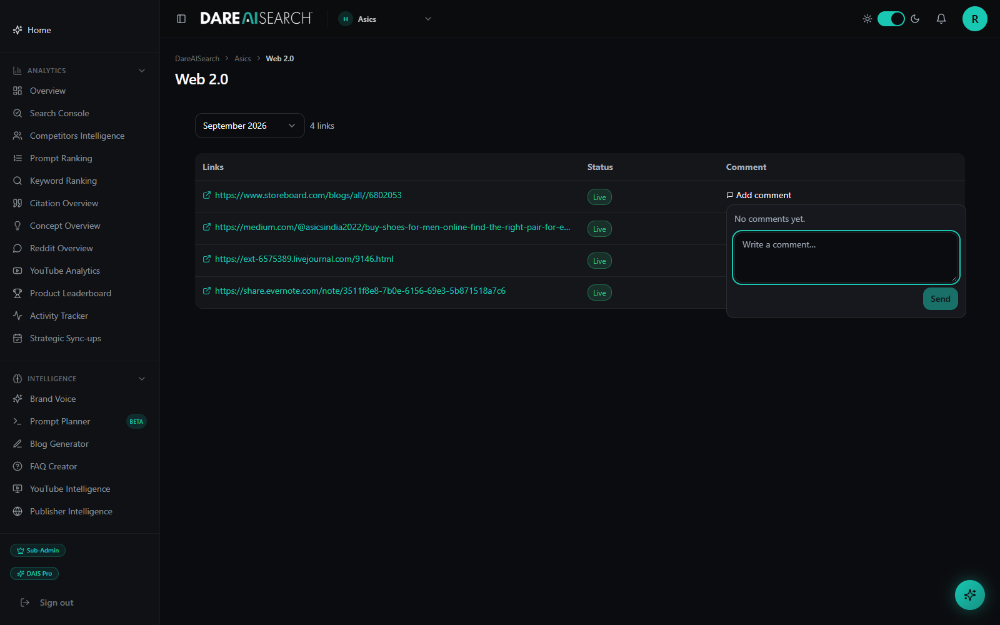
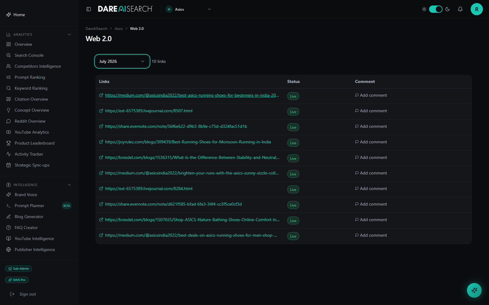

# Web 2.0

> Path in the platform: **Execution → Third Party Channels → Web 2.0** (`/execution/web-two`)
> In this document, **{brand name}** stands for the brand selected in the platform.
> Explored with a Sub-Admin account. Only observed behaviour is documented. Nothing was created, edited, deleted or submitted. No link was opened.
> The screenshots are unchanged and show the real brand name and real links.

## 1. Overview

The **Web 2.0** page is a monthly list of **content published for {brand name} on third-party Web 2.0 sites**. Web 2.0 sites are free blogging and content-sharing websites where anyone can publish a post or note. A post there can mention the brand and link back to its website, which helps search engines and AI search engines recognise the brand.

For each published item, the page shows:

- The link to the post.
- Its status (for example **Live**).
- A comment link.

It helps the team see which Web 2.0 posts were published each month and whether they are live, and lets users leave comments on them.

## 2. Page Layout

From top to bottom:

| # | Section | What it shows |
|---|---------|---------------|
| 1 | **Breadcrumb** | `DareAISearch > {brand name} > Web 2.0`. |
| 2 | **Page header** | Title "Web 2.0". There is no subtitle. |
| 3 | **Month selector** (left) | Drop-down showing the selected month. |
| 4 | **Count label** (next to the selector) | e.g. "4 links". |
| 5 | **Table** | One row per post, with 3 columns: Links, Status, Comment. |

The page has no summary cards, search box, status filter or action buttons (no Add, Edit, Delete or Upload). Other items on screen belong to the platform shell: sidebar, brand switcher, theme toggle, notifications bell, user menu and the **Ask Miss Daring** floating button (not explored).

## 3. Features and Functionality

### 3.1 Month selector

- The list is short. It had only **five months**: **September 2026**, **August 2026**, **July 2026**, **June 2026** and **May 2026**.
- The page opens on **September 2026**, the latest month with data. It does not open on the current calendar month.
- Choosing a month reloads the table and the count label. It is a view filter only.

### 3.2 Links

- Each row's link opens the post in a new tab. It has a small "open in new tab" icon in front of it.
- Long links are shortened with "…" in the table.
- I did not open any link.

### 3.3 Add comment

- Each row has an **Add comment** link with a speech-bubble icon.
- Clicking it opens a small box that lists existing comments (here: "No comments yet."), a text area labelled **Write a comment…** and a **Send** button.
- I did not click **Send**, because it would add a real comment. Closing the box with Esc leaves nothing saved.
- This is the same as on the Profile Citation and Guest Post pages. On the Social Citation and Classified pages, the comment box is read-only.

### 3.4 What is not available

There is no search, no filter, no sorting and no paging. The status badge is plain text and cannot be changed here. Clicking a row does nothing.

## 4. Data Fields and Columns

| Column | What it shows |
|--------|---------------|
| **Links** | The address of the Web 2.0 post. Opens in a new tab. |
| **Status** | A green badge showing the status of the post (observed: **Live**). |
| **Comment** | **Add comment** link that opens the comment box. |

How the data is organised:

- Data is grouped by **month** and by **brand**.
- Rows seen: May 2026: 10; June 2026: 10; July 2026: 10; August 2026: 4; September 2026: 4. Total 38 rows.
- **May, June and July 2026 show the same 10 links.** The 4 links in August and the 4 in September are different from those and from each other. Altogether the 38 rows contain **18 different posts**. The page does not explain the repeats.
- In the 10-link months, the posts are on 5 different Web 2.0 sites (about 2 to 3 posts each). In the 4-link months, each post is on a different site.
- The link addresses suggest the posts are about the brand's products (for example, buying shoes online). This is an observation only; the page does not state it.

## 5. Available Statuses

| Status | Look | Meaning (from its name) | Seen in data? |
|--------|------|-------------------------|---------------|
| **Live** | Green badge | The post is published and available online. | Yes, on all 38 rows |

Other statuses (for example Pending, as on the Profile Citation page) may exist, but none appeared here. The meaning of Live comes from its name; the page gives no explanation.

## 6. User Workflow

1. Sign in and select the brand in the top bar.
2. In the sidebar, open **Execution → Third Party Channels → Web 2.0**.
3. Read the count label to see how many links are listed for the month shown.
4. Use the **month selector** to move between the five available months.
5. Check the **Status** of each row.
6. Click a **link** to open the post in a new tab and check it.
7. To leave a note on a row, click **Add comment**, write the comment and click **Send**.

## 7. Important Notes and Dependencies

- The page is **view-only**, apart from **Add comment** → **Send**, which adds a comment.
- Data is **per brand and per month**. Changing the brand in the top bar changes the list. The brand switcher lists more than one brand; only one was explored.
- The month list contains only months that have data (five months were available). The page opens on the latest of them.
- Posts live on **third-party sites**, which the platform does not control. A link may stop working if a post is removed or the site changes.
- The same 10 posts appear in three months, so monthly counts should not be added together as new posts.
- No existing comments were seen, so how comments are displayed once added is not documented.
- Status and approval changes cannot be made here.
- **Not tested**: opening the links, **Send**, other brands and the **Ask Miss Daring** button.

## 8. Screenshots

| Screenshot | Description |
|------------|-------------|
|  | Default view: month selector, count label and table (September 2026). |
|  | Month selector list (five months). |
|  | Comment box with text area and **Send** button. |
|  | July 2026 with 10 links. |
