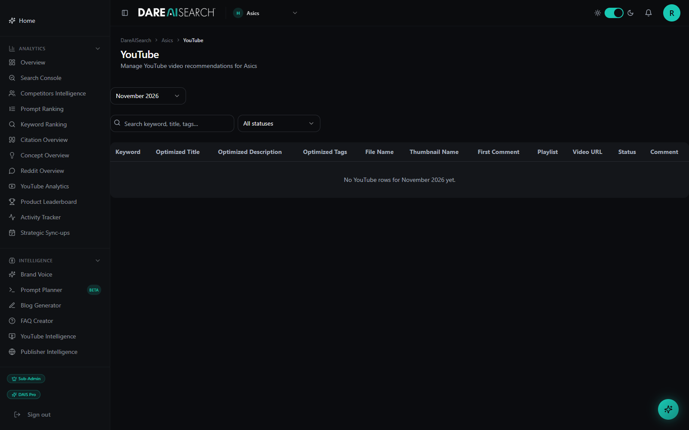
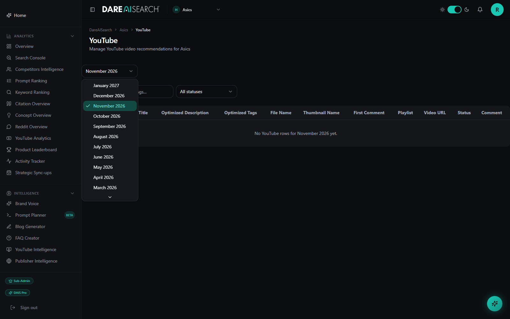
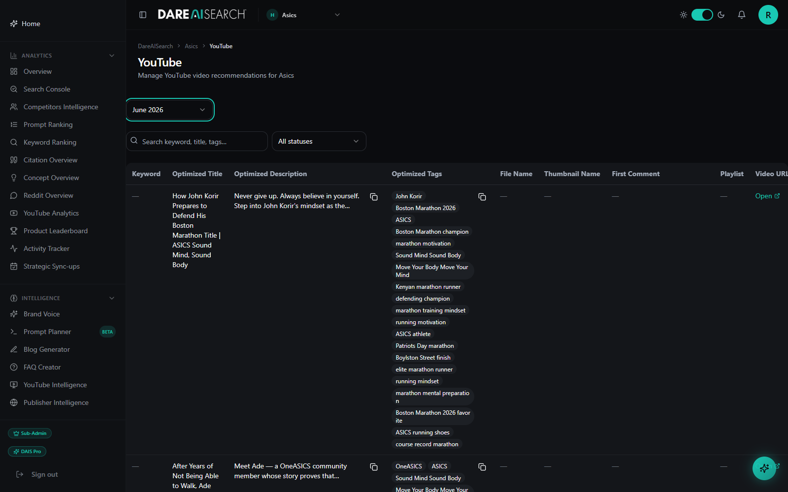
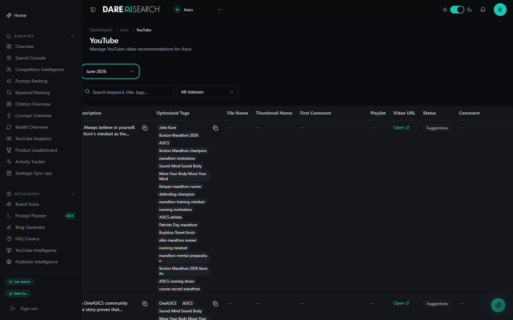
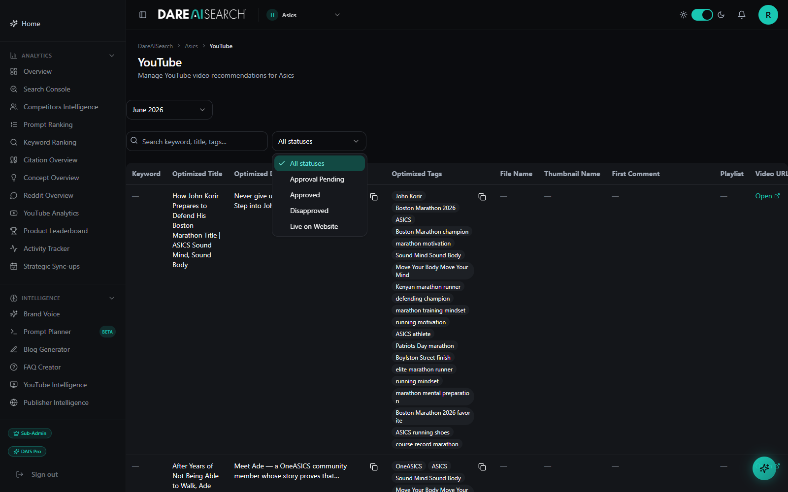
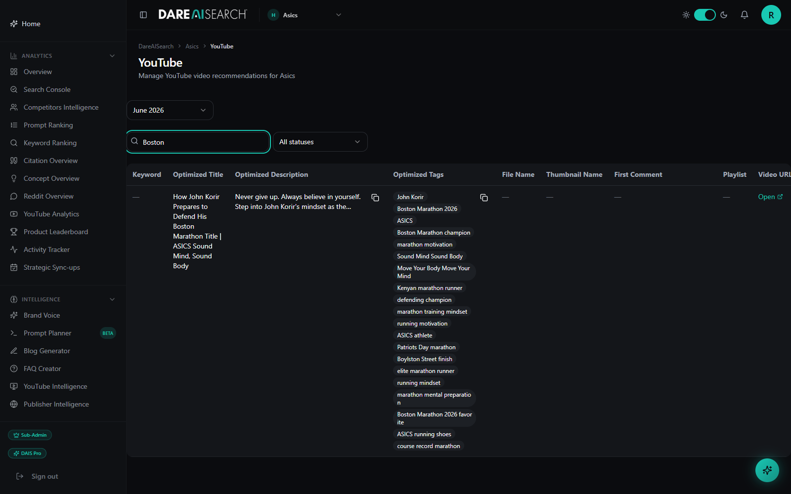

# YouTube

> Path in the platform: **Execution → Controlled Channels → YouTube** (`/execution/youtube`)

> This is a different page from **Analytics → YouTube Analytics** and **Intelligence → YouTube Intelligence**. Those are not covered here.

## 1. Overview

The **YouTube** page is a read-only monthly list of **optimized YouTube video details** for a brand. The page subtitle reads: *"Manage YouTube video recommendations for {brand name}"* (the brand name follows the selected brand).

For each video, the page shows the recommended title, description and tags, plus fields for the video file name, thumbnail name, first comment and playlist, a link to the video on YouTube, a status and a comment. It helps the team review the optimization recommended for each video and where it stands.

## 2. Page Layout

From top to bottom:

| # | Section | What it shows |
|---|---------|---------------|
| 1 | **Breadcrumb** | `DareAISearch > {brand name} > YouTube`. |
| 2 | **Page header** | Title "YouTube" and the subtitle. |
| 3 | **Month selector** | Drop-down showing the selected month (default: current month, e.g. *November 2026*). |
| 4 | **Search box** | "Search keyword, title, tags…". |
| 5 | **Status filter** | Drop-down, default **All statuses**. |
| 6 | **Table** | One row per video, with 11 columns. It is wide and scrolls sideways. |
| 7 | **Empty state** | If nothing matches: "No YouTube rows for *Month Year* yet." |

The page has no summary cards and no Add, Edit, Delete or Upload buttons. Other items on screen belong to the platform shell: sidebar, brand switcher, theme toggle, notifications bell, user menu and the **Ask Miss Daring** floating button (not explored).

## 3. Features and Functionality

### 3.1 Month selector

- Lists 15 months, from **January 2027** back to **November 2025**.
- Choosing a month reloads the table. It is a view filter only.
- Months with rows ({brand name}): **April 2026**, **May 2026** and **June 2026**, with 2 rows each. All other months, including the current month, were empty.

### 3.2 Search box

- Placeholder: **Search keyword, title, tags…**.
- Typing narrows the table. 
- A search with no match shows the empty-state message. Clearing the box restores all rows.

### 3.3 Status filter

Options: **All statuses**, **Approval Pending**, **Approved**, **Disapproved**, **Live on Website**.

- In June 2026, each of the four specific statuses showed the empty-state message.
- The rows in the data have the status **Suggestions**, which is **not** one of the filter options. These rows therefore appear only under **All statuses**.
- The month, search and status filters work together.

### 3.4 Copy buttons

A small copy icon (tooltip **Copy**) appears next to each **Optimized Description** and each **Optimized Tags** cell. It copies that text so it can be pasted elsewhere (for example into YouTube). I did not click these buttons.

### 3.5 Optimized Description and Tags display

- The description is shortened to two lines with "…" in the table.
- The tags are shown as small rounded labels, one per tag (one video had about 20 tags).

### 3.6 Video URL — "Open"

The **Video URL** column shows an **Open** link with an "open in new tab" icon. It opens the video on YouTube (observed addresses start with `youtube.com/watch`). I did not follow the links.

### 3.7 What is not available

- The **Comment** column showed only "—" on every row, with no Add comment link.
- The Status badge is plain text. It cannot be changed here. Clicking a row or the title does nothing.

## 4. Data Fields and Columns

| Column | What it shows | Observed |
|--------|---------------|----------|
| **Keyword** | The target keyword for the video. | "—" (empty) on the rows seen |
| **Optimized Title** | The recommended video title. | Filled |
| **Optimized Description** | The recommended description, with a Copy icon. | Filled |
| **Optimized Tags** | The recommended tags as labels, with a Copy icon. | Filled |
| **File Name** | Name of the video file. | "—" (empty) |
| **Thumbnail Name** | Name of the thumbnail image. | "—" (empty) |
| **First Comment** | Text for the first comment on the video. | "—" (empty) |
| **Playlist** | The playlist the video belongs to. | "—" (empty) |
| **Video URL** | **Open** link to the video on YouTube. | Filled |
| **Status** | Status badge. | **Suggestions** |
| **Comment** | Free-text comment. | "—" (empty) |

How the data is organised:

- Data is grouped by **month** and by **brand**.
- Rows seen ({brand name}): April 2026: 2; May 2026: 2; June 2026: 2. Total 6.
- Only the title, description, tags and video link were filled. The keyword, file name, thumbnail name, first comment and playlist columns were empty on the rows checked.

## 5. Available Statuses

| Status | Meaning (from its name) | Seen in data? |
|--------|-------------------------|---------------|
| **Suggestions** | Optimization suggestions have been provided for the video. Shown as a grey badge. | Yes, on all 6 rows. Not in the filter. |
| **Approval Pending** | Waiting for approval. | Filter option only; no rows seen |
| **Approved** | Approved. | Filter option only; no rows seen |
| **Disapproved** | Not approved. | Filter option only; no rows seen |
| **Live on Website** | Published. | Filter option only; no rows seen |

The meanings come from the names, because the page gives no explanation. The meaning of **Suggestions** in particular is inferred. How rows move between statuses is not visible here.

## 6. User Workflow

1. Sign in and select the brand in the top bar.
2. In the sidebar, open **Execution → Controlled Channels → YouTube**.
3. Choose a month in the **month selector**. If you see "No YouTube rows for *Month* yet", choose another month.
4. Optionally type a keyword, title or tag in the **search box**.
5. Read each row: the optimized title, description and tags.
6. Scroll sideways to see **File Name**, **Thumbnail Name**, **First Comment**, **Playlist**, **Video URL**, **Status** and **Comment**.
7. Click **Open** in the Video URL column to view the video on YouTube.
8. Use the **Copy** icons if you need the description or tags for another place.

## 7. Important Notes and Dependencies

- The page is **view-only**: no create, edit, delete, upload, approve or comment controls were available.
- Data is **per brand and per month**. The brand switcher lists {brand name}, Dorset and Herbal Chakra; only {brand name} was explored.
- The default month (current month) was empty at the time of exploring, so a user may need to move to an earlier month.
- The status filter does not include **Suggestions**, so use **All statuses** to see rows with that status.
- The table is wide; scroll sideways to see the last columns.
- The page assumes a video already exists on YouTube (the Video URL points to it).
- **Not tested**: Copy buttons, following the video links, other brands, and the **Ask Miss Daring** button.

## 8. Screenshots

| Screenshot | Description |
|------------|-------------|
|  | Empty state (November 2026) showing all 11 column headings. |
|  | Month selector list. |
|  | June 2026: keyword, title, description and tags. |
|  | June 2026 scrolled right: Video URL, Status and Comment. |
|  | Status filter options. |
|  | Search example (`Boston`). |
