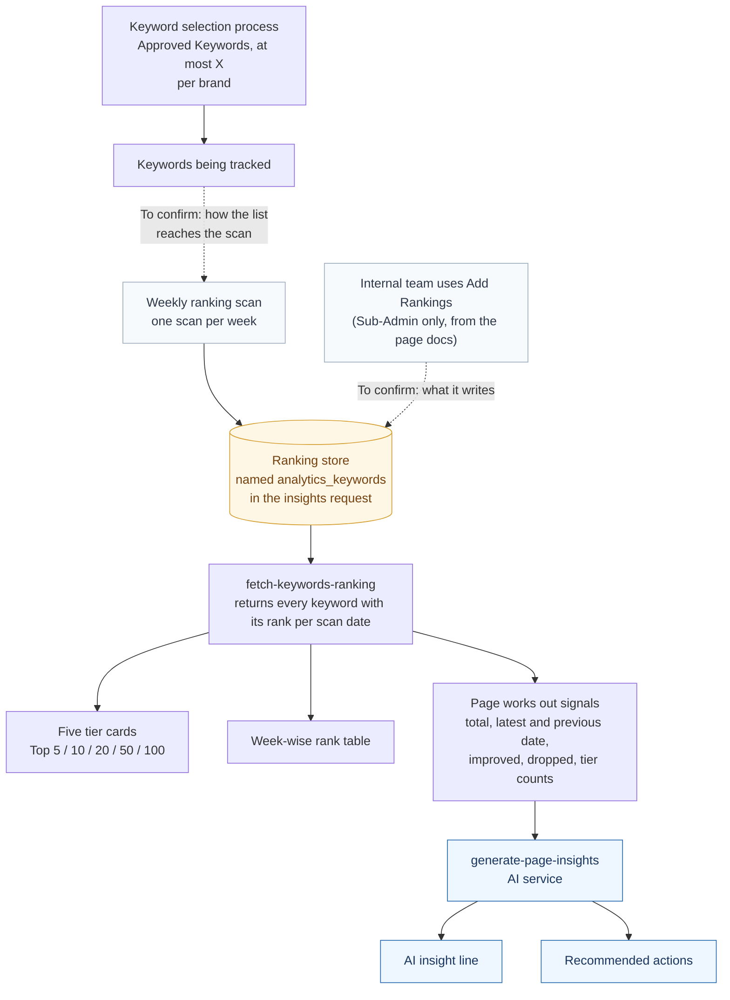
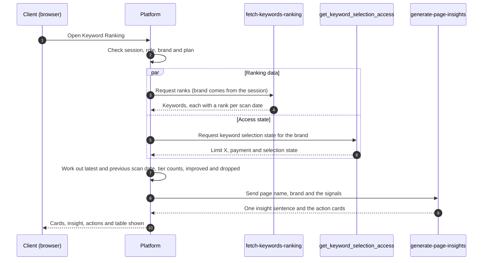
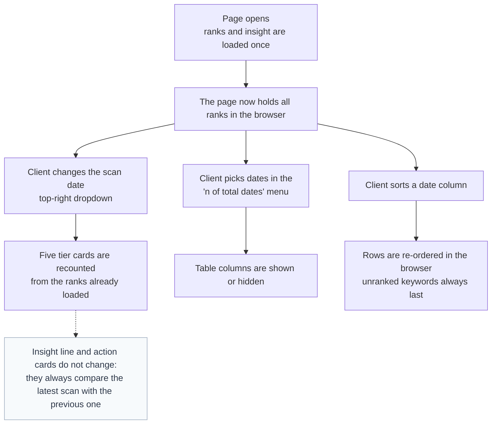

# Keyword Ranking: Data Flow

**Page:** Analytics → Keyword Ranking (`/analytics/keyword-ranking`). Screen layout and labels are in [doc analytics/05-keyword-ranking.md](doc%20analytics/05-keyword-ranking.md). This file explains **where the data comes from and how it reaches the screen**.

**Notation:** X = keyword limit of the client's package. One **scan** = one weekly ranking check. A **rank** = the position of the brand's page for a keyword (lower is better).

**Roles:** the **Client** (Pro User), the **Internal team** (Sub-Admin), and the **System**.

**Goal:** show the client how each of their tracked keywords ranks, week by week, with a short AI summary and recommended actions.

The flow is shown in three diagrams: where the data comes from, what happens when the page opens, and what each user action changes. The sections after them explain who sees what, the rules, and what is still to confirm.

## Purpose and Access

The page is **read-only for the client**: it shows data and never changes it. The keywords it shows are the keywords being tracked for the client. Those come from the keyword selection process (see [keyword selections.md](keyword%20selections.md)): the approved keywords, at most X.

Access follows the payment-first rule of keyword selection. The platform checks the client's plan and the keyword-selection state when the page opens. In the checked brand the plan was `paid` and the page showed data. A brand with `is_paid: false` was also seen showing ranking data, so the exact rule is listed under "To confirm".

## 1. Where the data comes from

Plain reading:

1. Keywords are approved through keyword selection and become the tracked keywords.
2. A weekly scan checks the rank of each tracked keyword and the result is stored per keyword and per scan date.
3. When the client opens the page, the page asks for all stored ranks of the brand.
4. From that one answer, the page builds the five cards and the table, and also works out the signals for the AI summary.

The dotted lines are the steps that were **not visible from the browser**. See "To confirm".

## 2. What happens when the page opens

The insight and actions are requested **after** the ranks are back, because they are built from them.

### The data that moves

| Call | Sent | Returned | Used for |
|------|------|----------|----------|
| `fetch-keywords-ranking` | Nothing. The brand comes from the session. | A list of keywords. Each has a map of **scan date → rank text**. | Cards, scan dates, table |
| `get_keyword_selection_access` | The brand name | One row: `max_keywords` (X), `is_paid`, `questionnaire_completed`, `has_proposal_rows`, `has_ranking_rows`, `eligible`, `keywords_finalized`, `access_role` | Keyword selection state |
| `generate-page-insights` | Page name, brand, source, **signals** | `aiInsight` (one sentence) and `recommendations` (each: category, title, explanation, action, priority) | Insight line and action cards |
| `user_page_sessions` | User id, page path, page label | A saved row | Usage tracking only |

How a rank is stored:

- A rank is the position as text, for example `23`.
- A keyword that does not rank has the text `Not in Rank`. The screen shows it as **-**.
- The scan dates come from the data itself (one per week) and arrive in no fixed order. The page sorts them, newest first.
- The number of keywords returned is the **total tracked keywords**.

### The signals sent to the AI service

| Signal | How it is worked out |
|--------|----------------------|
| Total tracked keywords | Number of keywords returned |
| Latest and previous date | The two most recent scan dates |
| Improved keywords | Keywords with a better rank on the latest scan than on the previous one |
| Dropped keywords | Keywords with a worse rank on the latest scan than on the previous one |
| Tier counts | For Top 3, 5, 10, 20 and 100: count on the latest scan, count on the previous scan, and the percentage change |

The Top 3 values were empty, and **Top 50 is not sent**, although the screen has a Top 50 card.

## 3. What each user action changes

| Action | New call to the server? | What changes | What stays the same |
|--------|--------------------------|--------------|---------------------|
| Change the scan date | None seen | The five tier cards | Insight, actions, table |
| Pick dates in the dates menu | None | Date columns in the table | Cards, insight, actions |
| Sort a date column | None | Row order | Everything else |

**Tier counting:** a keyword counts in a tier when its rank on the chosen date is a number within positions 1 to the tier limit. `Not in Rank` counts in no tier. Tiers are cumulative: Top 5 ≤ Top 10 ≤ Top 20 ≤ Top 50 ≤ Top 100 ≤ total.

## Roles and Scope

| Role | What they see and can do | What they cannot do |
|------|--------------------------|---------------------|
| **Client (Pro User)** | The five tier cards, the AI insight line, the recommended actions, and the week-wise table. Can change the scan date, pick table dates and sort. | Cannot add, edit or delete rankings. Cannot add or remove tracked keywords on this page. |
| **Internal team (Sub-Admin)** | Per the page docs: extra **Add Rankings** and **Download (Month YYYY)** buttons. The insight line and action cards are not shown in this view. | **Not verified in this session** (the account used showed the Pro User view). |
| **System** | Stores scan results, returns them, works out signals, asks the AI service for the insight and actions | – |

Notes:

- All data is for **one brand**, the brand selected in the top bar.
- The insight and action text is **generated** and can be different on each load.

## Data and Storage

| Data | Stored where | Notes |
|------|--------------|-------|
| Tracked keywords | From keyword selection: Approved Keywords | At most X, unique, per Client ID + Subscription ID |
| Ranks per keyword per scan date | Ranking store (named `analytics_keywords` in the insights request) | One value per keyword per week, `Not in Rank` when unranked |
| Keyword selection state | Returned by `get_keyword_selection_access` | Limit X, payment, finalized state |
| Insight line and action cards | **Not stored** by the page | Built again on every load |
| Page visit | `user_page_sessions` | Usage tracking |

## Rules

- The page is **read-only** for the client. Data only flows **to** the screen.
- Data is **per brand**. The brand comes from the session, not from the page.
- The scan is **weekly**. Scan dates come from the data, not from a calendar.
- The cards follow the **chosen scan date**. The table follows the **chosen dates menu**. The insight and actions always compare the **latest and previous scans**.
- Keywords that do not rank show **-** and stay at the bottom when sorting.
- Generated text is not saved and may change on reload.
- Tracked keywords come from the approved keywords. This page never approves, adds or removes keywords.

## Runbook: Client

1. Open **Analytics → Keyword Ranking**. The latest scan date is selected.
2. Read the five cards: how many tracked keywords rank in the Top 5, 10, 20, 50 and 100 on that date.
3. Read the AI insight line and the recommended actions. They compare the latest scan with the previous one.
4. Use the scan-date dropdown to see the cards for an earlier week.
5. In the table, use the dates menu to choose which weeks to show, and click a date header to sort by rank.
6. A **-** means the keyword did not rank on that date.

## Runbook: Internal Team

1. Open the client's brand in the top bar, then **Analytics → Keyword Ranking**.
2. Per the page docs, the page shows **Add Rankings** and **Download (Month YYYY)**. Use them to add or export ranking data.
3. Check that the latest scan date appears and that the number of keywords matches the approved keywords.

> Steps for the internal team come from the page docs. They were **not checked in this session**, so the exact fields and the file format of Add Rankings are not described here.

## Troubleshooting

| Situation | What to check |
|-----------|---------------|
| The page shows no keywords | Ranking data may not exist yet for the brand. Check that keyword selection is done and that a scan has run. |
| Every rank shows **-** | The keywords did not rank on any shown date. This is normal for new keywords. |
| A new keyword is missing | It may not be approved yet, or it has not been scanned yet. |
| The cards and the insight show different numbers | The cards follow the chosen scan date. The insight always uses the latest scan against the previous one. |
| The insight or actions look different after reload | They are generated again on every load. |
| The Top 50 card is shown but the insight never mentions Top 50 | The Top 50 count is not sent to the AI service. |
| The scan-date dropdown shows fewer weeks than expected | Dates come from the data. A week with no scan does not appear. **To confirm.** |

## To confirm

| # | Question | Why it matters |
|---|----------|----------------|
| 1 | What runs the weekly scan, and is it automatic or manual? | It is the start of the data flow. |
| 2 | Is the ranking store really `analytics_keywords`? The insight request names it as the source. | Name of the data source. |
| 3 | Are the tracked keywords exactly the Approved Keywords from keyword selection? | Link between the two flows. |
| 4 | What exactly does **Add Rankings** write, and in which format? | The second way data can enter. |
| 5 | Why can ranking data exist when `is_paid` and `keywords_finalized` are false? | Access rule. |
| 6 | Why is Top 50 left out of the AI signals? | Cards and insights can disagree. |
| 7 | Does changing the scan date ever trigger a new insights call? The existing page doc says yes, but none was seen. | Keeps the two docs consistent. |
| 8 | Which other pages reuse this data (Overview, Activity Tracker, Strategic Sync-ups, Reports)? | Downstream part of the flow. |
