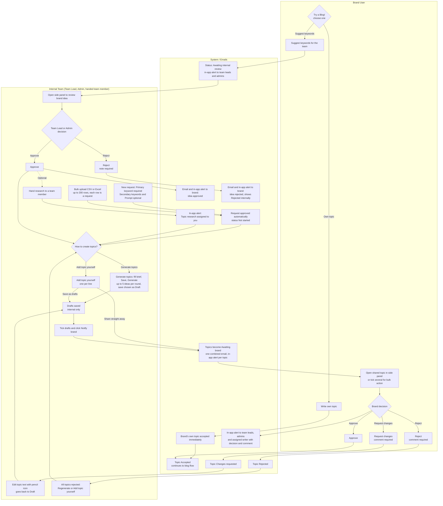
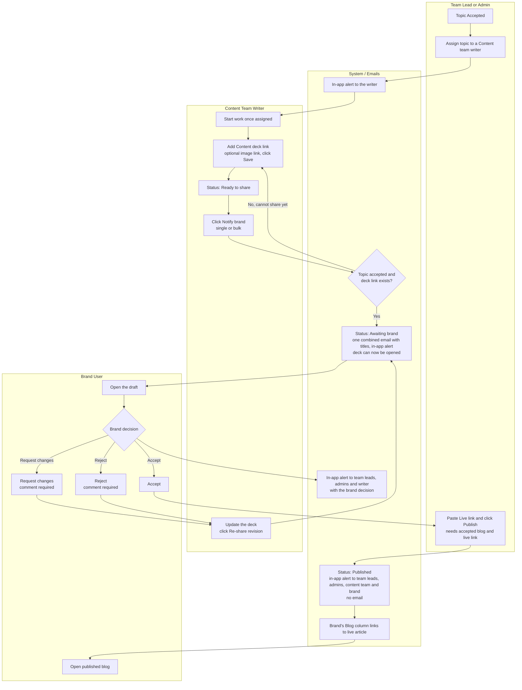
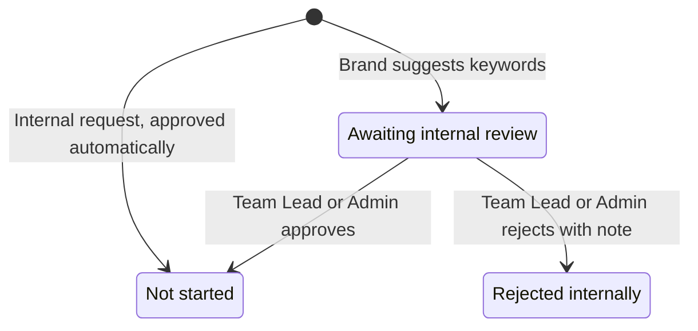
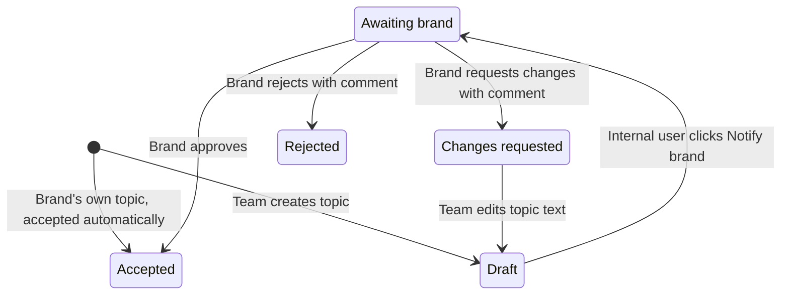
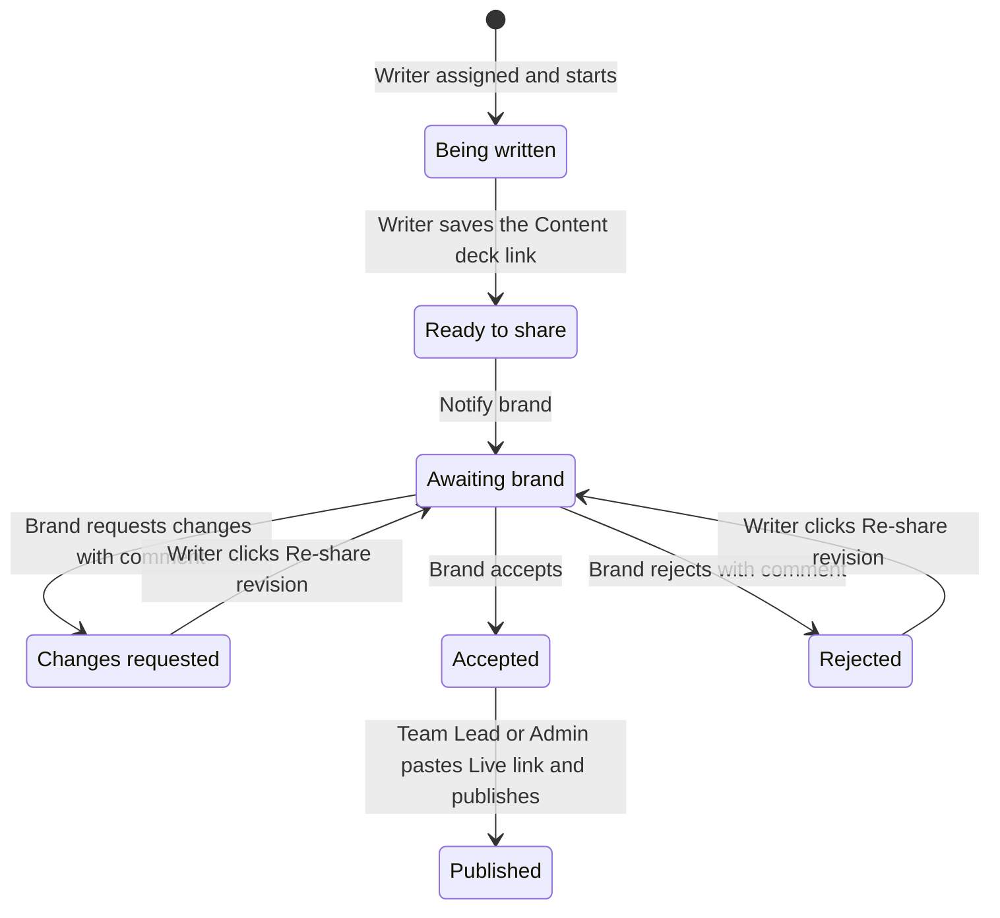

# Blog Generator – Workflow

The Blog Generator takes a blog from an idea to a published article for a brand: a request becomes topics, the brand decides on each topic, a writer drafts the blog, the brand reviews it, and a team lead publishes it.

## Request and topics

## Blog drafting and publishing

## Status changes

Request status:

Topic status:

Blog status:

## Key rules

- Internally raised requests are approved automatically. A brand keyword idea waits for internal review, and rejecting needs a note.
- Drafts are internal only. The brand sees a topic only after Notify brand.
- A brand's own topic is accepted immediately. A brand comment is required to reject or request changes.
- A blog cannot be shared until its topic is accepted and a content deck link exists. Publishing needs an accepted blog and a live link.
- Team members see only requests handed to them and topics assigned to them. Writers come only from the Content team.
- Publishing alerts the brand in-app but sends no email. The Deployment status rules do not apply to this page.
