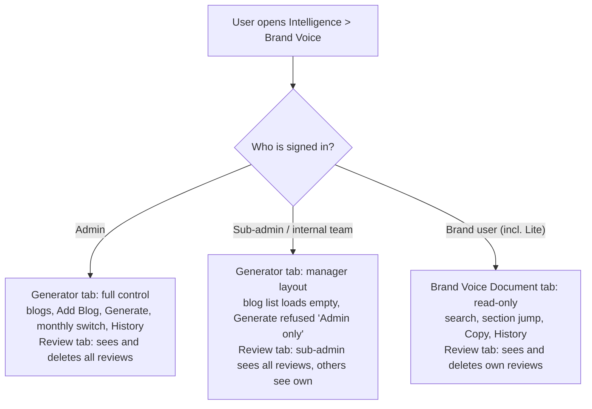
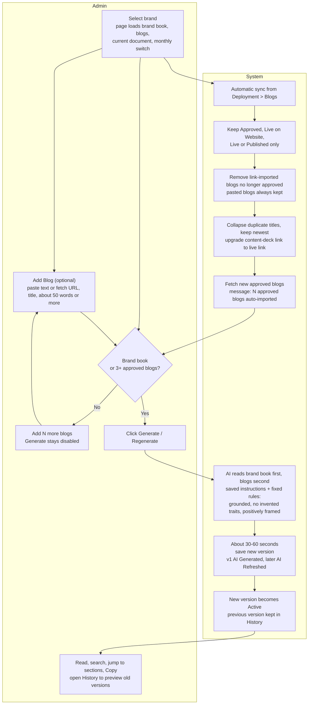
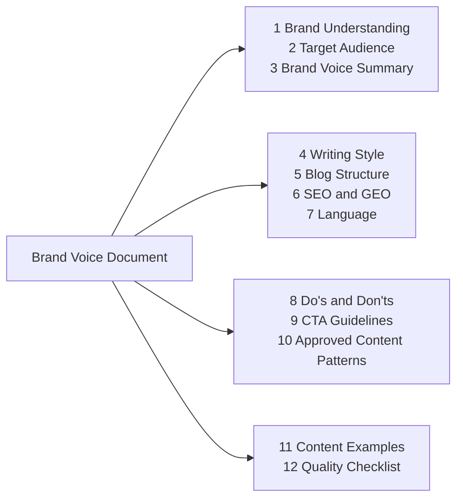
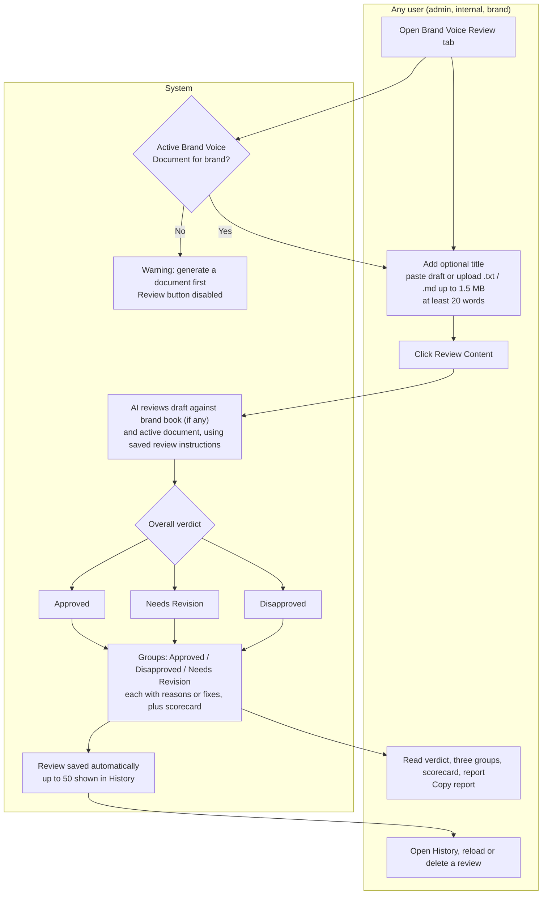
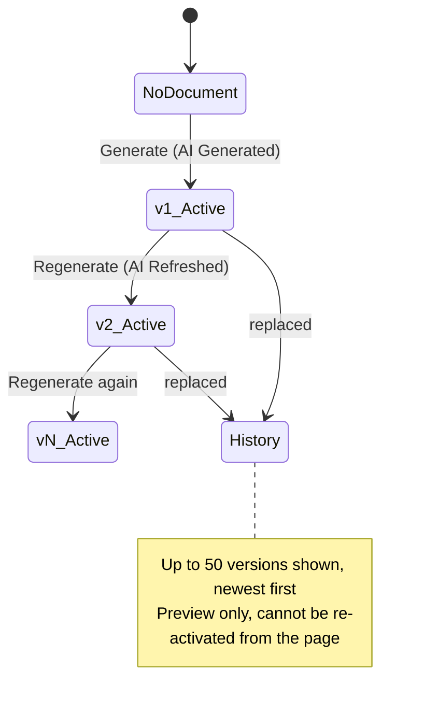

# Brand Voice – Workflow

Brand Voice turns a brand's approved blogs (and brand book, if any) into a 12-section Brand Voice Document, then uses that document to review new drafts. For the written runbook, see [Execution/brand-voice.md](../Execution/brand-voice.md).

## Access by role

## Flow A: building the Brand Voice Document

## The 12 sections of every document

## Flow B: reviewing a draft

## Document versions

## Key rules

- **Generate needs 3 approved blogs or a brand book.** The brand book wins where blogs disagree.
- **Only admins can generate or manage blogs.** Sub-admins and internal staff see the buttons but are refused.
- **Sync on page open can delete** link-imported blogs that are no longer approved in Deployment. Pasted blogs are kept.
- **Deleting a blog only affects future versions.** Regenerate to apply changes.
- **Review needs an active document** and at least 20 words of draft.
- **"Auto-refresh monthly" is a saved setting only**; nothing regenerates monthly yet.
- **No emails, WhatsApp or in-app alerts** are sent from this page.
