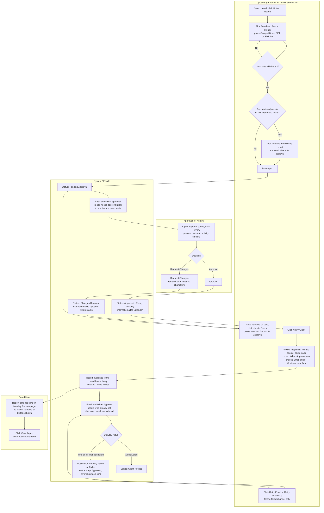
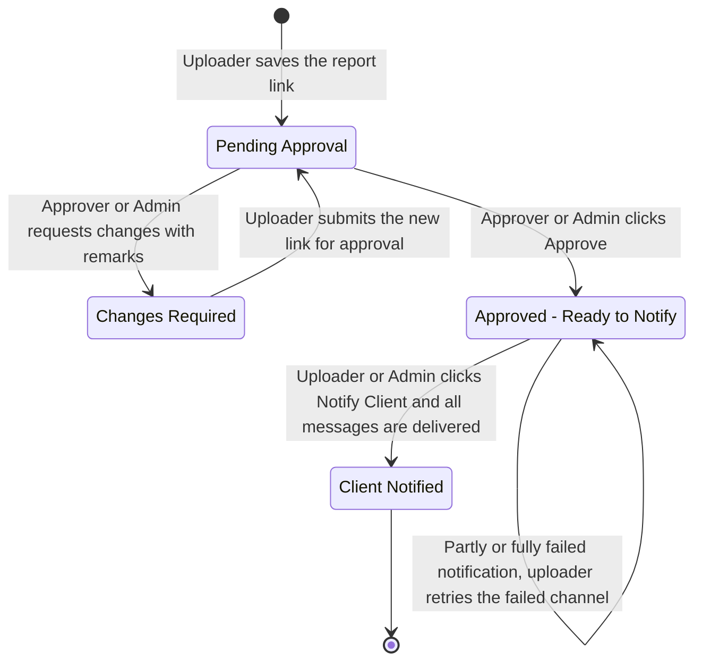
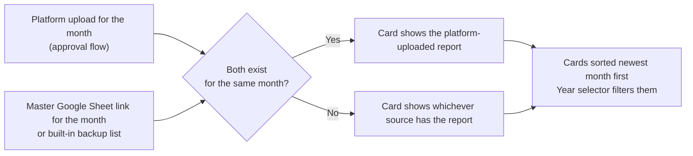

# Monthly Reports – Workflow

The Monthly Reports page shows each brand its monthly performance report, and behind the scenes works as an internal approval desk: an uploader adds the report, an approver reviews it, and the uploader then publishes it to the brand with Notify Client.

## Main workflow

## Status changes

## Which report a card shows

## Key rules

- Only the approver or an admin can approve or request changes, and nobody can approve their own upload.
- Request Changes always needs remarks of at least 50 characters.
- A report cannot be sent to the brand before it is approved.
- The report becomes visible to the brand the moment Notify Client is clicked, even if a message later fails. A retry resends only the failed channel.
- After publishing, Edit and Delete are locked.
- Brand users see only published reports. The Deployment rules (CSV upload, Approval Pending / Approved / Disapproved / Live on Website, brand dashboard Notify) do not apply to this page.
