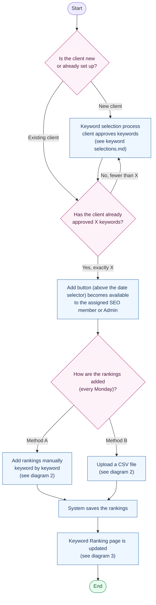
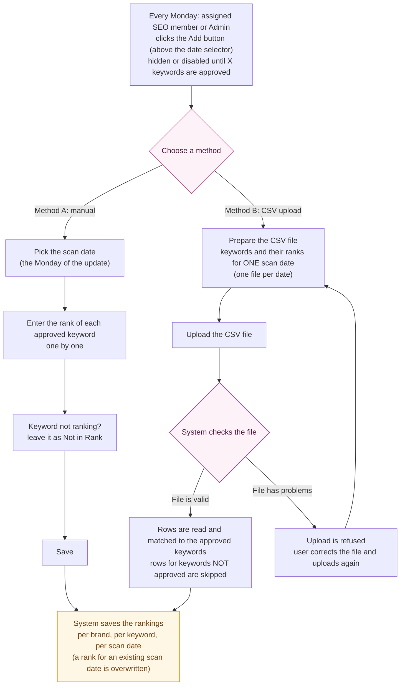
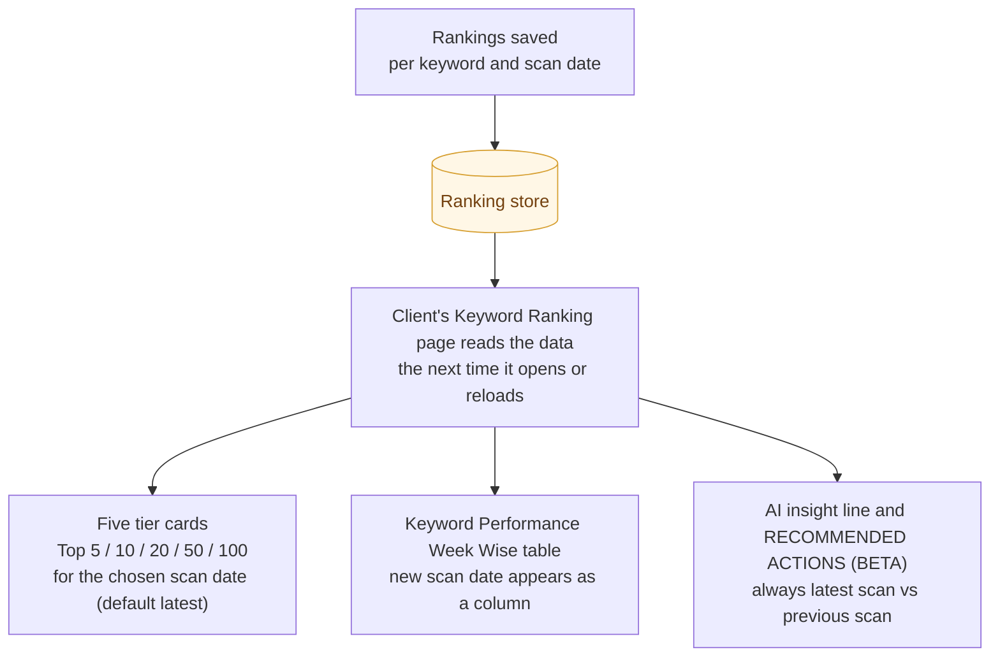

# Keywords Ranking Flow

## 1. Overall journey

Plain reading:

- **A new client** always starts with keyword selection. Keywords must be approved first, and the process repeats until exactly X are approved.
- **An existing client** who has already approved X keywords skips keyword selection and goes straight to adding rankings.
- **Only the assigned SEO team member or the Admin adds the rankings.** The client cannot add rankings. The client only sees the result on their Keyword Ranking page.
- **Rankings are updated every Monday**, by either method, by the assigned SEO member or the Admin.
- Rankings are added only once X keywords are approved, because the rankings belong to those approved keywords.

## 2. The two ways of adding rankings

| | Method A: Manual | Method B: CSV upload |
|---|---|---|
| Best for | A few keywords, or a quick correction | Many keywords at once |
| How | Enter the rank of each keyword in the page | Upload one file with all the ranks for one scan date (one file per date); rows for non-approved keywords are skipped |
| Result | Same: the rankings are saved for the scan date | Same: the rankings are saved for the scan date |
| Done by | The assigned SEO member or Admin | The assigned SEO member or Admin |
| When | Every Monday | Every Monday |

## 3. After the rankings are saved

- The new scan date is added to the top-right scan-date dropdown (newest first) and becomes a column in the week-wise table. The latest date is the default for the five cards and the default sort column (ascending, unranked **-** last).
- The scan-date dropdown changes **only the five cards**. The table columns are chosen with the "{n} of {total} dates" multi-select (default all; Clear keeps the latest). The insight and actions never follow the dropdown.
- Tier values are cumulative (Top 5 <= Top 10 <= ... <= Top 100 <= total tracked keywords). Unranked keywords count in no tier.
- The insight and actions come from `generate-page-insights` and are regenerated on each load (wording, number of cards, category VISIBILITY / GROWTH / RISK and priority HIGH / MEDIUM can differ). They are read-only.
- Data is read through `POST fetch-keywords-ranking` (empty body, brand from the session). The page has no search, pagination or export.
- A keyword with no rank for a scan date shows **-**. (The stored value `Not in Rank` is not stated in the page doc.)

