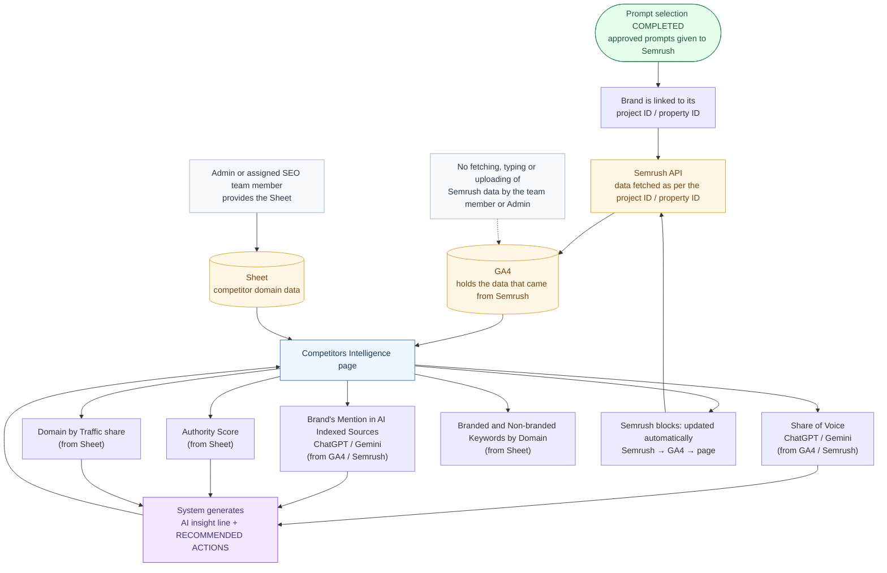
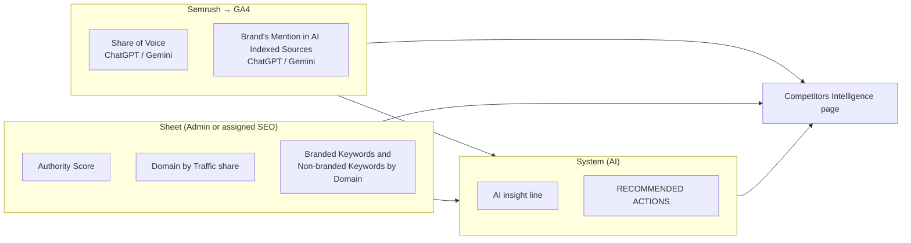

# Competitors Intelligence Flow

> Written for the **Competitors Intelligence** page (`/analytics/competitors`, `doc analytics/03-competitors-intelligence.md`).

**Notation:** **Share of Voice** = the brand's percentage share of AI mentions compared with its competitors. **Mentions in AI Indexed Sources** = how often the brand and competitors are mentioned in sources that AI models index. The **project ID / property ID** = the ID that links the brand to its project in Semrush and in GA4. The **Sheet** = the Excel / Google Sheet that holds the competitor domain data. The **AI insight** = the one-line summary and the RECOMMENDED ACTIONS cards (both BETA).

**Roles:** the **Client**, the **Assigned SEO team member**, the **Admin**, the **System**, **Semrush**, **GA4** and the **Sheet**.

**Goal:** the page compares the brand with its competitors. It has five data blocks from **two sources**, plus an AI insight built from them:

| Source | Blocks on the page |
|--------|--------------------|
| **Semrush** (through GA4) | Share of Voice (ChatGPT and Gemini); Brand's Mention in AI Indexed Sources (ChatGPT and Gemini) |
| **Sheet** (provided by the Admin or the assigned SEO team member) | Authority Score; Domain by Traffic share; Branded Keywords and Non-branded Keywords by Domain |
| **System (AI)** | AI insight line and RECOMMENDED ACTIONS, generated from the data above |

The Semrush data reaches the page automatically: **Semrush → GA4 → page**, using the **project ID / property ID** through the **Semrush API**. Nobody types it in. The Sheet is **provided by the Admin or the assigned SEO team member**.

## Purpose and Access

The page shows:

1. **AI insight line (BETA)**: one generated sentence on the brand's competitive position.
2. **RECOMMENDED ACTIONS (BETA)**: generated action cards (category COMPETITION / GROWTH / VISIBILITY, priority HIGH / MEDIUM, and a recommended step).
3. **Share of Voice**: line chart of each brand's share of mentions per day. Toggle: **ChatGPT** / **Gemini**.
4. **Brand's Mention in AI Indexed Sources**: line chart of mention counts per day. Toggle: **ChatGPT** / **Gemini**.
5. **Authority Score**: table with organic traffic, organic keywords, backlinks, referring domains and authority score per domain.
6. **Domain by Traffic share**: donut chart of organic traffic share per domain.
7. **Branded Keywords and Non-branded Keywords by Domain**: 100% stacked bars per domain.

The client can only view the page, and can use the brand filter, date range and model toggle on the two line charts. The client cannot add or change any data, and the action cards are read-only.

## In short

1. The brand is linked to its Semrush project ID / property ID (once).
2. Share of Voice and Mentions in AI Indexed Sources (ChatGPT and Gemini) come from Semrush into GA4 through the Semrush API. The page takes them from GA4.
3. The Admin or the assigned SEO team member provides the Sheet. Authority Score, Domain by Traffic share and Branded / Non-branded Keywords come from it.
4. The AI insight line and RECOMMENDED ACTIONS are generated by the System from the page data.
5. The Semrush blocks update automatically. The Sheet blocks change when the Sheet is updated.

## 1. Overall journey

## 2. Where each block comes from

## System rules

- **Share of Voice** and **Brand's Mention in AI Indexed Sources** (both **ChatGPT** and **Gemini**) come from **Semrush**, through **GA4**, matched by the brand's **project ID / property ID**, through the **Semrush API**.
- **Authority Score**, **Domain by Traffic share** and **Branded Keywords and Non-branded Keywords by Domain** come from the **Sheet**, which is provided by the **Admin or the assigned SEO team member**.
- The **AI insight line** and **RECOMMENDED ACTIONS** are generated by the System from the page data (for example the brand's traffic share and authority score against the leading competitors). The wording, the number of cards, categories and priorities can differ between loads.
- The same Semrush → GA4 source is used for the Citation Overview, the Sentiment Overview, the Reddit Overview and the Product Leaderboard.
- The Semrush blocks update **automatically**. There is no manual add or upload of Semrush data.
- The client cannot add or change any data.
- The data is **brand scoped**. The brand's own domain is shown first, then its competitors.
- Each of the two line charts has its **own** brand filter, date range and model toggle. Changing one does not change the other.
- Date ranges are counted back from the **latest date with data**, not from today.
- The Sheet blocks do **not** change with the chart date ranges.

## Roles and Scope

| Role | What they can do | What they cannot do |
|------|------------------|---------------------|
| **Client** | View the page; use the brand filter, date range and model toggle on the line charts; read the AI insight and actions | Cannot add or change data |
| **Assigned SEO team member** | Make sure the brand has the correct project ID / property ID; provide and update the Sheet for the brand | Does not fetch, type in or upload Semrush data |
| **Admin** | Same as the assigned SEO team member for any client | Same limits |
| **System** | Show the Semrush data from GA4 and the Sheet data; generate the AI insight and actions | – |
| **Semrush** | Source of Share of Voice and Mentions, read through the Semrush API by project ID / property ID | – |
| **GA4** | Holds the data that came from Semrush and feeds the two line charts | – |
| **Sheet** | Source of Authority Score, Traffic share and Branded / Non-branded Keywords | – |

## Data and Storage

| Data | Source | Stored where | Notes |
|------|--------|--------------|-------|
| Brand ↔ project ID / property ID | Brand setup | Brand setup | Set once per brand |
| Share of Voice (ChatGPT, Gemini) | Semrush | GA4 | Per brand, per day |
| Brand's Mention in AI Indexed Sources (ChatGPT, Gemini) | Semrush | GA4 | Per brand, per day |
| Authority Score (organic traffic, organic keywords, backlinks, referring domains, authority score) | Sheet (Admin / assigned SEO) | Sheet | Shows a "Last updated" month |
| Domain by Traffic share | Sheet (Admin / assigned SEO) | Sheet | Percentage per domain |
| Branded vs Non-branded Keywords by Domain | Sheet (Admin / assigned SEO) | Sheet | Percentage split per domain |
| AI insight line and RECOMMENDED ACTIONS | System (AI) | Not stored (per the page docs, generated on every load) | Built from the data above. Per the page docs: `generate-page-insights` |

Page details: `doc analytics/03-competitors-intelligence.md`.

## Runbook: Client

1. Open **Analytics → Competitors Intelligence**.
2. Read the AI insight line and the RECOMMENDED ACTIONS.
3. In **Share of Voice** and **Brand's Mention in AI Indexed Sources**, pick the model (ChatGPT or Gemini), the brands and the date range.
4. Read **Authority Score**, **Domain by Traffic share** and **Branded and Non-branded Keywords by Domain** to compare the domains.

## Runbook: Assigned SEO Team Member (and Admin)

1. Make sure the brand has the correct project ID / property ID.
2. Provide the Sheet for the brand: the brand's domain and its competitors, with authority score, traffic share and branded / non-branded keywords.
3. Update the Sheet when the figures change. The page shows the "Last updated" month.
4. **Do not fetch or type in Semrush data.**

## Troubleshooting

| Situation | What to check |
|-----------|---------------|
| Share of Voice or Mentions chart is empty or flat (ChatGPT or Gemini) | Check the project ID / property ID, and whether prompts are being tracked in Semrush. |
| Authority Score, Traffic share or Keywords block is empty or old | Check that the Sheet was provided for the brand, and its "Last updated" month. |
| A competitor is missing in a Sheet block | Check that the domain is in the Sheet. |
| A competitor is missing in a line chart | Check the brand filter; the brand may be deselected. |
| AI insight or actions look wrong | They are built from the page data. Check the Semrush and Sheet data first. |
| Someone wants to upload Semrush data | Not needed and not done. |

## Open points

| # | Question |
|---|----------|
| 1 | Is it one Sheet for all brands, or one per brand? And is it an Excel file or a Google Sheet? |
| 2 | How often must the Admin / assigned SEO update the Sheet? |
| 3 | How does the page read the Sheet (direct, or through a backend function)? |
| 4 | What happens if the Semrush API call fails for a day? Who is told? |
| 5 | If the Sheet is missing for a brand, should the three Sheet blocks and the AI insight show an empty state? (No empty state is documented today.) |
