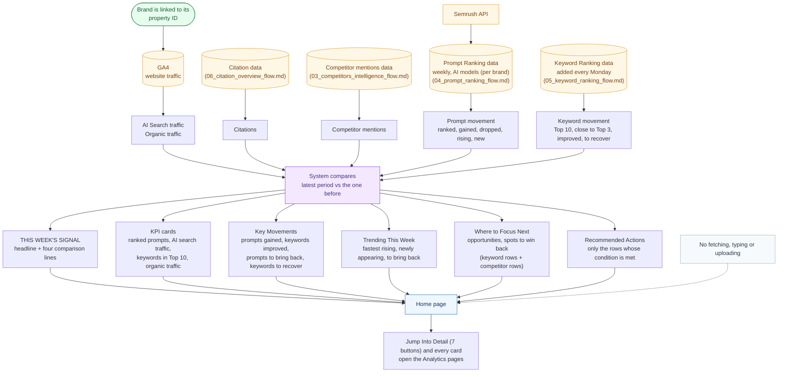
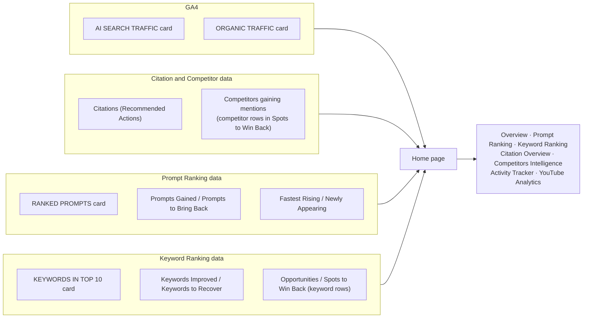

# Home Flow

> Written for the **Home** page (`/brand-pulse`, `doc home/01-home.md`), the page the app opens after sign-in. It is the first item in the sidebar, above the ANALYTICS group. The shared shell (top bar, sidebar, breadcrumb, Miss Daring assistant) is in `doc analytics/00-global-layout.md`.

**Notation:** **Week over week** = the latest period compared with the one before it. A **scan date** = the week a ranking or citation result belongs to. The **property ID** = the ID that links the brand to its GA4 data (brand setup; not shown on Home).

**Goal:** the Home page is a one-page **weekly summary** of the brand. It does not hold any data of its own. Every number on it is read directly from the stored data in the database (the same stored data the Analytics pages show), so the numbers on Home match those pages. GA4 data and Semrush data are both stored in the database, so Home does not depend on a live source. Nothing is typed in or uploaded on Home, and every click is a link into an Analytics page. There is no date picker, filter, Refresh button, data-freshness banner or tooltip on the page. The prompt data follows the **AI models enabled for the brand** (for example ChatGPT, Gemini, Perplexity); they are not a fixed set.

## Where the data comes from

| Data on Home | Read from (stored in the database) | Same data as page |
|--------------|-----------------------------------|-------------------|
| Ranked prompts, prompts gained, prompts to bring back, fastest rising and newly appearing prompts | **Prompt Ranking** data (Semrush data, stored, updated weekly, for the brand's enabled AI models) | Prompt Ranking |
| Keywords in Top 10, keywords close to Top 3, keywords improved, keywords to recover | **Keyword Ranking** data (rankings added every Monday) | Keyword Ranking |
| Citations (for example "citations to earn back") | **Citation** data | Citation Overview |
| Competitors gaining mentions | **Competitor mentions** data | Competitors Intelligence |
| AI Search traffic and Organic traffic | **GA4** data (stored in the database) | Overview |
| Usage tracking and the sub-admin brands list | App shell | – |

Home reads this stored data directly; it does not call the same fetch functions as the Analytics pages. Shell calls (roles, subscription, notifications) are listed in the global layout document, section 5.

## In short

1. The brand is linked to its property ID (once).
2. The traffic cards take their data from GA4.
3. The prompt cards take their data from the Prompt Ranking data, which Semrush updates every week.
4. The keyword cards take their data from the Keyword Ranking data, which is added every Monday.
5. The citation and competitor lines take their data from the Citation and Competitor mentions data (the same data as Citation Overview and Competitors Intelligence).
6. The System compares the latest period with the one before, and builds the headline, the cards, the lists and the Recommended Actions from the changes.
7. The page follows the brand chosen in the top bar (choosing another brand reloads the app for it). Every card or row opens the matching Analytics page.

## 1. Overall journey

## 2. Where each section gets its data

## What is compared with what

| Part of Home | Compares | Source |
|--------------|----------|--------|
| Traffic (AI search, organic) | Last full week vs the week before | GA4 |
| Prompts | Last two scan dates | Prompt Ranking data |
| Keywords | Last two scan dates | Keyword Ranking data |
| Citations | Last two scan dates | Citation data |

The four comparison lines in THIS WEEK'S SIGNAL (Traffic, Prompts, Keywords, Citations) show these periods, so the dates differ line by line, and each line uses a different date style. On one brand the Keywords line lost its spaces ("16November 2026 vs 10November 2026"). The keyword dates can lag far behind the others when keyword rankings were added less recently (months old on one brand).

## System rules

- Home has **no data of its own**. It reads the stored data directly (the same stored data the Analytics pages show), so its numbers should match them.
- The page is **brand scoped**: it follows the brand chosen in the top bar.
- The **headline** and the **Recommended Actions** are built from the week's changes. A part or a row with nothing to report is dropped (the headline wording is not always grammatical, for example "1 more prompt ranking"; on a brand with no prompt data the headline has no prompt part). A Trending list with no rows shows its own empty-state sentence ("No rising prompts this week.", "No new prompts entered ranking this week.", "Every prompt held its rank this week — a strong base to build on.").
- The lists are cut to the top few rows (for example 3 improved keywords out of 33). The number of Recommended Actions rows depends on the brand (5, 4 and 3 were seen).
- A KPI change line shows a green up arrow for a rise, a red down arrow for a fall and a grey dash ("0") for no change.
- **Jump Into Detail** has seven buttons: Overview, Prompt Ranking, Keyword Ranking, Citations, Competitors, Activity, YouTube. The YouTube button shows on every brand, even one whose sidebar has no YouTube Analytics item.
- Each Key Movements card shows a priority tag (HIGH / MED / LOW), which changes with the brand.
- Every card, row and button is a **link** to an Analytics page (prompt rows to Prompt Ranking, keyword rows to Keyword Ranking, competitor rows to Competitors Intelligence, the citations action to Citation Overview). Nothing on Home changes data.
- The Home view is the **same for Sub-Admin and Pro User**.
- GA4 data and Semrush data are stored in the database and Home reads them from there, so there is no live-source failure case.
- The data updates **automatically**: prompts and the Semrush-based data update weekly, traffic comes from stored GA4 data, and keywords follow the weekly Monday ranking update.

## Data and Storage

| Data | Source | Stored where | Notes |
|------|--------|--------------|-------|
| Brand ↔ property ID | Brand setup | Brand setup | Set once per brand |
| Traffic | GA4 | Database (stored GA4 data) | Last full week vs the week before |
| Citations, competitor mentions | Citation and Competitor mentions data | As per the Citation Overview and Competitors Intelligence pages | Compared on the last two scan dates |
| Prompt data | Prompt Ranking data (Semrush data) | Database; as per `../../flows/analytics flows/04_prompt_ranking_flow.md` | Updated weekly as per Semrush |
| Keyword data | Keyword Ranking data | As per `../../flows/analytics flows/05_keyword_ranking_flow.md` | Added every Monday |
| Headline, cards, lists, Recommended Actions | System (built from the data above) | Not stored | Rebuilt on every load |

Page details: `doc home/01-home.md`.

## Runbook: Client

1. Sign in. The app opens **Home**.
2. Read THIS WEEK'S SIGNAL and the four KPI cards.
3. Read Key Movements, Trending This Week and Where to Focus Next.
4. Follow Recommended Actions, or open any card or **Jump Into Detail** button to see the full page.

## Troubleshooting

| Situation | What to check |
|-----------|---------------|
| A card shows 0 or no change | There may be no change, or no data yet. Check the matching Analytics page. |
| A Trending card shows an empty-state sentence | Nothing moved in that group this week. |
| Prompt cards are missing | The prompts may not have been given to Semrush yet. See `../../flows/analytics flows/04_prompt_ranking_flow.md`. |
| Keyword dates look old | Keyword rankings were not added recently. See `../../flows/analytics flows/05_keyword_ranking_flow.md`. |
| A number differs from an Analytics page | It should match. Check the date or scan date that Home compared. |
| Someone wants to upload data on Home | Not needed and not done. |
