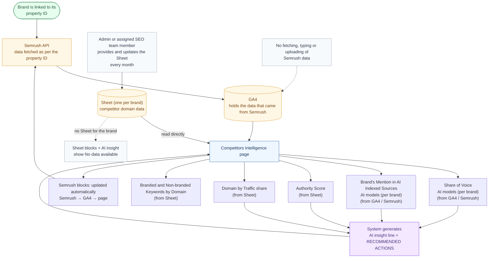
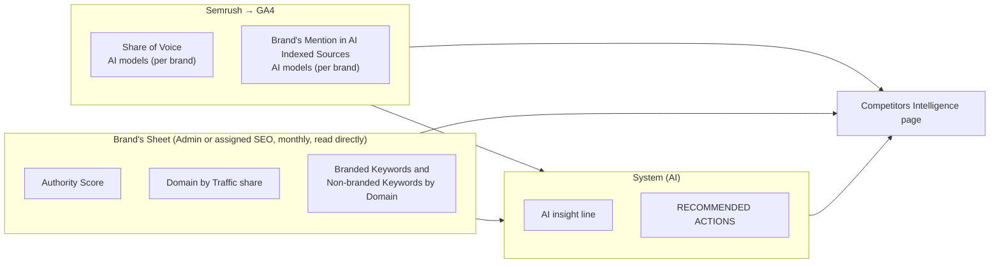

# Competitors Intelligence Flow

> Written for the **Competitors Intelligence** page (`/analytics/competitors`, `doc analytics/03-competitors-intelligence.md`).

**Notation:** **Share of Voice** = the brand's percentage share of AI mentions compared with its competitors. **Mentions in AI Indexed Sources** = how often the brand and competitors are mentioned in sources that AI models index. The **property ID** = the ID that links the brand to its data in Semrush and in GA4. The **Sheet** = the brand's own Google Sheet that holds the competitor domain data (one Sheet per brand). The **AI insight** = the one-line summary and the RECOMMENDED ACTIONS cards (both BETA).

**Goal:** the page compares the brand with its competitors. It has five data blocks from **two sources**, plus an AI insight built from them:

| Source | Blocks on the page |
|--------|--------------------|
| **Semrush** (through GA4) | Share of Voice (AI models enabled for the brand, e.g. ChatGPT, Gemini, Perplexity); Brand's Mention in AI Indexed Sources (same enabled models) |
| **Sheet** (one per brand; provided and updated every month by the Admin or the assigned SEO team member; read directly by the page) | Authority Score; Domain by Traffic share; Branded Keywords and Non-branded Keywords by Domain |
| **System (AI)** | AI insight line and RECOMMENDED ACTIONS, generated from the data above |

The Semrush data reaches the page automatically: **Semrush → GA4 → page**, using the **property ID** through the **Semrush API**. Nobody types it in. There is **one Sheet per brand**. It is provided by the **Admin or the assigned SEO team member**, who must **update it every month**. The page reads the Sheet **directly** (not through a backend function).

## Purpose and Access

The page shows:

1. **AI insight line (BETA)**: one generated sentence on the brand's competitive position.
2. **RECOMMENDED ACTIONS (BETA)**: generated action cards (category COMPETITION / GROWTH / VISIBILITY, priority HIGH / MEDIUM, and a recommended step).
3. **Share of Voice - {Model}**: line chart of each brand's percentage share of that day's mentions across all tracked brands. Controls: brand filter (default 10 brands), date range (Last 7 days default; 14 days, 30 days, All time) and a model toggle with one tab per enabled AI model (first enabled model is the default; the title follows the toggle). Clicking a legend entry hides or shows that brand's line.
4. **Brand's Mention in AI Indexed Sources - {Model}**: line chart of mention counts per day (axes titled Date and Value), with the same kinds of controls and a legend that scrolls with a › arrow when it does not fit.
5. **Authority Score**: table (Domain, Organic Traffic, Organic Keywords, Backlinks, Ref. Domains, Authority Score) with a "Last updated: {Month YYYY}" note. The own brand is the first row, highlighted. Columns are not sortable and rows are not clickable.
6. **Domain by Traffic share**: donut chart of organic traffic share per domain (legend on the right, hover shows the traffic share %).
7. **Branded Keywords and Non-branded Keywords by Domain**: 100% stacked horizontal bars per domain (0% to 100%).

Each block title has an ⓘ tooltip. The footer strip reads "Data source: ChatGPT AI Overview, Semrush" (fixed on-screen text) with a Privacy Policy link. There is no page-level date picker, search, export or table sorting.

The client can only view the page, and can use the brand filter, date range, model toggle and legend on the two line charts. The client cannot add or change any data, and the action cards are read-only.

## In short

1. The brand is linked to its Semrush property ID (once).
2. Share of Voice and Mentions in AI Indexed Sources (for each AI model enabled for the brand) come from Semrush into GA4 through the Semrush API. The page takes them from GA4.
3. The Admin or the assigned SEO team member provides the Sheet. Authority Score, Domain by Traffic share and Branded / Non-branded Keywords are read directly from the brand's Sheet (one Sheet per brand, updated every month).
4. The AI insight line and RECOMMENDED ACTIONS are generated by the System from the page data.
5. The Semrush blocks update automatically. The Sheet blocks change when the brand's Sheet is updated (monthly). If the brand has no Sheet, the three Sheet blocks and the AI insight show "No data available".

## 1. Overall journey

## 2. Where each block comes from

## System rules

- **Share of Voice** and **Brand's Mention in AI Indexed Sources** (for each **AI model enabled for the brand**, per `brand_model_config`) come from **Semrush**, through **GA4**, matched by the brand's **property ID**, through the **Semrush API**.
- **Authority Score**, **Domain by Traffic share** and **Branded Keywords and Non-branded Keywords by Domain** come from the **Sheet**, which is **one Sheet per brand**, provided and **updated every month** by the **Admin or the assigned SEO team member**. The page reads the Sheet **directly**, not through a backend function.
- If the brand's Sheet is **missing**, the three Sheet blocks and the AI insight show **"No data available"**.
- The **AI insight line** and **RECOMMENDED ACTIONS** are generated by the System from the page data (for example the brand's traffic share and authority score against the leading competitors). The wording, the number of cards, categories and priorities can differ between loads.
- The same Semrush → GA4 source is used for the Citation Overview, the Sentiment Overview, the Reddit Overview and the Product Leaderboard.
- The Semrush blocks update **automatically**. There is no manual add or upload of Semrush data.
- The client cannot add or change any data.
- The data is **brand scoped**. The brand's own domain is shown first, then its competitors.
- Each of the two line charts has its **own** brand filter, date range and model toggle. Changing one does not change the other.
- The brand filter panel (**Filter Brands**) has **All** and **Clear**. **Clear** keeps the own brand selected, but clicking the own brand's row does deselect it. There is no search box.
- Date ranges are counted back from the **latest date with data**, not from today.
- The Sheet blocks do **not** change with the chart date ranges.

## Data and Storage

| Data | Source | Stored where | Notes |
|------|--------|--------------|-------|
| Brand ↔ property ID | Brand setup | Brand setup | Set once per brand (brand lookup: `GET brands`) |
| Share of Voice (per enabled AI model) | Semrush | GA4 | Per brand, per day. Page call `rpc/get_share_of_voice_window` (7 / 14 / 30 days, loaded 1000 rows at a time); the brand selection is applied in the browser |
| Brand's Mention in AI Indexed Sources (per enabled AI model) | Semrush | GA4 | Per brand, per day. Page call `fetch-competitor-mentions` (also gives the brand list) |
| Authority Score (organic traffic, organic keywords, backlinks, referring domains, authority score) | Sheet (Admin / assigned SEO) | Brand's Sheet | Shows a "Last updated" month. Updated monthly. Read directly from the Sheet |
| Domain by Traffic share | Sheet (Admin / assigned SEO) | Brand's Sheet | Percentage per domain. Read directly from the brand's Sheet |
| Branded vs Non-branded Keywords by Domain | Sheet (Admin / assigned SEO) | Brand's Sheet | Percentage split per domain. Read directly from the brand's Sheet |
| AI insight line and RECOMMENDED ACTIONS | System (AI) | Not stored (per the page docs, generated on every load) | Built from the data above. Per the page docs: `generate-page-insights` |

Page details: `doc analytics/03-competitors-intelligence.md`.

## Runbook: Client

1. Open **Analytics → Competitors Intelligence**.
2. Read the AI insight line and the RECOMMENDED ACTIONS.
3. In **Share of Voice** and **Brand's Mention in AI Indexed Sources**, pick the model (one of the AI models enabled for the brand), the brands (Filter Brands: All / Clear) and the date range (Last 7 / 14 / 30 days, All time). Click legend entries to hide or show lines.
4. Read **Authority Score**, **Domain by Traffic share** and **Branded and Non-branded Keywords by Domain** to compare the domains.

## Troubleshooting

| Situation | What to check |
|-----------|---------------|
| Share of Voice or Mentions chart is empty or flat (for a given AI model). Charts draw zero-value lines when a brand has no mentions | Check the property ID, and whether prompts are being tracked in Semrush. |
| Authority Score, Traffic share, Keywords block and AI insight show "No data available" | The brand's Sheet is missing. Ask the Admin or assigned SEO team member to provide it. |
| Authority Score, Traffic share or Keywords block is old | Check the brand's Sheet and its "Last updated" month; it must be updated every month. |
| A competitor is missing in a Sheet block | Check that the domain is in the brand's Sheet. |
| A competitor is missing in a line chart | Check the brand filter; the brand may be deselected. |
| AI insight or actions look wrong | They are built from the page data. Check the Semrush and Sheet data first. |
| Someone wants to upload Semrush data | Not needed and not done. |
