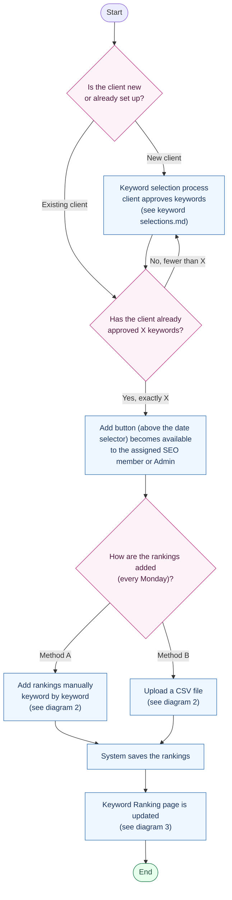
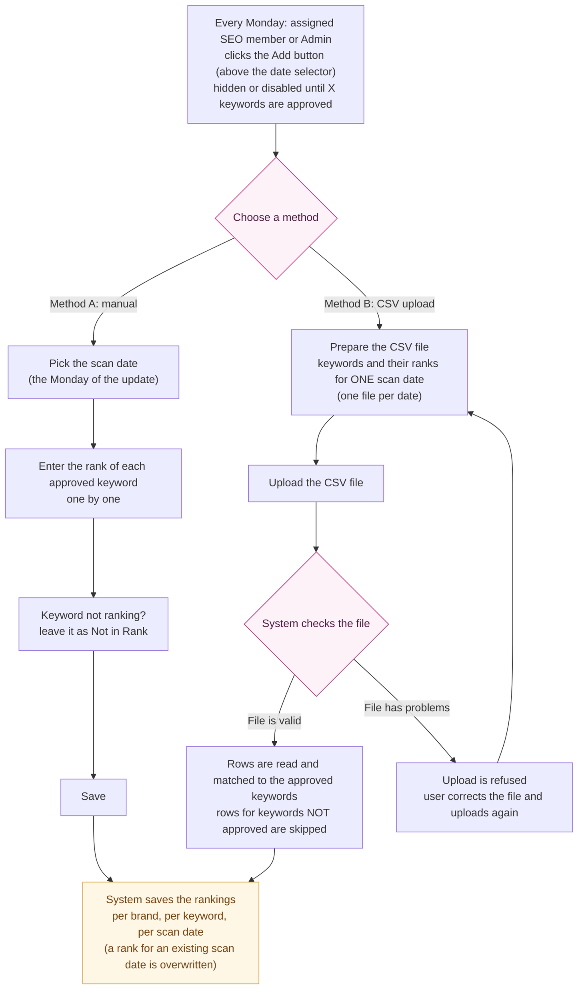
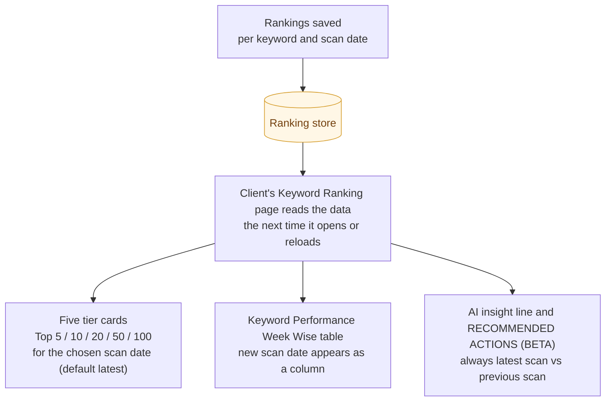

# Keywords Ranking Flow

**Notation:** X = keyword limit of the client's package. A **rank** = the position of the brand's page for a keyword (lower is better). A **scan date** = the week the ranks belong to.

**Roles:** the **Client**, the **Assigned SEO team member** (the SEO team member assigned to the client), the **Admin**, and the **System**. The assigned SEO team member or the Admin adds the rankings. The client never does.

**Goal:** once the client's X keywords are approved, the **assigned SEO team member or the Admin** adds the rank of each keyword (by hand or by CSV) **every Monday**, and the data is reflected on the client's Keyword Ranking page.

This flow comes **after** the keyword selection process. See [keyword selections.md](../../keyword%20selections.md) for how the X keywords are approved. For how the Keyword Ranking page reads and shows the data, see [05-keyword-ranking.md](../../doc%20analytics/05-keyword-ranking.md). The page doc covers the read-only part of the page (route `/analytics/keyword-ranking`); the **Add button, manual entry and CSV upload are part of this flow**. The Add button sits **above the date selector** and is tied to the `get_keyword_selection_access` permission check the page makes. Keyword ranks are search-engine positions and do not depend on the AI models enabled for the brand (e.g. ChatGPT, Gemini, Perplexity).

The flow is shown in three diagrams: the overall journey for a new and an existing client, the two ways of adding rankings, and what happens after the rankings are saved.

## 1. Overall journey

Plain reading:

- **A new client** always starts with keyword selection. Keywords must be approved first, and the process repeats until exactly X are approved.
- **An existing client** who has already approved X keywords skips keyword selection and goes straight to adding rankings.
- **Only the assigned SEO team member or the Admin adds the rankings.** The client cannot add rankings. The client only sees the result on their Keyword Ranking page.
- **Rankings are updated every Monday**, by either method, by the assigned SEO member or the Admin.
- Rankings are added only once X keywords are approved, because the rankings belong to those approved keywords.

## 2. The two ways of adding rankings

| | Method A: Manual | Method B: CSV upload |
|---|---|---|
| Best for | A few keywords, or a quick correction | Many keywords at once |
| How | Enter the rank of each keyword in the page | Upload one file with all the ranks for one scan date (one file per date); rows for non-approved keywords are skipped |
| Result | Same: the rankings are saved for the scan date | Same: the rankings are saved for the scan date |
| Done by | The assigned SEO member or Admin | The assigned SEO member or Admin |
| When | Every Monday | Every Monday |

## 3. After the rankings are saved

- The new scan date is added to the top-right scan-date dropdown (newest first) and becomes a column in the week-wise table. The latest date is the default for the five cards and the default sort column (ascending, unranked **-** last).
- The scan-date dropdown changes **only the five cards**. The table columns are chosen with the "{n} of {total} dates" multi-select (default all; Clear keeps the latest). The insight and actions never follow the dropdown.
- Tier values are cumulative (Top 5 <= Top 10 <= ... <= Top 100 <= total tracked keywords). Unranked keywords count in no tier.
- The insight and actions come from `generate-page-insights` and are regenerated on each load (wording, number of cards, category VISIBILITY / GROWTH / RISK and priority HIGH / MEDIUM can differ). They are read-only.
- Data is read through `POST fetch-keywords-ranking` (empty body, brand from the session). The page has no search, pagination or export.
- A keyword with no rank for a scan date shows **-**. (The stored value `Not in Rank` is not stated in the page doc.)

## System rules

- Rankings can be added only after the client has approved **X** keywords.
- A **new** client must finish keyword selection first. An **existing** client with X approved keywords can add rankings directly.
- Rankings belong to the **approved keywords** of the client's Client ID and Subscription ID.
- A ranking is stored **per keyword and per scan date**. Adding a rank again for an existing scan date **overwrites** it (allowed).
- The **scan date is the Monday of the update**. If a Monday is missed, or an update is added late for an earlier Monday, an **internal email is sent to the team lead and Admin on Monday at 8pm**.
- The **Add button** is above the date selector, tied to the `get_keyword_selection_access` permission check, and is **hidden or disabled until the required X keywords are approved**.
- A CSV holds **one scan date per upload** (one file per date). CSV rows for keywords that are **not approved are skipped**.
- The rankings are updated **every Monday** by the assigned SEO team member or the Admin, whichever method is used.
- Only the **assigned SEO team member** of the client or the **Admin** adds the rankings. The client cannot. There are **two ways**: manually, keyword by keyword, or by uploading a CSV file. Both give the same result.
- The client does not add rankings. The saved rankings are **reflected on the client's Keyword Ranking page**.
- A keyword that does not rank for a date is shown as **-** on the page.
- The page is brand scoped (brand chosen in the top bar), and scan dates come from the ranking data, not from a calendar.
- After saving, the data is updated on the Keyword Ranking page.

## Roles and Scope

| Role | What they can do | What they cannot do |
|------|------------------|---------------------|
| **Client** | Approve keywords (keyword selection). View the Keyword Ranking page (scan-date dropdown, date multi-select, sort by date column), where the rankings added by the assigned SEO member or Admin are reflected. | **Cannot add rankings.** |
| **Assigned SEO team member** | Use the Add button to add rankings manually or by CSV, every Monday. View the Keyword Ranking page (it has no download or export). | Cannot add rankings before X keywords are approved. |
| **Admin** | Same as the assigned SEO team member for any client: add rankings manually or by CSV, every Monday. | Cannot add rankings before X keywords are approved. |
| **System** | Check that X keywords are approved, check the CSV, save the rankings, update the page, generate the insight and actions (`generate-page-insights`) | – |

## Runbook: Adding Rankings (every Monday, by the assigned SEO member or Admin)

1. On Monday, confirm the client has approved exactly **X** keywords. If not, go back to keyword selection.
2. Open **Analytics → Keyword Ranking** for the client's brand.
3. Click the **Add** button (above the date selector). It is hidden or disabled until X keywords are approved.
4. Choose a method:
   - **Manual:** pick the scan date (the Monday of the update) and enter the rank of each keyword. Leave a keyword unranked if it is not ranking.
   - **CSV upload:** prepare one file for one scan date (one file per date) and upload it. Rows for non-approved keywords are skipped. If the file has problems, correct it and upload again.
5. Save.
6. Open the Keyword Ranking page and check that the new scan date shows in the scan-date dropdown, the table and the cards.

## Troubleshooting

| Situation | What to check |
|-----------|---------------|
| The Add button is not available | The Add button (above the date selector) is hidden or disabled until X keywords are approved. Otherwise the account may not pass the `get_keyword_selection_access` check (not the assigned SEO member of this client, nor an Admin). |
| A keyword is missing from the entry list | It is not an approved keyword yet. Finish keyword selection first. |
| The CSV upload is refused | Check the file format: it must hold one scan date only (one file per date), and the keyword names must match the approved keywords. |
| Some CSV rows were not added | Rows for keywords that are not approved are skipped, or the rank is not valid. Correct the rows and upload again. |
| A rank changed after a second add | Expected. Adding a rank again for an existing scan date overwrites it. |
| The team lead and Admin got an email on Monday at 8pm | A Monday was missed, or an update was added late for an earlier Monday. |
| New ranks are not on the page | Reload the page. The page reads the saved data when it opens. Also check the date multi-select: the table shows only the checked dates. |
| The cards and the insight refer to different dates | Expected. The dropdown drives only the cards; the insight and actions always compare the latest scan with the previous one. |
| A keyword shows **-** | It was entered as not ranking, or no rank was added for that date. |
