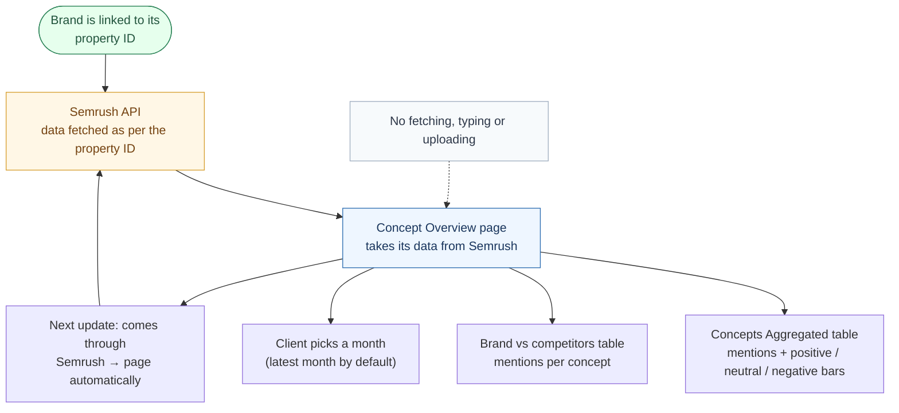

# Concept Overview Flow (Sentiment Overview)

> Written for the **Concept Overview** page (`/analytics/concept-overview`, `doc analytics/07-concept-overview.md`). "Sentiment Overview" and "Concept Overview" are the same page.

**Notation:** A **concept** = a topic AI models associate with the brand (for example manufacturing, certifications, ingredients). **Sentiment** = positive, neutral or negative. The **property ID** = the ID that links the brand to its data in Semrush.

**Goal:** the page shows which concepts AI models associate with the brand, how often, and with what sentiment. The page data comes directly from **Semrush**, using the **property ID** through the **Semrush API**. Nobody types in or uploads the data, and it keeps updating automatically.

## Purpose and Access

The page shows:

1. **Concepts Aggregated** for a chosen month: each concept, its mentions, and the positive / neutral / negative counts with bars.
2. A second table comparing how often each concept is mentioned for the brand versus its competitors.

The client can only view the page. The client cannot add or change any data.

## In short

1. The brand is linked to its Semrush property ID (once).
2. The data comes from Semrush straight to the page through the Semrush API.
3. The page updates automatically. The client picks a month to see.

## 1. Overall journey

## System rules

- The page data comes directly from **Semrush**, matched by the brand's **property ID**, through the **Semrush API**.
- The same source is used for the Citation Overview, the Reddit Overview and the Product Leaderboard.
- The data updates **automatically**. There is no manual add or upload.
- The client cannot add or change any data.
- The data is **brand scoped**.
- The month list comes from the data. The latest month is shown first.
- Zero values are shown as `0`. In the sampled brands and months, every negative value was 0.

## Data and Storage

| Data | Stored where | Notes |
|------|--------------|-------|
| Brand ↔ property ID | Brand setup | Set once per brand |
| Source data | Semrush, read through the Semrush API | Matched by property ID |
| Page data | Semrush, read through the Semrush API | Comes directly from Semrush |
| Concepts, mentions, sentiments, month list | `fetch-concept-data` (per the page docs) | `{}` for the latest month, `{ "month": "{YYYY-MM}" }` for another month |

## Runbook: Client

1. Open **Analytics → Concept Overview**.
2. Pick a month to see the concepts and their sentiment.

## Troubleshooting

| Situation | What to check |
|-----------|---------------|
| No concepts show | Check the property ID and that the prompts were given to Semrush. Then report it to the product team. |
| Negative column is empty | Every negative value is 0 for that month. This is a real result. |
| Someone wants to upload data | Not needed and not done. |

## Open points

| # | Question |
|---|----------|
| 1 | How often does the data update (the page is monthly)? |
