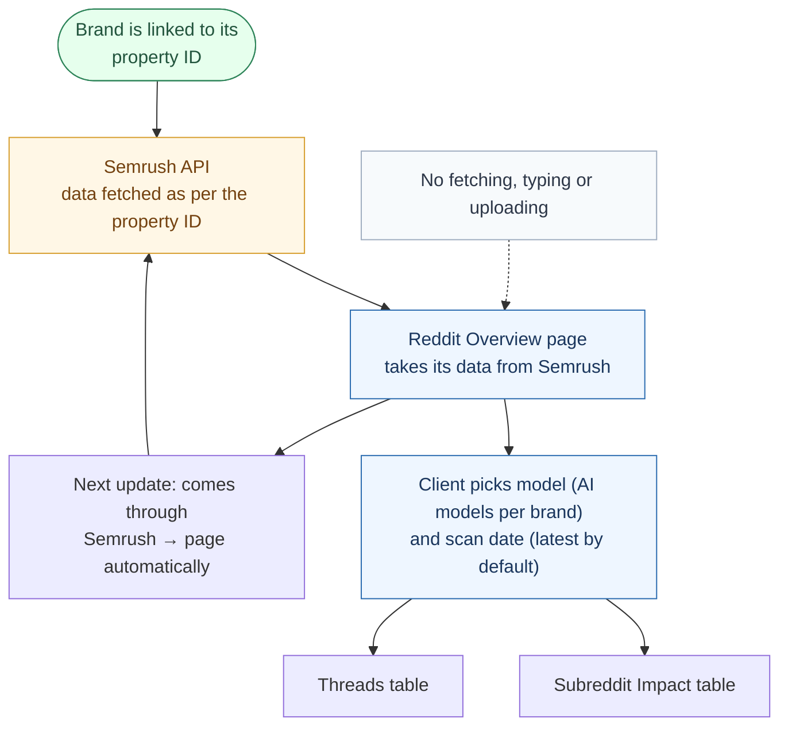

# Reddit Overview Flow

**Notation:** A **subreddit** = a Reddit community. A **thread** = one Reddit post. A **scan date** = the date a set of results belongs to. The **property ID** = the ID that links the brand to its data in Semrush.

**Goal:** the page shows which subreddits and threads AI models cite when answering the brand's prompts. The page data comes directly from **Semrush**, using the **property ID** through the **Semrush API**. Nobody types in or uploads the data. It updates automatically **every Saturday**.

## Purpose and Access

The page (`/analytics/reddit-overview`) has a model dropdown (one option per AI model enabled for the brand, e.g. ChatGPT, Gemini, Perplexity) and a scan-date dropdown, and two tables:

1. **Subreddit Impact:** prompts, visibility %, threads and citations per subreddit.
2. **Threads:** the cited threads, with their link, subreddit and number of prompts.

There is no AI insight line and no recommended actions on this page. The client can only view it.

## In short

1. The brand is linked to its Semrush property ID (once).
2. The data comes from Semrush through the Semrush API straight to the page.
3. The page updates automatically. The client chooses the model and scan date.

## 1. Overall journey

## System rules

- The page data comes directly from **Semrush**, matched by the brand's **property ID**, through the **Semrush API**.
- The same source is used for the Citation Overview, the Sentiment Overview and the Product Leaderboard.
- The data updates **automatically every Saturday**. There is no manual add or upload.
- The client cannot add or change any data.
- The data is **brand scoped**.
- The model and the scan date drive **both tables**. Available dates differ per model.
- **Visibility %** = the subreddit's share of all subreddit citations for that scan.
- A scan date with no subreddit data shows "No subreddit data available yet." in Subreddit Impact. The Threads table can still list rows for that date.

## Data and Storage

| Data | Stored where | Notes |
|------|--------------|-------|
| Brand ↔ property ID | Brand setup | Set once per brand |
| Source data | Semrush, read through the Semrush API | Matched by property ID |
| Page data | Semrush | Read through the Semrush API |
| Both tables and the date list | `fetch-reddit-overview` (per the page docs) | `{}` for the first enabled model and the latest date; model and date added when chosen |

Page details: `doc analytics/08-reddit-overview.md`.

## Runbook: Client

1. Open **Analytics → Reddit Overview**.
2. Choose a model and a scan date to see the subreddits and threads.

## Troubleshooting

| Situation | What to check |
|-----------|---------------|
| "No subreddit data available yet." | No subreddit data for that model and date. Try another date. If every date is empty, check the property ID. |
| One model has fewer dates | Available dates differ per model. |
| Someone wants to upload data | Not needed and not done. |
