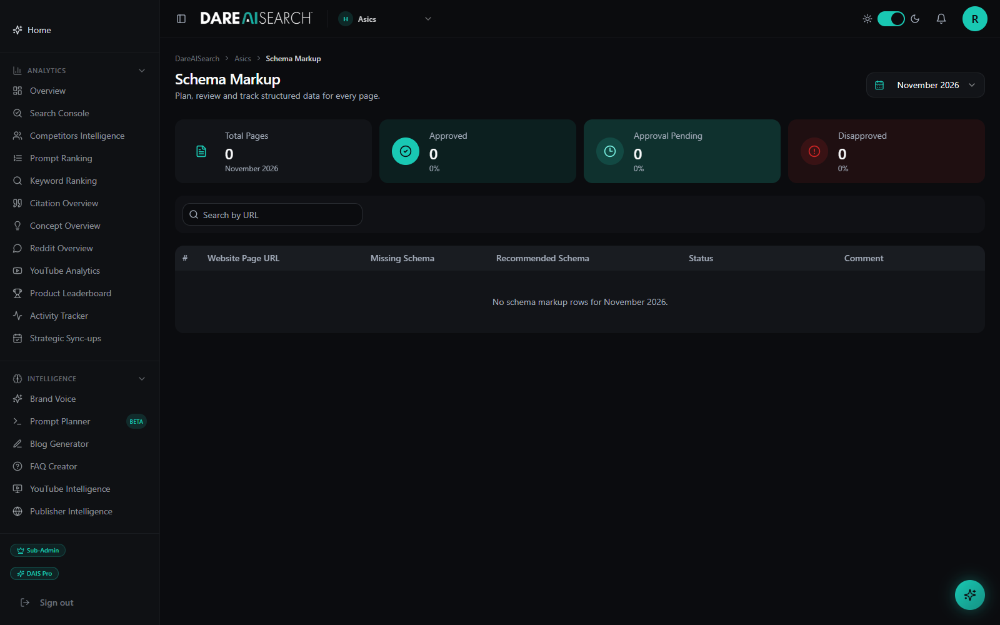
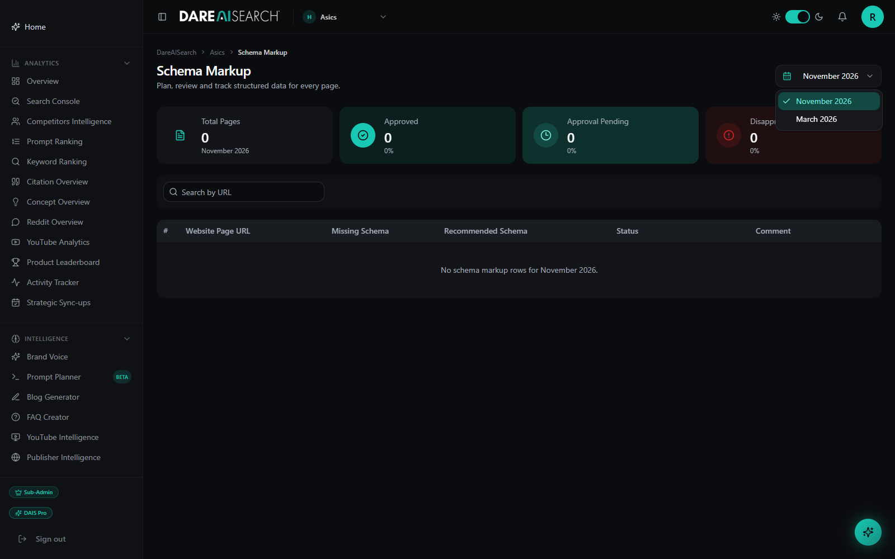
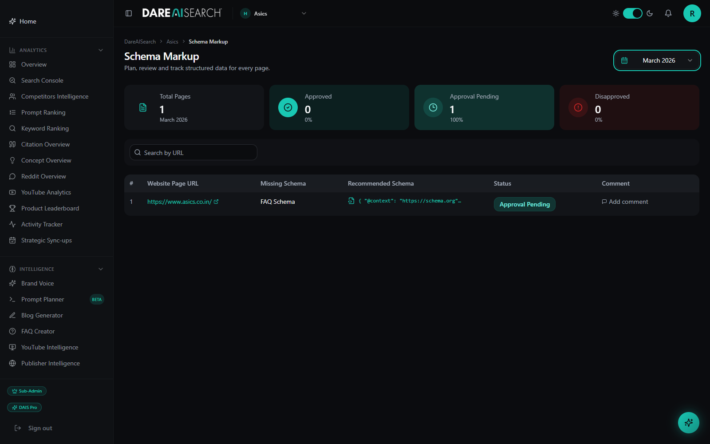
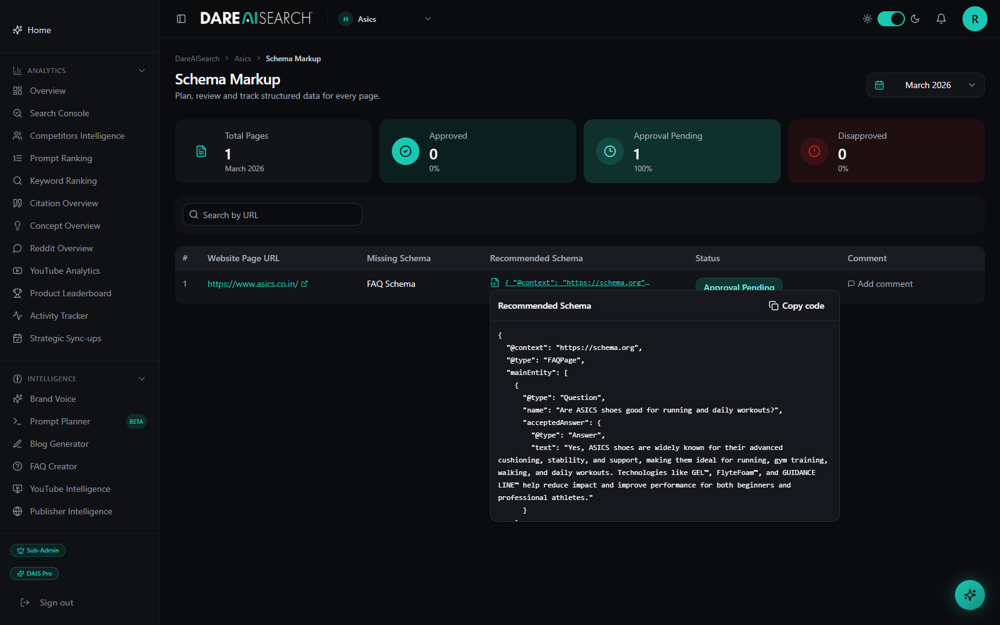
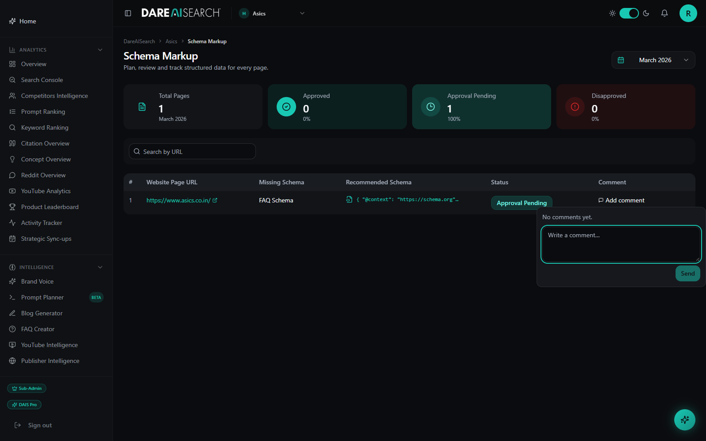
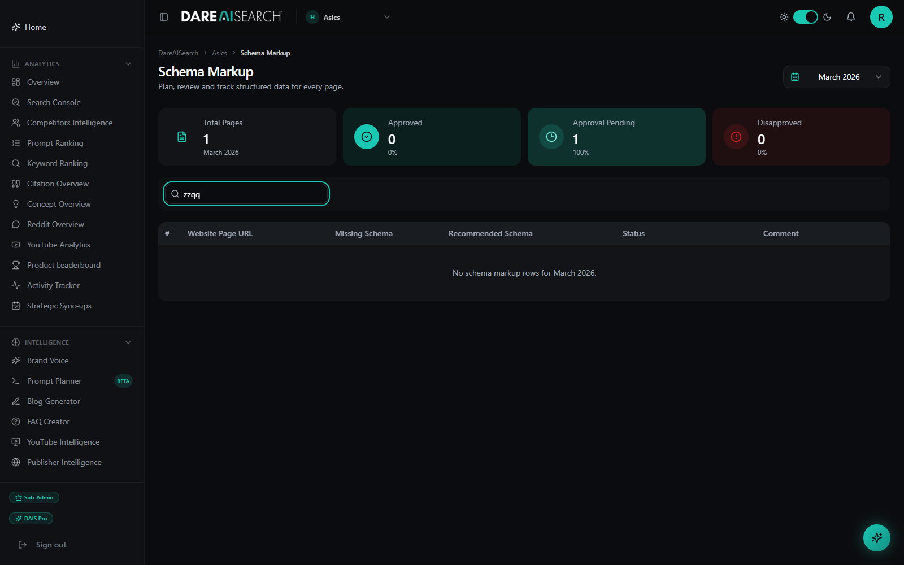

# Schema Markup

> Path in the platform: **Deployment → Owned Channels → Schema Markup** (`/execution/schema-markup`)

## 1. Overview

The **Schema Markup** page tracks the **structured data** (schema markup) planned for the pages of a brand's website. Schema markup is a block of code added to a page that tells search engines and AI search engines what the page contains (for example, a list of frequently asked questions).

The page subtitle reads: *"Plan, review and track structured data for every page."*

For each page, the table shows:

- Which schema type is **missing** on the page.
- The **recommended schema code** to add.
- The approval **status** of the recommendation.
- A **comment** thread for discussion.

## 2. Page Layout

From top to bottom:

| # | Section | What it shows |
|---|---------|---------------|
| 1 | **Breadcrumb** | `DareAISearch > {brand name} > Schema Markup`. |
| 2 | **Page header** | Title "Schema Markup" and the subtitle. |
| 3 | **Month selector** (top right) | Drop-down showing the selected month (default: current month, e.g. *November 2026*). |
| 4 | **Summary cards** (4) | Total Pages, Approved, Approval Pending, Disapproved. |
| 5 | **Search box** | "Search by URL". |
| 6 | **Table** | One row per page, with 6 columns. |
| 7 | **Empty state** | If nothing matches: "No schema markup rows for *Month Year*." |

The page has no Add, Edit, Delete or Upload buttons. Other items on screen belong to the platform shell: sidebar, brand switcher, theme toggle, notifications bell, user menu and the **Ask Miss Daring** floating button (not explored).

## 3. Features and Functionality

### 3.1 Month selector

- Choosing a month reloads the cards and table. It is a view filter only.

### 3.2 Summary cards

| Card | Shows |
|------|-------|
| **Total Pages** | Number of rows (pages) in the selected month. |
| **Approved** | Count of rows with Approved status and its percentage. |
| **Approval Pending** | Count of rows waiting for approval and its percentage. |
| **Disapproved** | Count of rows that were disapproved and its percentage. |

Example (March 2026): Total 1, Approved 0 (0%), Approval Pending 1 (100%), Disapproved 0 (0%).

### 3.3 Search by URL

- Type part of a page address to narrow the table. Example: searching `{brand name}` in March 2026 kept the 1 row.
- A search with no match shows "No schema markup rows for *Month Year*." Clearing the box restores the rows.
- The search works only on the page URL (the placeholder says "Search by URL").

### 3.4 Website Page URL link

The page address is a clickable link with an "open in new tab" icon. It opens the live page in a new tab.

### 3.5 View complete schema code

- In the **Recommended Schema** column, the schema is shown as a shortened line of code with a small code-file icon.
- Clicking it opens a panel titled **Recommended Schema** with the complete code, formatted over several lines.
- The panel has a **Copy code** button, which copies the code so it can be pasted into the website.
- Pressing **Esc** closes the panel. (I did not click Copy code.)
- **Open Document variant:** for some rows (for example, all 10 rows of Origin Nutrition in November 2026) the column does not show code. It shows an **Open Document** link with an "open in new tab" icon instead. The link opens an external **Google Doc** that holds the recommended schema. In this case there is no code panel or Copy code button on the page. The Google Doc itself was not opened or documented.

### 3.6 Add comment

- The **Comment** column shows an **Add comment** link with a speech-bubble icon.
- Clicking it opens a small comment box showing the existing comments (here: "No comments yet."), a text area labelled **Write a comment…** and a **Send** button.
- **Send** was not clicked, because it would add a real comment. Closing the box with Esc leaves nothing saved.

### 3.7 What is not available

The Status badge is plain text. It is not a button or drop-down, so status cannot be changed from this page. Clicking a row does nothing.

## 4. Data Fields and Columns

| Column | What it shows |
|--------|---------------|
| **#** | Row number. |
| **Website Page URL** | The page that needs the schema. Opens in a new tab. |
| **Missing Schema** | The type of schema missing on the page. Observed value: **FAQ Schema**. |
| **Recommended Schema** | The recommended schema code. Shown as a shortened line; click to see all of it. Some rows show an **Open Document** link to a Google Doc instead (see 3.5). |
| **Status** | Approval state, shown as a badge. |
| **Comment** | **Add comment** link that opens the comment box. |

Notes on the data:

- Data is organised by **month** and by **brand**.

## 5. Available Statuses

| Status | Meaning (from its name) | Seen in data? |
|--------|-------------------------|---------------|
| **Approval Pending** | The recommended schema is waiting for approval. | Yes (the only row) |
| **Approved** | The recommendation has been approved. | Summary card only; no row seen |
| **Disapproved** | The recommendation was not approved. | Summary card only; no row seen |

The meanings of Approved and Disapproved come from the card names, because no rows with those statuses were available.

## 6. User Workflow

1. Sign in and select the brand in the top bar.
2. In the sidebar, open **Deployment → Owned Channels → Schema Markup**.
3. Use the **month selector** to choose a month. The current month may be empty, so choose an earlier month that appears in the list.
4. Check the **summary cards** to see how many pages are approved, pending or disapproved.
5. Use **Search by URL** if you need to find a specific page.
6. Read the **Missing Schema** column to see which schema type the page lacks.
7. Click the code line in **Recommended Schema** to read the full code, and use **Copy code** if you need to copy it.
8. Click the **Website Page URL** to open the live page and check it.
9. Check the **Status** column. To discuss a row, click **Add comment**, write the comment and click **Send**.

## 7. Important Notes and Dependencies

- A **brand must be selected**. The page and its data are per brand and per month.
- The page is mostly **view-only**. The only action that adds anything is **Add comment** → **Send**.
- The month list contains only months with data plus the current month .
- Status changes (to Approved or Disapproved) cannot be made on this page.
- The recommended schema is **code**. Someone with access to the website must add it to the page. The platform does not do this from this page.
- Only one row existed, so behaviour for large lists, other schema types and other statuses was not seen.

## 8. Screenshots

| Screenshot | Description |
|------------|-------------|
|  | Empty state (November 2026) with summary cards and search box. |
|  | Month selector list. |
|  | March 2026 with one row. |
|  | Recommended Schema panel with the **Copy code** button. |
|  | Comment box with text area and **Send** button. |
|  | Search with no matching rows. |
