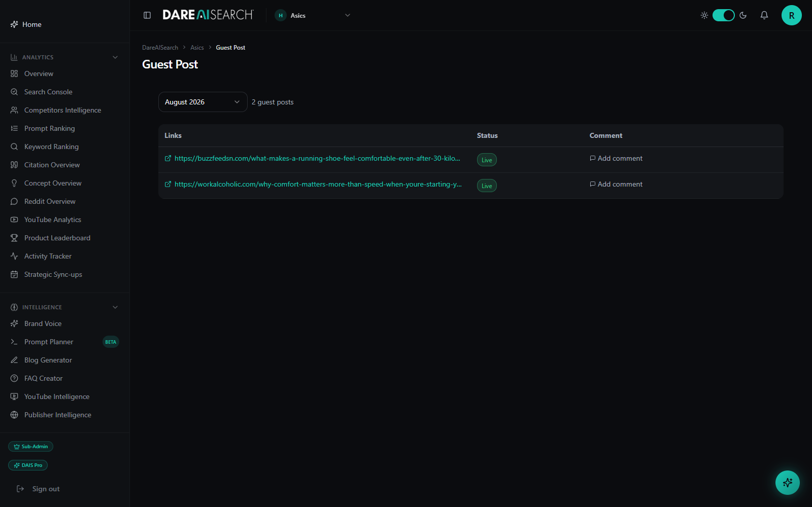
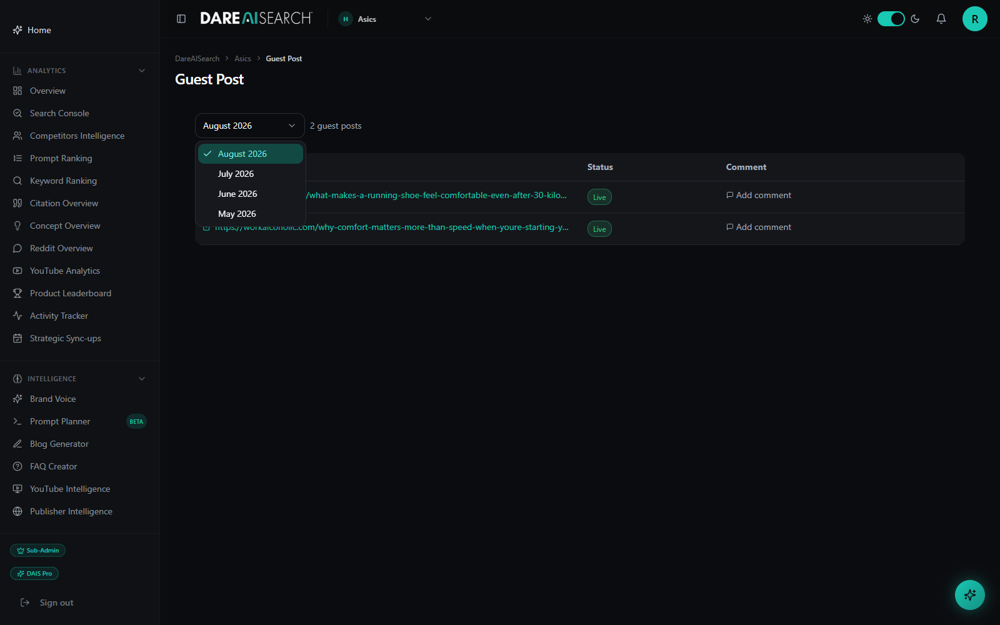
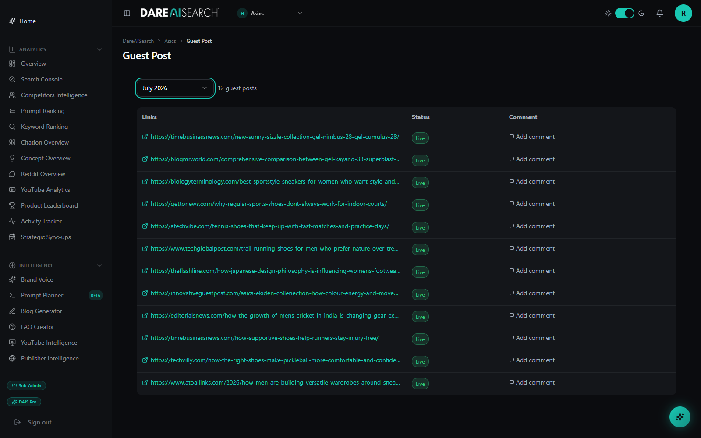
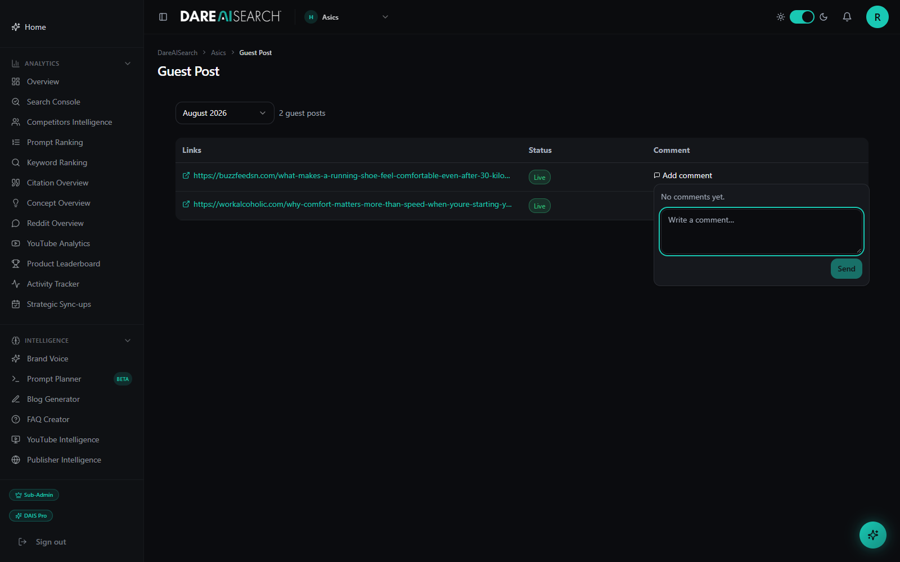

# Guest Post

> Path in the platform: **Deployment → Third Party Channels → Guest Post** (`/execution/guest-post`)
> In this document, **{brand name}** stands for the brand selected in the platform.
> Explored with a Sub-Admin account. Only observed behaviour is documented. Nothing was created, edited, deleted or submitted. No guest-post link was opened.
> The screenshots are unchanged and show the real brand name and real links.

## 1. Overview

The **Guest Post** page is a monthly list of **guest articles published for {brand name} on third-party websites** (such as blogs and publications). A guest post is an article placed on another website that can mention the brand and link back to its website. It helps search engines and AI search engines recognise the brand.

For each guest post, the page shows:

- The link to the article.
- Its status (for example **Live**).
- A comment link.

It helps the team see which guest posts were published each month and whether they are live, and lets users leave comments on them.

## 2. Page Layout

From top to bottom:

| # | Section | What it shows |
|---|---------|---------------|
| 1 | **Breadcrumb** | `DareAISearch > {brand name} > Guest Post`. |
| 2 | **Page header** | Title "Guest Post". There is no subtitle. |
| 3 | **Month selector** (left) | Drop-down showing the selected month. |
| 4 | **Count label** (next to the selector) | e.g. "2 guest posts". |
| 5 | **Table** | One row per guest post, with 3 columns: Links, Status, Comment. |

The page has no summary cards, search box, status filter or action buttons (no Add, Edit, Delete or Upload). Other items on screen belong to the platform shell: sidebar, brand switcher, theme toggle, notifications bell, user menu and the **Ask Miss Daring** floating button (not explored).

## 3. Features and Functionality

### 3.1 Month selector

- The list is short. It had only **four months**: **August 2026**, **July 2026**, **June 2026** and **May 2026**.
- The page opens on **August 2026**, the latest month with data. It does not open on the current calendar month.
- Choosing a month reloads the table and the count label. It is a view filter only.

### 3.2 Links

- Each row's link opens the article in a new tab. It has a small "open in new tab" icon in front of it.
- Long links are shortened with "…" in the table.
- I did not open any link.

### 3.3 Add comment

- Each row has an **Add comment** link with a speech-bubble icon.
- Clicking it opens a small box that lists existing comments (here: "No comments yet."), a text area labelled **Write a comment…** and a **Send** button.
- I did not click **Send**, because it would add a real comment. Closing the box with Esc leaves nothing saved.
- This is the same as on the Profile Citation page. On the Social Citation and Classified pages, the comment box is read-only.

### 3.4 What is not available

There is no search, no filter, no sorting and no paging. The status badge is plain text and cannot be changed here. Clicking a row does nothing.

## 4. Data Fields and Columns

| Column | What it shows |
|--------|---------------|
| **Links** | The address of the guest article. Opens in a new tab. |
| **Status** | A green badge showing the status of the post (observed: **Live**). |
| **Comment** | **Add comment** link that opens the comment box. |

How the data is organised:

- Data is grouped by **month** and by **brand**.
- Rows seen: May 2026: 8; June 2026: 8; July 2026: 12; August 2026: 2. Total 30 rows.
- Unlike the Social Citation and Classified pages, the lists **differ from month to month**. Some posts appear in more than one month: 5 posts appear in both June and July, and 1 post appears in both May and June. Altogether the 30 rows contain 24 different articles. The page does not explain the repeats.
- Each post is on a different third-party website (almost no site appears twice in the same month).
- The link addresses read like article titles about running and running shoes (for example, comfort for new runners). This is an observation only; the page does not state it.

## 5. Available Statuses

| Status | Look | Meaning (from its name) | Seen in data? |
|--------|------|-------------------------|---------------|
| **Live** | Green badge | The guest post is published and available online. | Yes, on all 30 rows |

Other statuses (for example Pending, as on the Profile Citation page) may exist, but none appeared here. The meaning of Live comes from its name; the page gives no explanation.

## 6. User Workflow

1. Sign in and select the brand in the top bar.
2. In the sidebar, open **Deployment → Third Party Channels → Guest Post**.
3. Read the count label to see how many guest posts are listed for the month shown.
4. Use the **month selector** to move between the four available months.
5. Check the **Status** of each row.
6. Click a **link** to open the article in a new tab and check it.
7. To leave a note on a row, click **Add comment**, write the comment and click **Send**.

## 7. Important Notes and Dependencies

- The page is **view-only**, apart from **Add comment** → **Send**, which adds a comment.
- Data is **per brand and per month**. Changing the brand in the top bar changes the list. The brand switcher lists more than one brand; only one was explored.
- The month list contains only months that have data (four months were available). The page opens on the latest of them.
- Guest posts are on **third-party websites**, which the platform does not control. A link may stop working if the site removes the article.
- Some posts appear in two months, so monthly counts should not be added together without checking for repeats.
- No existing comments were seen, so how comments are displayed once added is not documented.
- Status and approval changes cannot be made here.
- **Not tested**: opening the links, **Send**, other brands and the **Ask Miss Daring** button.

## 8. Screenshots

| Screenshot | Description |
|------------|-------------|
|  | Default view: month selector, count label and table (August 2026). |
|  | Month selector list (four months). |
|  | July 2026, the month with the most guest posts (12). |
|  | Comment box with text area and **Send** button. |
