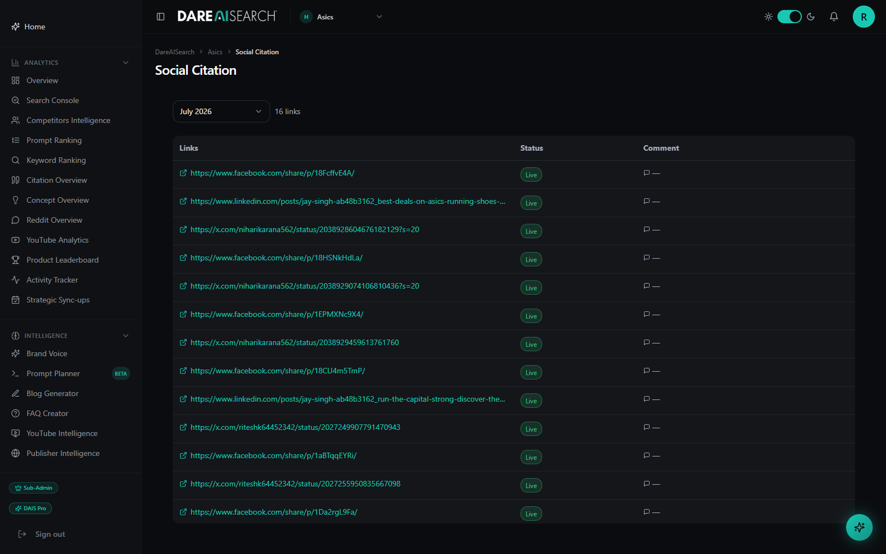
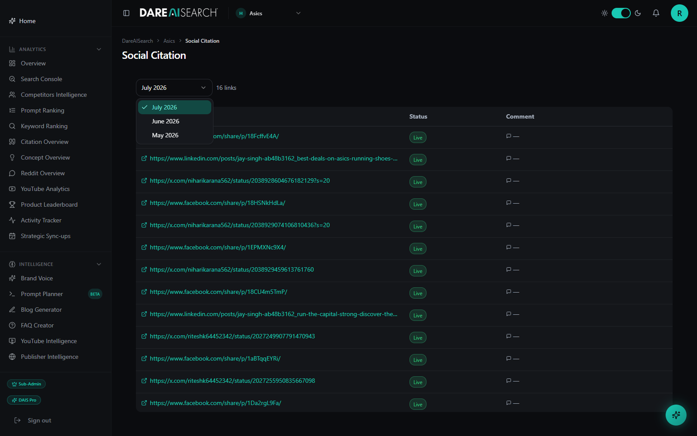
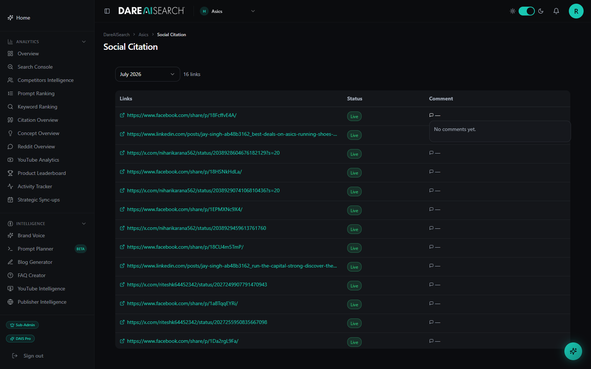

# Social Citation

> Path in the platform: **Deployment → Third Party Channels → Social Citation** (`/execution/social-citation`)
> In this document, **{brand name}** stands for the brand selected in the platform.
> Explored with a Sub-Admin account. Only observed behaviour is documented. Nothing was created, edited, deleted or submitted. No social media link was opened.
> The screenshots are unchanged and show the real brand name and real social media links.

## 1. Overview

The **Social Citation** page is a read-only monthly list of **social media posts that mention {brand name}**. Each post is a "citation": an online mention of the brand on a social platform that can help search engines and AI search engines recognise the brand.

For each citation, the page shows:

- The link to the social media post.
- Its status (for example **Live**).
- A comment button.

It helps the team see which social posts were published for the brand each month and whether they are live.

## 2. Page Layout

From top to bottom:

| # | Section | What it shows |
|---|---------|---------------|
| 1 | **Breadcrumb** | `DareAISearch > {brand name} > Social Citation`. |
| 2 | **Page header** | Title "Social Citation". There is no subtitle. |
| 3 | **Month selector** (left) | Drop-down showing the selected month. |
| 4 | **Count label** (next to the selector) | e.g. "16 links". |
| 5 | **Table** | One row per social post, with 3 columns: Links, Status, Comment. |

The page has no summary cards, search box, status filter or action buttons (no Add, Edit, Delete or Upload). Other items on screen belong to the platform shell: sidebar, brand switcher, theme toggle, notifications bell, user menu and the **Ask Miss Daring** floating button (not explored).

## 3. Features and Functionality

### 3.1 Month selector

- The list is short. It had only **three months**: **July 2026**, **June 2026** and **May 2026**.
- The page opens on **July 2026**, the latest month with data. It does not open on the current calendar month.
- Choosing a month reloads the table and the count label. It is a view filter only.

### 3.2 Links

- Each row's link opens the social media post in a new tab. It has a small "open in new tab" icon in front of it.
- Long links are shortened with "…" in the table.
- I did not open any link.

### 3.3 Comment button

- The **Comment** column shows a small speech-bubble icon followed by "—".
- Clicking it opens a small box that reads **No comments yet.** (observed on the first row).
- The box has **no text area and no Send button**, so comments cannot be written from this page. This is different from the Profile Citation page, which has an **Add comment** box with a Send button.
- I did not check whether other rows have existing comments.

### 3.4 What is not available

There is no search, no filter, no sorting and no paging. The status badge is plain text and cannot be changed here. Clicking a row does nothing.

## 4. Data Fields and Columns

| Column | What it shows |
|--------|---------------|
| **Links** | The address of the social media post. Opens in a new tab. |
| **Status** | A green badge showing the status of the post (observed: **Live**). |
| **Comment** | A comment button (icon and "—") that opens the comments box. |

How the data is organised:

- Data is grouped by **month** and by **brand**.
- Each of the three months shows **16 links**, and the list is **identical in all three months** (the same 16 posts appear in July, June and May 2026). The page does not explain why.
- The posts are spread over three social platforms:

| Platform (from the link) | Number of links |
|--------------------------|-----------------|
| Facebook | 7 |
| X (formerly Twitter) | 6 |
| LinkedIn | 3 |

- The posts appear to be published from individual user accounts (not a brand account), judging from the link addresses. This is an observation only; the page does not state it.

## 5. Available Statuses

| Status | Look | Meaning (from its name) | Seen in data? |
|--------|------|-------------------------|---------------|
| **Live** | Green badge | The social post is published and available online. | Yes, on all 16 rows in each month |

Other statuses (for example Pending, as on the Profile Citation page) may exist, but none appeared here. The meaning of Live comes from its name; the page gives no explanation.

## 6. User Workflow

1. Sign in and select the brand in the top bar.
2. In the sidebar, open **Deployment → Third Party Channels → Social Citation**.
3. Read the count label to see how many social links are listed for the month shown.
4. Use the **month selector** to move between the three available months.
5. Check the **Status** of each row.
6. Click a **link** to open the post in a new tab and check it.
7. Click the comment button on a row to see its comments (if any).

## 7. Important Notes and Dependencies

- The page is **view-only**. No control on it adds or changes data.
- Data is **per brand and per month**. Changing the brand in the top bar changes the list. The brand switcher lists more than one brand; only one was explored.
- The month list contains only months that have data (three months were available). The page opens on the latest of them.
- Posts live on **social platforms**, which the platform does not control. A link may stop working if a post is removed.
- The same 16 posts appear in every month seen, so counts across months should not be added together as new posts.
- No existing comments were seen, so how comments are displayed once added is not documented. Comments seem to be added elsewhere.
- **Not tested**: opening the links, other brands and the **Ask Miss Daring** button.

## 8. Screenshots

| Screenshot | Description |
|------------|-------------|
|  | Default view: month selector, count label and table (July 2026). |
|  | Month selector list (three months). |
|  | Comment box showing "No comments yet." with no text area or Send button. |
