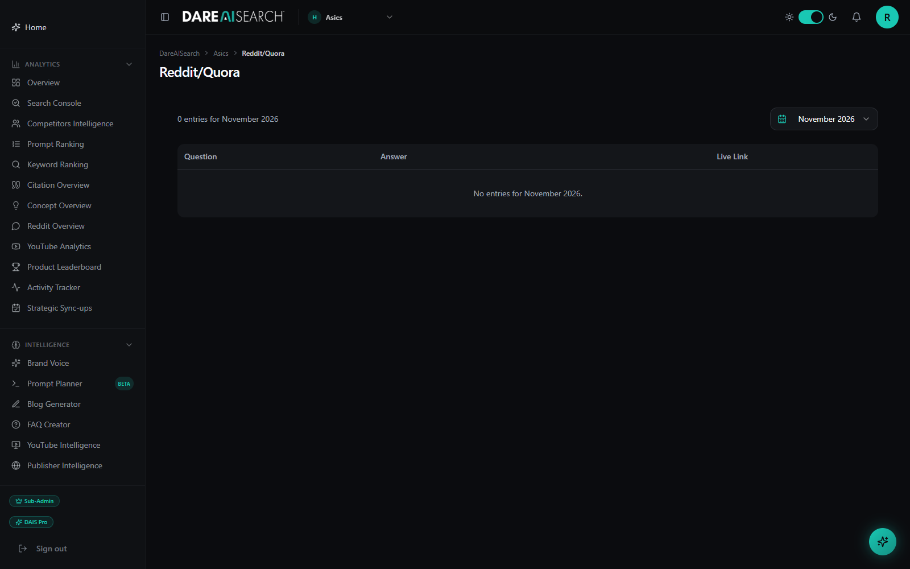
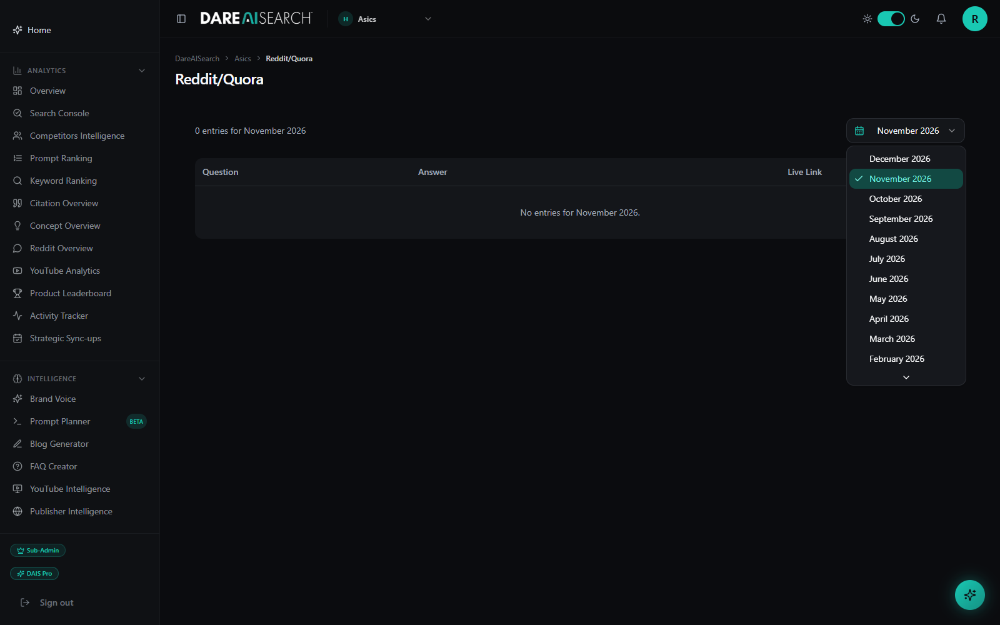
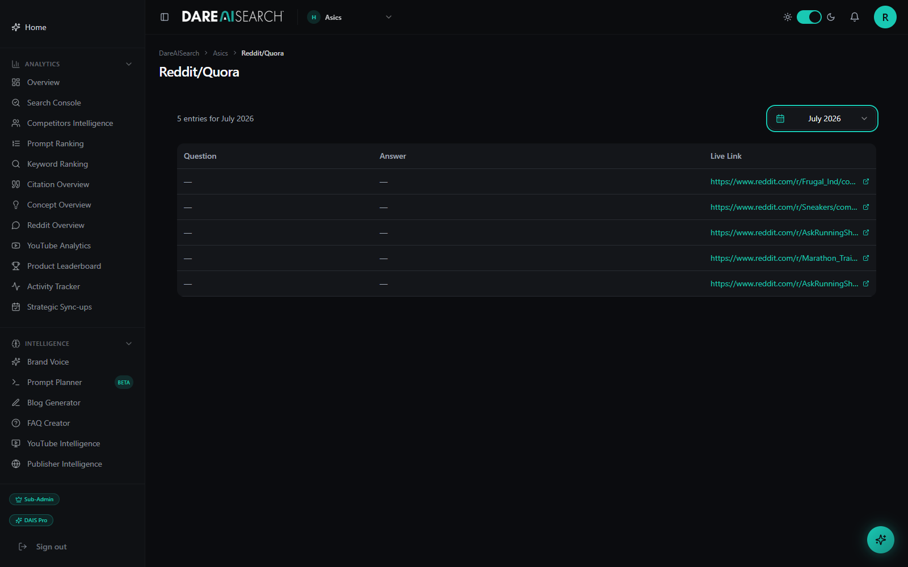
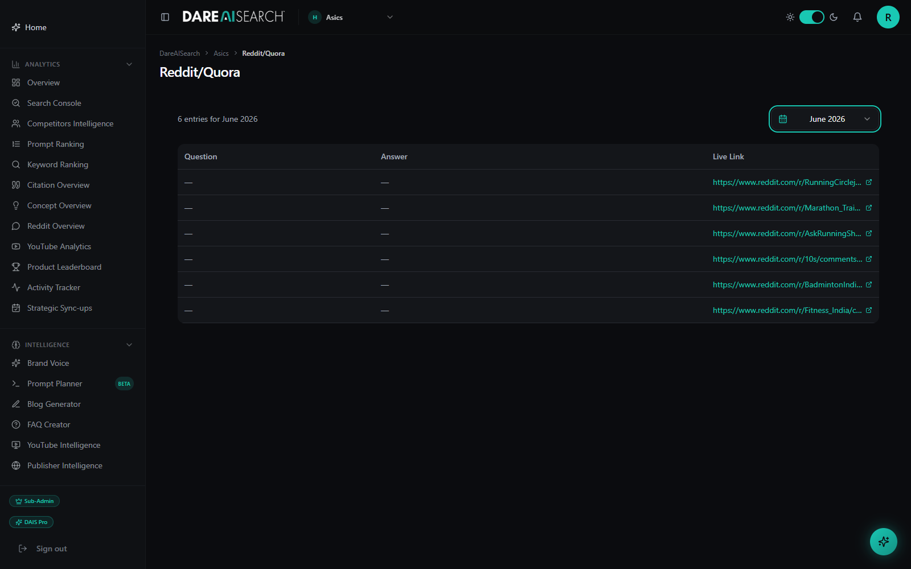

# Reddit/Quora

> Path in the platform: **Deployment → Third Party Channels → Reddit/Quora** (`/execution/reddit`)
> In this document, **{brand name}** stands for the brand selected in the platform.
> Explored with a Sub-Admin account. Only observed behaviour is documented. Nothing was created, edited, deleted or submitted. No link was opened.
> This is a different page from **Analytics → Reddit Overview**, which is not covered here.
> The screenshots are unchanged and show the real brand name and real links.

## 1. Overview

The **Reddit/Quora** page is a read-only monthly list of **question-and-answer discussions on Reddit and Quora** where {brand name} is part of the conversation. Each entry points to a live discussion thread. A thread can mention the brand and its products, which helps search engines and AI search engines recognise the brand.

For each entry, the page has three columns: the **question**, the **answer**, and the **live link** to the thread. It helps the team see which discussions were joined each month and where to find them.

## 2. Page Layout

From top to bottom:

| # | Section | What it shows |
|---|---------|---------------|
| 1 | **Breadcrumb** | `DareAISearch > {brand name} > Reddit/Quora`. |
| 2 | **Page header** | Title "Reddit/Quora". There is no subtitle. |
| 3 | **Count label** (left) | e.g. "5 entries for July 2026". |
| 4 | **Month selector** (right) | Drop-down showing the selected month. |
| 5 | **Table** | One row per entry, with 3 columns: Question, Answer, Live Link. |
| 6 | **Empty state** | If the month has no entries: "No entries for *Month Year*." |

The layout differs from the other third-party pages: the count label is on the left and the month selector is on the right, and there is no Status or Comment column. The page has no summary cards, search box, status filter or action buttons. Other items on screen belong to the platform shell: sidebar, brand switcher, theme toggle, notifications bell, user menu and the **Ask Miss Daring** floating button (not explored).

## 3. Features and Functionality

### 3.1 Month selector

- Lists 13 months, from **December 2026** back to **December 2025**.
- The page opens on the **current month** (November 2026), which was empty. Use the selector to move to a month with data.
- Choosing a month reloads the table and the count label. It is a view filter only.
- Months with entries (for the brand explored): **June 2026** (6 entries) and **July 2026** (5 entries). All other months were empty.

### 3.2 Live Link

- Each row's link opens the discussion thread in a new tab. It has a small "open in new tab" icon after the text.
- Long links are shortened with "…" in the table. The full address appears when you hover over the link.
- I did not open any link.

### 3.3 What is not available

- There is no search, no filter, no sorting and no paging.
- There is no **Status** column and no **Comment** column, so nothing on this page can be approved or commented on.
- Clicking a row or a Question or Answer cell does nothing.

## 4. Data Fields and Columns

| Column | What it shows | Observed |
|--------|---------------|----------|
| **Question** | The question asked in the discussion. | "—" (empty) on all 11 rows |
| **Answer** | The answer posted for {brand name}. | "—" (empty) on all 11 rows |
| **Live Link** | Link to the live discussion thread. | Filled on every row |

How the data is organised:

- Data is grouped by **month** and by **brand**.
- Rows seen: June 2026: 6; July 2026: 5. Total 11 rows.
- All 11 links point to **Reddit** discussions. No Quora link was seen.
- 2 links appear in both June and July, so the 11 rows contain **9 different threads**. The page does not explain the repeats.
- The thread addresses show they sit in running, shoe and sneaker communities. This is an observation only; the page does not state it.
- The Question and Answer columns were empty on every row. The only information that is filled in is the link.

## 5. Available Statuses

This page has **no status column**, so there are no statuses to list. The only status-like signal is that an entry has a **Live Link**, which suggests the thread is already live. The page does not state this.

## 6. User Workflow

1. Sign in and select the brand in the top bar.
2. In the sidebar, open **Deployment → Third Party Channels → Reddit/Quora**.
3. Check the count label. If it says "0 entries", use the **month selector** to choose another month.
4. Read the table. Check the **Question** and **Answer** columns when they are filled.
5. Click a **Live Link** to open the discussion in a new tab and check it.

## 7. Important Notes and Dependencies

- The page is **fully view-only**: it has no buttons that add or change data.
- Data is **per brand and per month**. Changing the brand in the top bar changes the list. The brand switcher lists more than one brand; only one was explored.
- The page opens on the current month, which may be empty. The month selector includes months with no data and one future month (December 2026).
- Threads are on **Reddit**, which the platform does not control. A link may stop working if a thread or comment is removed.
- Because Question and Answer were empty on all rows, how they look when filled is not documented.
- Two links repeat across months, so monthly counts should not be added together without checking for repeats.
- **Not tested**: opening the links, other brands and the **Ask Miss Daring** button.

## 8. Screenshots

| Screenshot | Description |
|------------|-------------|
|  | Default view: empty current month (November 2026) with column headings. |
|  | Month selector list (13 months). |
|  | July 2026: 5 entries with empty Question and Answer cells and filled Live Links. |
|  | June 2026: 6 entries. |
