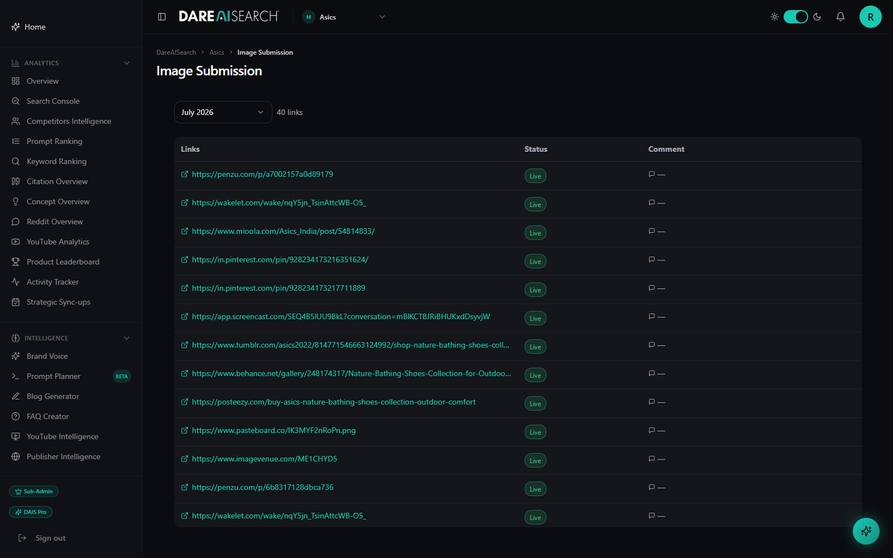
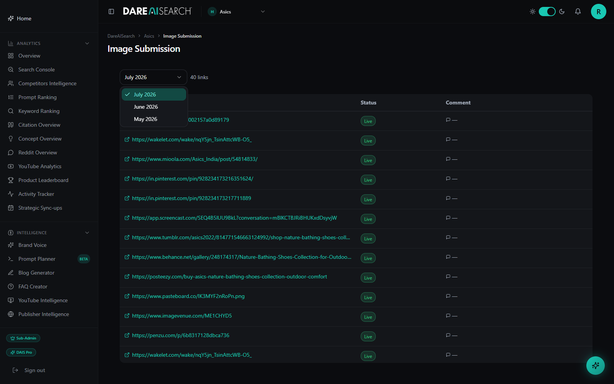
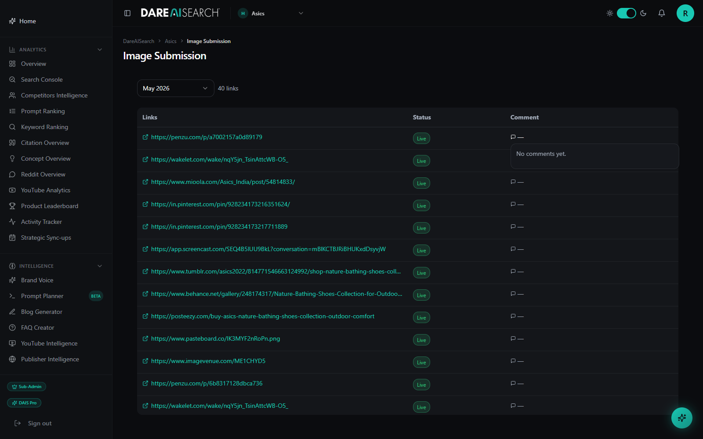
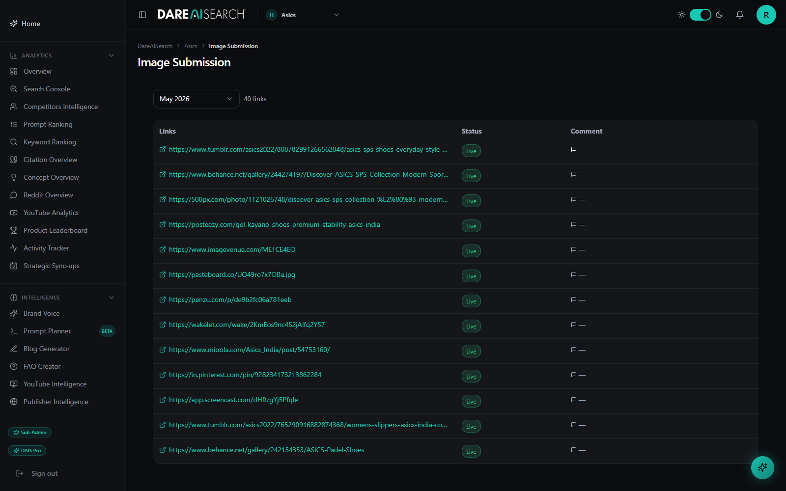

# Image Submission

> Path in the platform: **Deployment → Third Party Channels → Image Submission** (`/execution/image-submission`)
> In this document, **{brand name}** stands for the brand selected in the platform.
> Explored with a Sub-Admin account. Only observed behaviour is documented. Nothing was created, edited, deleted or submitted. No link was opened.
> The screenshots are unchanged and show the real brand name and real links.

## 1. Overview

The **Image Submission** page is a read-only monthly list of **images and image-based posts submitted for {brand name} to third-party image-sharing and content-sharing websites**. Each submission is a "citation": an online mention of the brand (for example, a product image with a description) that can link back to its website and help search engines and AI search engines recognise the brand.

For each submission, the page shows:

- The link to the submitted item.
- Its status (for example **Live**).
- A comment button.

It helps the team see which image submissions were made each month and whether they are live.

## 2. Page Layout

From top to bottom:

| # | Section | What it shows |
|---|---------|---------------|
| 1 | **Breadcrumb** | `DareAISearch > {brand name} > Image Submission`. |
| 2 | **Page header** | Title "Image Submission". There is no subtitle. |
| 3 | **Month selector** (left) | Drop-down showing the selected month. |
| 4 | **Count label** (next to the selector) | e.g. "40 links". |
| 5 | **Table** | One row per submission, with 3 columns: Links, Status, Comment. |

The page has no summary cards, search box, status filter or action buttons (no Add, Edit, Delete, Upload or Download). The page lists links only; it does not show image previews. Other items on screen belong to the platform shell: sidebar, brand switcher, theme toggle, notifications bell, user menu and the **Ask Miss Daring** floating button (not explored).

## 3. Features and Functionality

### 3.1 Month selector

- The list is short. It had only **three months**: **July 2026**, **June 2026** and **May 2026**.
- The page opens on **July 2026**, the latest month with data. It does not open on the current calendar month.
- Choosing a month reloads the table and the count label. It is a view filter only.

### 3.2 Links

- Each row's link opens the submitted item in a new tab. It has a small "open in new tab" icon in front of it.
- Long links are shortened with "…" in the table.
- I did not open any link.

### 3.3 Comment button

- The **Comment** column shows a small speech-bubble icon followed by "—".
- Clicking it opens a small box that reads **No comments yet.** (observed on the first row).
- The box has **no text area and no Send button**, so comments cannot be written from this page. This is the same as on the Social Citation and Classified pages, and different from the Profile Citation, Guest Post and Web 2.0 pages.
- I did not check whether other rows have existing comments.

### 3.4 Long list

All rows for the month are shown on one page. There is no paging, no "load more" button and no search. Scroll down the page to see the full list (40 rows in each month).

### 3.5 What is not available

There is no search, no filter and no sorting. The status badge is plain text and cannot be changed here. Clicking a row does nothing.

## 4. Data Fields and Columns

| Column | What it shows |
|--------|---------------|
| **Links** | The address of the submitted item on a third-party site. Opens in a new tab. |
| **Status** | A green badge showing the status of the submission (observed: **Live**). |
| **Comment** | A comment button (icon and "—") that opens the comments box. |

How the data is organised:

- Data is grouped by **month** and by **brand**.
- Each of the three months shows **40 links**, and the list is **identical in all three months** (the same 40 rows appear in July, June and May 2026). The page does not explain why.
- Within one month, **37 of the 40 links are different**. The other 3 rows repeat a link that is already in the list.
- The links are spread over **11 different third-party websites**. Most sites have 3 or 4 links each, one has 5 and one has 2.
- The sites are of the kind used for sharing images, photo boards, notes and short posts. This is an observation from the link addresses only.
- The link addresses suggest the submissions are about the brand's products (for example, a shoe collection). The page does not state this.

## 5. Available Statuses

| Status | Look | Meaning (from its name) | Seen in data? |
|--------|------|-------------------------|---------------|
| **Live** | Green badge | The submission is published and available online. | Yes, on all 40 rows in each month |

Other statuses (for example Pending, as on the Profile Citation page) may exist, but none appeared here. The meaning of Live comes from its name; the page gives no explanation.

## 6. User Workflow

1. Sign in and select the brand in the top bar.
2. In the sidebar, open **Deployment → Third Party Channels → Image Submission**.
3. Read the count label to see how many links are shown for the month.
4. Use the **month selector** to move between the three available months.
5. Scroll down to see all rows and check the **Status** of each.
6. Click a **link** to open the submission in a new tab and check it.
7. Click the comment button on a row to see its comments (if any).

## 7. Important Notes and Dependencies

- The page is **view-only**. No control on it adds or changes data.
- Data is **per brand and per month**. Changing the brand in the top bar changes the list. The brand switcher lists more than one brand; only one was explored.
- The month list contains only months that have data (three months were available). The page opens on the latest of them.
- Submissions are on **third-party websites**, which the platform does not control. A link may stop working if an item is removed.
- The same 40 rows appear in every month seen, so counts across months should not be added together as new submissions. Three rows in each month repeat a link.
- The page lists links only. To see the images themselves, you must open the links.
- No existing comments were seen, so how comments are displayed once added is not documented. Comments seem to be added elsewhere.
- **Not tested**: opening the links, other brands and the **Ask Miss Daring** button.

## 8. Screenshots

| Screenshot | Description |
|------------|-------------|
|  | Default view: month selector, count label and table (July 2026). |
|  | Month selector list (three months). |
|  | Comment box showing "No comments yet." with no text area or Send button. |
|  | Bottom of the list, showing that all rows are on one page. |
