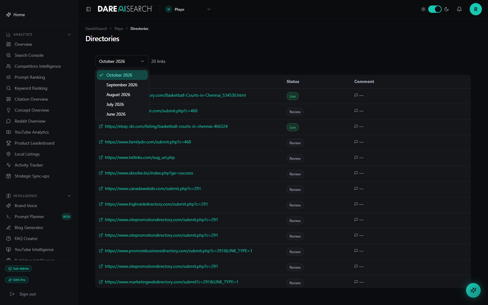
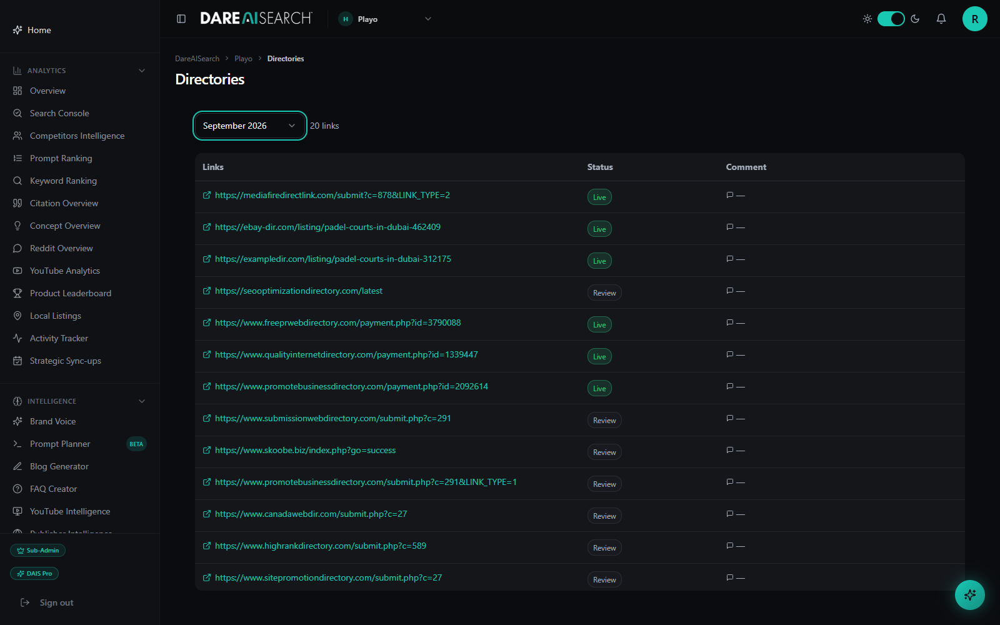
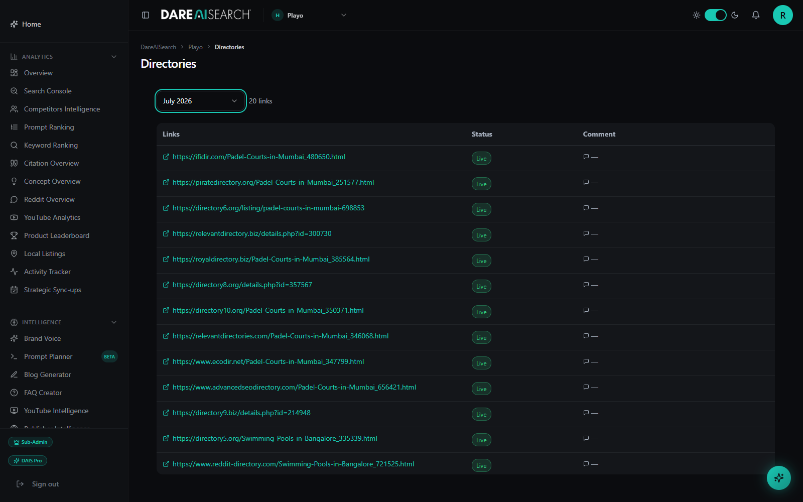
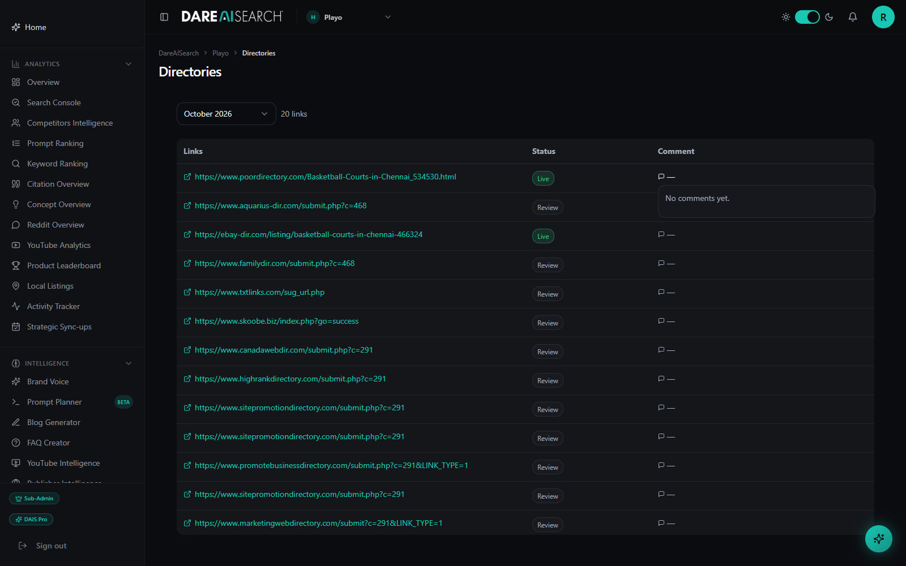
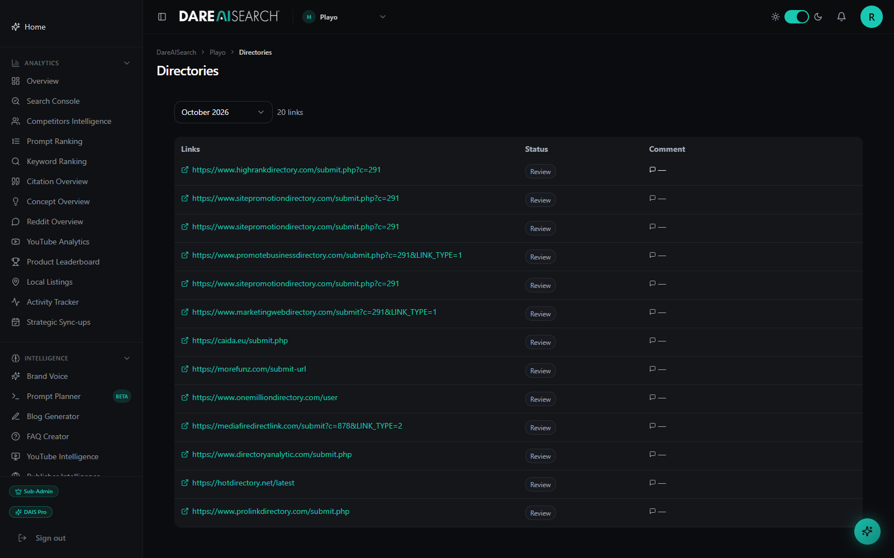

# Directories

> Path in the platform: **Deployment → Third Party Channels → Directories** (`/execution/directories`)
> In this document, **{brand name}** stands for the brand selected in the platform.
> **This page is not in every brand's sidebar.** It is listed for some brands (for example Origin Nutrition) and not for others (for example Asics). The data described here was seen on the brand **Playo**. Dorset also has data. Asics, Origin Nutrition and Herbal Chakra show an empty page ("No ... yet") for the current month.
> Explored with a Sub-Admin account. Only observed behaviour is documented. Nothing was created, edited, deleted or submitted. No link was opened.
> The screenshots are unchanged and show the real brand name and real links.

## 1. Overview

The **Directories** page is a read-only monthly list of **business-directory websites where {brand name} has been listed or submitted for listing**. A directory listing is an online mention of the brand (name, category and a link to its website) that can help search engines and AI search engines recognise the brand.

For each directory, the page shows:

- The link to the directory page.
- Its status (**Live** or **Review**).
- A comment button.

It helps the team see which directory listings were completed each month and which are still in progress.

## 2. Page Layout

From top to bottom:

| # | Section | What it shows |
|---|---------|---------------|
| 1 | **Breadcrumb** | `DareAISearch > {brand name} > Directories`. |
| 2 | **Page header** | Title "Directories". There is no subtitle. |
| 3 | **Month selector** (left) | Drop-down showing the selected month. |
| 4 | **Count label** (next to the selector) | e.g. "20 links". |
| 5 | **Table** | One row per directory link, with 3 columns: Links, Status, Comment. |

The page has no summary cards, search box, status filter or action buttons (no Add, Edit, Delete or Upload). Other items on screen belong to the platform shell: sidebar, brand switcher, theme toggle, notifications bell, user menu and the **Ask Miss Daring** floating button (not explored).

## 3. Features and Functionality

### 3.1 Month selector

- The list is short. It had only **five months**: **October 2026**, **September 2026**, **August 2026**, **July 2026** and **June 2026**.
- The page opens on **October 2026**, the latest month with data. It does not open on the current calendar month.
- Choosing a month reloads the table and the count label. It is a view filter only.

### 3.2 Links

- Each row's link opens the directory page in a new tab. It has a small "open in new tab" icon in front of it.
- Long links are shortened with "…" in the table.
- I did not open any link.

### 3.3 Comment button

- The **Comment** column shows a small speech-bubble icon followed by "—".
- Clicking it opens a small box that reads **No comments yet.** (observed on the first row).
- The box has **no text area and no Send button**, so comments cannot be written from this page. This is the same as on the Social Citation, Classified, Image Submission and PPT/PDF Submission pages.
- I did not check whether other rows have existing comments.

### 3.4 Long list

All rows for the month are shown on one page. There is no paging, no "load more" button and no search. Scroll down to see the full list (20 rows in each month).

### 3.5 What is not available

There is no search, no filter and no sorting. The status badge is plain text and cannot be changed here. Clicking a row does nothing.

## 4. Data Fields and Columns

| Column | What it shows |
|--------|---------------|
| **Links** | The address of a page on a directory website. Opens in a new tab. |
| **Status** | A badge showing the state of the listing (**Live** in green or **Review** in grey). |
| **Comment** | A comment button (icon and "—") that opens the comments box. |

How the data is organised:

- Data is grouped by **month** and by **brand**.
- Every month shows **20 links**. Counts by status:

| Month | Live | Review | Different links | Note |
|-------|------|--------|-----------------|------|
| October 2026 | 2 | 18 | 18 | 2 links repeat |
| September 2026 | 7 | 13 | 20 | |
| August 2026 | 19 | 1 | 20 | |
| July 2026 | 20 | 0 | 20 | |
| June 2026 | 20 | 0 | 19 | 1 link repeats |

- Each month's links are on different directory websites (nearly one link per site).
- The months mostly contain **different links**. Only **6 links** appear in both October and September 2026. Other months share none.
- Observation from the link addresses: rows marked **Live** usually point to the actual listing page of the brand. Rows marked **Review** (17 of 18 in October) usually point to a directory's "submit" or sign-up page. The page does not state this.

## 5. Available Statuses

| Status | Look | Meaning (inferred) | Seen in data? |
|--------|------|--------------------|---------------|
| **Live** | Green badge | The listing is published and available on the directory. | Yes (68 of 100 rows) |
| **Review** | Grey badge | The listing has been submitted and is not yet live, so it appears to be waiting for review or approval. | Yes (32 of 100 rows) |

The meanings come from the names and the link patterns. The page gives no explanation. Other statuses may exist but did not appear.

## 6. User Workflow

1. Sign in and select the brand in the top bar. (Check that **Directories** appears in the sidebar for that brand.)
2. In the sidebar, open **Deployment → Third Party Channels → Directories**.
3. Read the count label to see how many links are shown for the month.
4. Use the **month selector** to move between the five available months.
5. Scroll down to see all rows. Check the **Status**: **Live** means the listing is done; **Review** means it is still in progress.
6. Click a **link** to open the directory page in a new tab and check it.
7. Click the comment button on a row to see its comments (if any).

## 7. Important Notes and Dependencies

- The page is **view-only**. No control on it adds or changes data.
- The page is **brand-specific**: it is available in the sidebar for some brands only.
- Data is **per brand and per month**. Changing the brand in the top bar changes the list.
- The month list contains only months that have data (five months were available). The page opens on the latest of them.
- Directory sites are **third-party websites**, which the platform does not control. A listing may be rejected, removed or take time to appear.
- The status changes over time. Earlier months are mostly **Live**, the latest month is mostly **Review**.
- A few links repeat within a month (for example a directory's submit page may appear more than once).
- No existing comments were seen, so how comments are displayed once added is not documented.
- **Not tested**: opening the links, other brands and the **Ask Miss Daring** button.

## 8. Screenshots

| Screenshot | Description |
|------------|-------------|
|  | Default view: month selector, count label and table with Live and Review rows (October 2026). |
|  | Month selector list (five months). |
|  | September 2026, a month with a mix of Live and Review rows. |
|  | July 2026, a month where every row is Live. |
|  | Comment box showing "No comments yet." with no text area or Send button. |
|  | Bottom of the list, showing that all rows are on one page. |
