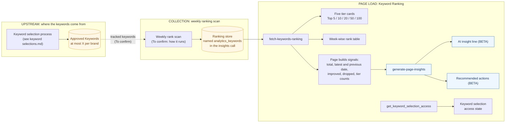
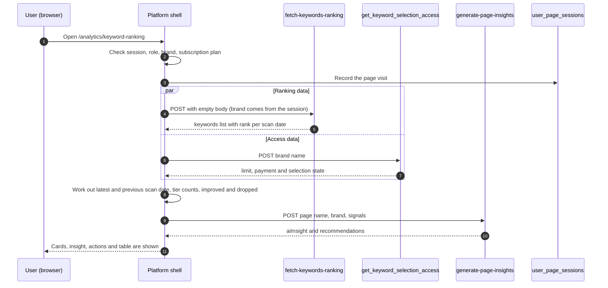
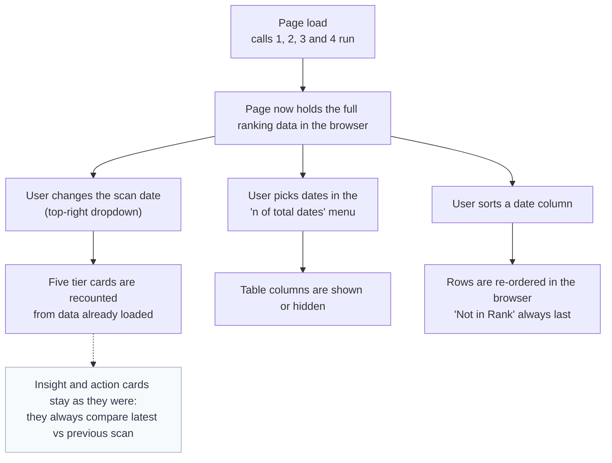

# Flow: Analytics → Keyword Ranking (Data Flow)

> Page: **Analytics → Keyword Ranking** (`/analytics/keyword-ranking`). For the screen layout, tooltips and every on-screen label, see [doc analytics/05-keyword-ranking.md](doc%20analytics/05-keyword-ranking.md). This document explains only **how the data moves**: where it comes from, which calls the page makes, what each call returns, and which user action changes which block.
>
> **How this was checked:** the page was opened in the live app (internal Admin account) and its network calls were recorded for three moments: page load, changing the scan date, and sorting the table. Values below are placeholders such as `{n}` and `{D Month YYYY}`. Items marked **To confirm** were not visible from the browser (back-end internals).

---

## 1. The big picture

The page shows one thing: **how the brand's tracked keywords rank, week by week.** Three kinds of data feed it:

| Data | What it is | Real or generated |
|------|-----------|-------------------|
| **Ranking data** | For each tracked keyword, its rank on each weekly scan date | Real data |
| **Access / eligibility data** | Brand limit, payment and keyword-selection state | Real data |
| **Insight and actions** | One AI sentence and 2 to 3 action cards | **Generated** on each load |

---

## 2. What happens when the page opens

Order that matters: the insight and action cards are requested **after** the ranking data is back, because they are built from it.

---

## 3. The calls and what they carry

| # | Call | Sent | Returned | Used for |
|---|------|------|----------|----------|
| 1 | `POST fetch-keywords-ranking` | Empty body `{}`. The brand is taken from the logged-in session. | `{ "keywords": [ { "keyword": "{text}", "rankings": { "{D Month YYYY}": "{rank}" , … } }, … ] }` | Tier cards, scan-date list, week-wise table |
| 2 | `POST rpc/get_keyword_selection_access` | `{ "_brand_name": "{Brand}" }` | One row: `brand_id`, `brand_name`, `max_keywords`, `access_role`, `is_paid`, `questionnaire_completed`, `has_proposal_rows`, `has_ranking_rows`, `eligible`, `keywords_finalized` | Keyword-selection permission and state (see section 6) |
| 3 | `POST generate-page-insights` | `page`, `brand`, `source`, `signals` (see section 4) | `aiInsight` (one sentence) and `recommendations` (list) | Insight line and Recommended Actions |
| 4 | `POST user_page_sessions` | User id, `page_path`, `page_label` | Created row | Usage tracking only |

Shell calls (roles, profile, subscription plan, notifications) run on every page and are not specific to this one.

### 3.1 Shape of the ranking data (call 1)

- One entry per **tracked keyword**.
- Inside each entry, `rankings` is a map: **scan date → rank text**.
- A rank is the position as text (for example `"23"`). A keyword that does not rank has the text **`Not in Rank`**. The screen shows this as **-**.
- The dates in the map are **not in order**. The page sorts them (newest first).
- The scan dates on screen come from these maps. There is no separate "dates" call. One scan date is one week.
- The number of keyword entries is the **total tracked keywords** used in the insight text.

---

## 4. How the page builds the insight request (call 3)

After the ranking data arrives, the page works out these **signals** and sends them. Nothing else about the brand is sent.

| Signal | How it is worked out |
|--------|----------------------|
| `total_tracked_keywords` | Number of keyword entries returned by call 1 |
| `latest_date` and `previous_date` | The two most recent scan dates in the data |
| `improved_keywords_count` | Keywords whose rank is **better** on the latest scan than on the previous scan |
| `dropped_keywords_count` | Keywords whose rank is **worse** on the latest scan than on the previous scan |
| `position_buckets` | For each tier: `latest` count, `previous` count and `delta_pct` |

Observed tiers in the signals: **Top 3, Top 5, Top 10, Top 20, Top 100**. The Top 3 values were empty (`null`). **Top 50 is not in the signals**, although the screen has a Top 50 card.

The reply has:

- `aiInsight`: one sentence, shown in the insight line.
- `recommendations`: a list of items, each with `category` (Visibility, Growth or Risk), `title`, `explanation`, `action` and `priority` (High, Medium or Low). They become the Recommended Action cards.

The wording is generated each load, so the same data can give different sentences and a different number of cards.

---

## 5. What each user action does to the data

| Action | New network call? | What changes | What does **not** change |
|--------|-------------------|--------------|--------------------------|
| Change the scan date | **None seen** in the recording | The five tier cards (value and "as of" date) | Insight line, action cards, table |
| Pick dates in the "n of total dates" menu | None | Which date columns show in the table | Cards, insight, actions |
| Sort a date column | None | Row order only | Everything else |

**Tier counting rule:** a keyword counts in a tier when its rank on the chosen date is a number within positions 1 to the tier limit. `Not in Rank` counts in no tier. Tiers are cumulative (Top 5 ≤ Top 10 ≤ … ≤ Top 100 ≤ total).

---

## 6. Link to the keyword selection process

The access call (call 2) is where this page meets the process described in [keyword selections.md](keyword%20selections.md).

| Field returned | What it appears to mean | Link to keyword selection |
|----------------|-------------------------|---------------------------|
| `max_keywords` | The keyword limit for the brand | This is **X**, the package limit (one brand observed: 75) |
| `is_paid` | Whether the client has paid | The **payment-first** rule: the client sees the keyword selection only after payment |
| `has_proposal_rows` | Whether the SEO team has given suggestions | **Stage 1** has started |
| `keywords_finalized` | Whether the keyword selection is finished | Process **Completed** (X unique approved keywords) |
| `questionnaire_completed` | Whether the brand questionnaire is done | A step before suggestions (not part of the keyword flow) |
| `has_ranking_rows` | Whether ranking data exists for the brand | This page has something to show |
| `eligible` | Whether the brand may use keyword selection | Combines the checks above (**To confirm** the exact rule) |
| `access_role` | The role for this brand (observed: `brand`) | Decides who can act on keyword selection |

Reading in plain words: **approved keywords from the selection process are the keywords that get tracked here.** The ranking page only reads what was tracked. It never adds, removes or approves keywords.

> The brand used for the recording showed `is_paid: false` and `keywords_finalized: false` but still had `has_ranking_rows: true` and a 4 of 20 ranking. So ranking data can exist while the selection state shows as unfinished. **To confirm** with the product team whether this is expected.

---

## 7. Rules

- **Read-only page.** It has no add, edit, delete or upload. Data only flows **in** to the screen.
- **Brand scoped.** The brand comes from the session. The ranking call takes no brand in its body.
- **Weekly cadence.** One scan date per week. Dates come from the data, not from a calendar.
- **Latest vs previous.** The insight and action cards always use the two latest scans, whatever scan date is chosen at the top.
- **Generated content is not stored by the page.** It is requested on each load. It can differ between loads.
- **Unranked keywords** are shown as **-** and stay at the bottom when sorting.

---

## 8. To confirm (not visible from the browser)

| # | Question | Why it matters |
|---|----------|----------------|
| 1 | What runs the weekly rank scan, and is it automatic or manual? | The start of the data flow |
| 2 | Is the ranking store really the table named `analytics_keywords`? The insight call names it as its source. | Name of the data source |
| 3 | Are the tracked keywords exactly the Approved Keywords from keyword selection, or a separate list? | Link between the two flows |
| 4 | Does a missing scan week appear as an empty column, or is it left out? | Gaps in the table |
| 5 | Why is the Top 50 tier left out of the insight signals? | Cards and insights can disagree on tiers |
| 6 | Does changing the scan date ever trigger a new insights call? The existing page doc says it does, but no call was seen in this recording. | Keeps the two docs consistent |
| 7 | Which other pages reuse this data (Overview, Activity Tracker, Strategic Sync-ups, Reports)? | Downstream part of the flow, not checked |
| 8 | What is the exact rule for `eligible`? | Access rule |
