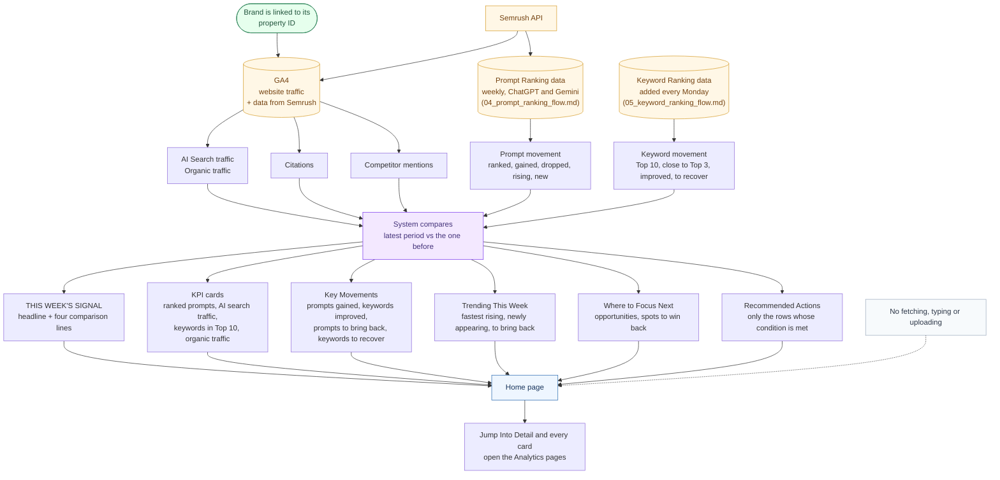
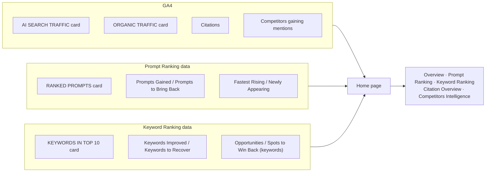

# Home Flow

> Written for the **Home** page (`/brand-pulse`, `doc home/01-home.md`), the page the app opens after sign-in.

**Notation:** **Week over week** = the latest period compared with the one before it. A **scan date** = the week a ranking or citation result belongs to. The **property ID** = the ID that links the brand to its data in Semrush and in GA4.

**Goal:** the Home page is a one-page **weekly summary** of the brand. It does not hold any data of its own. Every number on it is taken from the same data that feeds the Analytics pages, so the numbers on Home match those pages. Nothing is typed in or uploaded on Home, and every click is a link into an Analytics page.

## Where the data comes from

| Data on Home | Comes from | Same data as page | Call (per the page docs) |
|--------------|-----------|-------------------|--------------------------|
| Ranked prompts, prompts gained, prompts to bring back, fastest rising and newly appearing prompts | **Prompt Ranking** data (Semrush, weekly) | Prompt Ranking | `fetch-prompt-visibility` |
| Keywords in Top 10, keywords close to Top 3 | **Keyword Ranking** data (rankings added every Monday) | Keyword Ranking | `fetch-keywords-ranking` |
| Keywords improved | **Keyword Ranking** data | Keyword Ranking | `fetch-improved-keywords` |
| Keywords to recover | **Keyword Ranking** data | Keyword Ranking | `fetch-dropped-keywords` |
| Citations (for example "citations to earn back") | **Citation** data (Semrush → GA4) | Citation Overview | `fetch-citation-data` |
| Competitors gaining mentions | **Competitor mentions** data (Semrush → GA4) | Competitors Intelligence | `fetch-competitor-mentions` |
| AI Search traffic and Organic traffic | **GA4** | Overview | `fetch-ga4-analytics` |
| Search score trend | Search score data | – | `fetch-searchscore-trend` |

## In short

1. The brand is linked to its property ID (once).
2. The traffic cards take their data from GA4.
3. The prompt cards take their data from the Prompt Ranking data, which Semrush updates every week.
4. The keyword cards take their data from the Keyword Ranking data, which is added every Monday.
5. The citation and competitor lines take their data from Semrush through GA4.
6. The System compares the latest period with the one before, and builds the headline, the cards, the lists and the Recommended Actions from the changes.
7. The page follows the brand chosen in the top bar. Every card or row opens the matching Analytics page.

## 1. Overall journey

## 2. Where each section gets its data

## What is compared with what

| Part of Home | Compares | Source |
|--------------|----------|--------|
| Traffic (AI search, organic) | Last full week vs the week before | GA4 |
| Prompts | Last two scan dates | Prompt Ranking data |
| Keywords | Last two scan dates | Keyword Ranking data |
| Citations | Last two scan dates | Citation data |

The four comparison lines in THIS WEEK'S SIGNAL show these periods, so the dates differ line by line. The keyword dates can lag behind the others when keyword rankings were added less recently.

## System rules

- Home has **no data of its own**. It reads the same data as the Analytics pages, so its numbers should match them.
- The page is **brand scoped**: it follows the brand chosen in the top bar.
- The **headline** and the **Recommended Actions** are built from the week's changes. A part or a row with nothing to report is dropped, and a list with no rows shows its empty-state sentence.
- The lists are cut to the top few rows (for example 3 improved keywords out of 33).
- The **priority tag** (HIGH / MED / LOW) on each Key Movements card changes with the brand. How it is chosen is not documented.
- Every card, row and button is a **link** to an Analytics page. Nothing on Home changes data.
- The data updates **automatically**: prompts and the Semrush-based data update weekly, traffic comes from GA4, and keywords follow the weekly Monday ranking update.

## Data and Storage

| Data | Source | Stored where | Notes |
|------|--------|--------------|-------|
| Brand ↔ property ID | Brand setup | Brand setup | Set once per brand |
| Traffic, citations, competitor mentions | GA4 (the last two from Semrush) | GA4 | Compared week over week |
| Prompt data | Prompt Ranking data | As per `04_prompt_ranking_flow.md` | Updated weekly as per Semrush |
| Keyword data | Keyword Ranking data | As per `05_keyword_ranking_flow.md` | Added every Monday |
| Headline, cards, lists, Recommended Actions | System (built from the data above) | Not stored | Rebuilt on every load |

Page details: `doc home/01-home.md`.

## Runbook: Client

1. Sign in. The app opens **Home**.
2. Read THIS WEEK'S SIGNAL and the four KPI cards.
3. Read Key Movements, Trending This Week and Where to Focus Next.
4. Follow Recommended Actions, or open any card or **Jump Into Detail** button to see the full page.

## Troubleshooting

| Situation | What to check |
|-----------|---------------|
| A card shows 0 or no change | There may be no change, or no data yet. Check the matching Analytics page. |
| A Trending card shows an empty-state sentence | Nothing moved in that group this week. |
| Prompt cards are missing | The prompts may not have been given to Semrush yet. See `04_prompt_ranking_flow.md`. |
| Keyword dates look old | Keyword rankings were not added recently. See `05_keyword_ranking_flow.md`. |
| A number differs from an Analytics page | It should match. Check the date or scan date that Home compared. |
| Someone wants to upload data on Home | Not needed and not done. |

## Open points

| # | Question |
|---|----------|
| 1 | How is the priority (HIGH / MED / LOW) of each Key Movements card chosen? |
| 2 | Does Home read the stored data directly, or call the same fetch functions as the Analytics pages? |
| 3 | What is the Search score trend (`fetch-searchscore-trend`) used for on Home? It is not shown as a section. |
| 4 | What happens if one source (GA4 or the Semrush data) fails to load? Does the rest of Home still show? |
