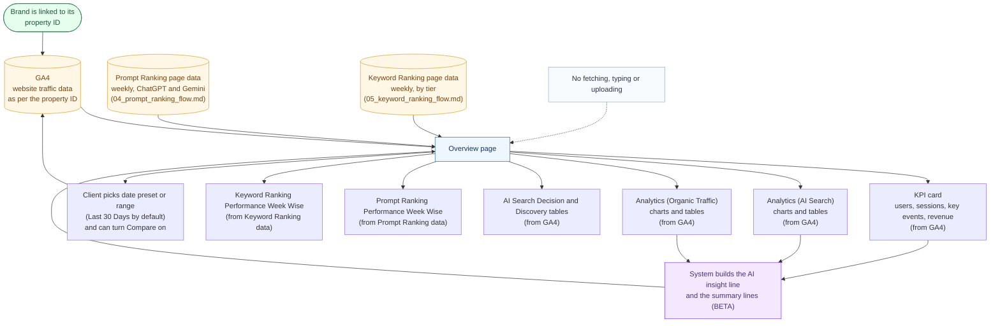
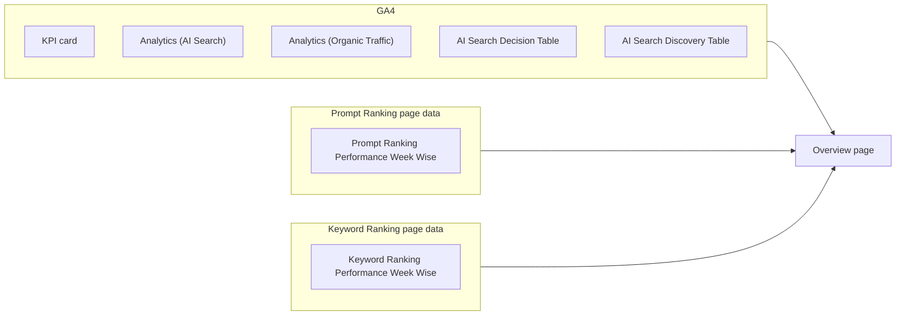

# Overview Flow

> Written for the **Overview** page (`/analytics/overview`, `doc analytics/01-overview.md`). If "Overview" means the Home page instead, tell me and I will change it.

**Notation:** **AI Search traffic** = website sessions that come from AI platforms (ChatGPT, Perplexity, Gemini and similar). **Organic traffic** = sessions from traditional search engines (Google, Bing, Yahoo and others). A **scan date** = the week a ranking belongs to. The **property ID** = the ID that links the brand to its data in GA4.

**Goal:** the Overview page is a one-screen summary of the brand's performance. Most of its data is taken from **GA4**. The two week-wise ranking tables are not taken from GA4: the **prompt** table comes from the **Prompt Ranking** page data, and the **keyword** table comes from the **Keyword Ranking** page data. Nobody types in or uploads data on the Overview page, and it keeps updating automatically.

| Data on the page | Source |
|------------------|--------|
| KPI card, AI Search traffic, Organic traffic, AI Search Decision Table, AI Search Discovery Table | **GA4**, using the **property ID** |
| Prompt Ranking Performance Week Wise (ChatGPT / Gemini) | **Prompt Ranking** page data (see `04_prompt_ranking_flow.md`) |
| Keyword Ranking Performance Week Wise | **Keyword Ranking** page data (see `05_keyword_ranking_flow.md`) |

## Purpose and Access

The page shows:

1. **KPI card:** Active users, New users, Sessions, Key events, Revenue.
2. **AI insight line (BETA):** one sentence on the top AI platform's share of AI Search traffic.
3. **Analytics (AI Search):** line chart, bar chart by platform, session-source table, landing-page table and a BETA summary line.
4. **Analytics (Organic Traffic):** line chart, bar chart by source, session-source table, landing-page table and a BETA summary line.
5. **Prompt Ranking Performance Week Wise:** number of ranked prompts per week, with a ChatGPT / Gemini toggle.
6. **Keyword Ranking Performance Week Wise:** number of keywords in Top 5, 10, 20, 50 and 100 per week.
7. **AI Search Decision Table** and **AI Search Discovery Table:** which AI platforms drive sessions and how users first discovered the brand.

The client can only view the page. The client can change the date preset and range, switch **Compare** on, search the landing pages, and pick the engine and dates in the prompt table. The client cannot add or change any data.

## In short

1. The brand is linked to its GA4 property ID (once).
2. The traffic blocks take their data from GA4.
3. The prompt table takes its data from the Prompt Ranking page data.
4. The keyword table takes its data from the Keyword Ranking page data.
5. The page updates automatically. The client picks the date range, and can compare it with the previous period.

## 1. Overall journey

## 2. Where each block comes from

## System rules

- The **KPI card**, **AI Search**, **Organic Traffic**, **AI Search Decision Table** and **AI Search Discovery Table** are taken from **GA4**, using the brand's **property ID**.
- The **Prompt Ranking Performance Week Wise** table shows the same data as the **Prompt Ranking** page: the number of ranked prompts per week, for ChatGPT or Gemini.
- The **Keyword Ranking Performance Week Wise** table shows the same data as the **Keyword Ranking** page: the number of keywords in Top 5, 10, 20, 50 and 100 per week. The tiers add up, so Top 100 is never lower than Top 5.
- GA4 sessions whose source is an AI platform (for example chatgpt.com, perplexity.ai, gemini.google.com) are shown as **AI Search**. Sessions from search engines are shown as **Organic**.
- The **date preset / range** (Last 7 Days, Last 15 Days, Last 30 Days, All Time, or a custom range) and **Compare** change the GA4 blocks only. The prompt and keyword tables are not compared and do not follow the date range.
- The **AI insight line** and the **summary lines** are generated by the System (BETA) from the GA4 data.
- If GA4 or the keyword data has not been collected yet, the page shows the banner **"No data collected yet"** with the status of Website analytics and Keyword ranking.
- The **NEW** tag in a landing-page table = the page got traffic in this period but not in the previous period of equal length.
- The data updates **automatically**. There is no manual add or upload on this page.
- The client cannot add or change any data.
- The data is **brand scoped**.

## Data and Storage

| Data | Source | Stored where | Notes |
|------|--------|--------------|-------|
| Brand ↔ property ID | Brand setup | Brand setup | Set once per brand |
| KPI card, AI Search, Organic, Decision and Discovery tables | GA4 | GA4 | Follows the date range and Compare |
| Prompt Ranking Performance Week Wise | Prompt Ranking page data | As per `04_prompt_ranking_flow.md` | Weekly, ChatGPT and Gemini. Does not follow the date range |
| Keyword Ranking Performance Week Wise | Keyword Ranking page data | As per `05_keyword_ranking_flow.md` | Weekly, by tier. Does not follow the date range |
| AI insight line and summary lines | System (generated) | Not stored | Built from the GA4 data |

Page details: `doc analytics/01-overview.md`.

## Runbook: Client

1. Open **Analytics → Overview**.
2. Pick the date preset or range. Turn **Compare** on to see the previous period.
3. Read the KPI card, then the AI Search and Organic blocks. Use the landing-page search to find a page.
4. Read the Prompt Ranking table (pick ChatGPT or Gemini, and the dates) and the Keyword Ranking table.
5. Read the Decision and Discovery tables to see which AI platforms drive and start the visits.

## Troubleshooting

| Situation | What to check |
|-----------|---------------|
| "No data collected yet" banner | See which chip says "Not collected": Website analytics (GA4) or Keyword ranking. |
| Traffic blocks are empty or zero | Check the brand's GA4 property ID and the date range. Key events and Revenue stay 0 if GA4 has no conversion or revenue event set up. |
| Prompt table is empty | The prompts may not have been given to Semrush yet, or no weekly data has come in. See `04_prompt_ranking_flow.md`. |
| Keyword table is empty or old | Rankings are added on the Keyword Ranking page. See `05_keyword_ranking_flow.md`. |
| Prompt or keyword numbers differ from the date range | Expected. These two tables follow weekly scan dates, not the date range. |
| Someone wants to upload data | Not needed and not done. |

## Open points

| # | Question |
|---|----------|
| 1 | The organic landing-page table also has Search Console columns (Clicks, Impressions, CTR, Position). Is Search Console part of this flow, or only GA4? |
| 2 | Are the Prompt and Keyword tables read from the same stored data as the Prompt Ranking and Keyword Ranking pages, or fetched again? |
| 3 | What happens if the GA4 call fails? Who is told? |
