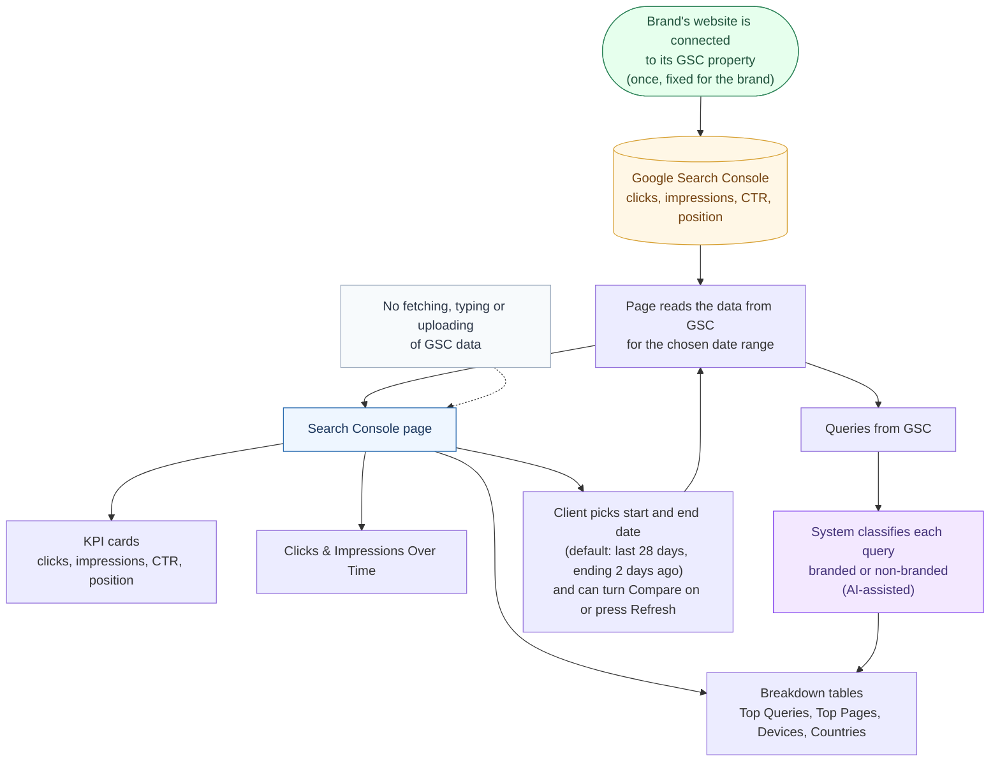

# Search Console Flow

> Written for the **Search Console** page (`/analytics/console-insights`, `doc analytics/02-search-console.md`).

**Notation:** **GSC** = Google Search Console. The **GSC property** = the Search Console property of the brand's website (shown on the page as "Property: {GSC property}", for example `sc-domain:{domain}`). A **branded query** = a search query that contains the brand name, its variations, misspellings or products. A **non-branded query** = any other query.

**Goal:** the page shows how the brand's website performs in Google search: clicks, impressions, CTR and average position for a chosen date range, with four breakdowns (queries, pages, devices, countries). All of this data comes from **GSC**. It does not come from Semrush or from GA4. The only part that is not from GSC is the **branded / non-branded split**, which the System adds to the queries.

## Where the data comes from

| Data on the page | Source | Call (per the page docs) |
|------------------|--------|--------------------------|
| KPI cards (Total Clicks, Total Impressions, Avg CTR, Avg Position) | **GSC** | `fetch-search-console-data` |
| Clicks & Impressions Over Time (chart) | **GSC** | `fetch-search-console-data` |
| Top Queries, Top Pages, Devices, Countries | **GSC** | `fetch-search-console-data` |
| Branded / Non-branded split and counts | **System** (AI-assisted), applied to the queries that came from GSC | `classify-branded-queries` |
| The "Property: {GSC property}" label | The brand's connected GSC property | – |

## Purpose and Access

The page shows:

1. **Four KPI cards:** TOTAL CLICKS, TOTAL IMPRESSIONS, AVG CTR, AVG POSITION.
2. **Clicks & Impressions Over Time:** one line for clicks and one for impressions.
3. **Breakdown card** with four tabs: **Top Queries**, **Top Pages**, **Devices**, **Countries**. On Top Queries the client can filter **All / Branded / Non-branded**.

The client can only view the page. The client can pick the start and end date, turn **Compare** on, press **Refresh**, search inside a table and filter the queries. The client cannot add or change any data.

## In short

1. The brand's website is connected to its GSC property (once, fixed for the brand).
2. The page reads the performance data from GSC for the chosen date range.
3. The System marks each query as branded or non-branded.
4. The default range is the last 28 days, ending 2 days before today, because GSC is about 2 days behind.
5. The client can change the dates, compare with the previous period, or press Refresh to read the data again.

## 1. Overall journey

## System rules

- All numbers come from **GSC**: the KPI cards, the chart and the four tables.
- The brand is linked to its **GSC property** once. The property is fixed for the brand and is shown on the page as "Property: {GSC property}".
- **Reporting lag:** GSC data is about 2 days behind. So the default end date is **today minus 2 days**, and the default start date is 28 days before the end date. Dates after today cannot be picked.
- **KPI maths:** Avg CTR = clicks ÷ impressions over the range. Avg Position is the average position reported by GSC (lower is better).
- **Branded / non-branded** is decided by the System (AI-assisted), and can occasionally be wrong. It applies only to the **Top Queries** tab: Branded ({n}) + Non-branded ({n}) = All.
- Changing the start date, the end date, the compare dates, or pressing **Refresh**, reads the data from GSC again for those dates, and the branded split is re-run for the queries that come back.
- **Compare** shows the previous period (equal length, immediately before) as "vs {value}" only. There is no percentage change on this page.
- The data is **brand scoped**: it follows the brand chosen in the top bar.
- Rows are ordered by clicks, highest first. Columns cannot be sorted.
- If the data call fails (for example after a date range that is rejected), the page shows an error message and keeps the previous numbers on screen.
- The client cannot add or change any data.

## Data and Storage

| Data | Source | Stored where | Notes |
|------|--------|--------------|-------|
| Brand ↔ GSC property | Brand setup | Brand setup | Set once, fixed for the brand |
| Clicks, impressions, CTR, position (totals, per day, per query, page, device, country) | GSC | GSC | Read for the chosen date range, about 2 days behind |
| Branded / non-branded label per query | System (AI-assisted) | Not stored (per the page docs, worked out for the queries returned) | Re-run on every read |

Page details: `doc analytics/02-search-console.md`.

## Other pages that use the same data

The **Overview** page uses the same Search Console data for its organic landing-page table (Clicks, Impressions, CTR, Position and the "GSC matched" pill). See `01_overview_flow.md`.

## Runbook: Client

1. Open **Analytics → Search Console**.
2. Check the date range (the last 28 days by default). Change the start or end date if needed, or turn **Compare** on.
3. Read the four KPI cards and the Clicks & Impressions chart.
4. Open the tabs: **Top Queries** (use All / Branded / Non-branded), **Top Pages**, **Devices**, **Countries**. Use the search box to find a row.
5. Press **Refresh** to read the latest data again.

## Troubleshooting

| Situation | What to check |
|-----------|---------------|
| No data or zeros | The brand may not be connected to its GSC property, or the date range has no data. |
| Last two days are missing or low | Expected. GSC is about 2 days behind. |
| Error message and numbers did not change | The data call failed. Check the dates (start must not be after end), then press Refresh. |
| A query is in the wrong group (branded / non-branded) | The split is AI-assisted and can be wrong. |
| Branded and non-branded counts look off | They count queries, and All = Branded + Non-branded. |
| Someone wants to upload GSC data | Not needed and not done. |

## Open points

| # | Question |
|---|----------|
| 1 | The page reads GSC for the chosen dates each time (and again on Refresh). Is GSC data also copied and stored once and then fixed, or is it always read live? |
| 2 | How is the brand connected to its GSC property (who does it, and where)? |
| 3 | Is the Search Console item locked for some brands (as seen on one brand's sidebar)? What decides that? |
| 4 | Which date ranges does the data call reject, and can the page check the dates before calling? |
