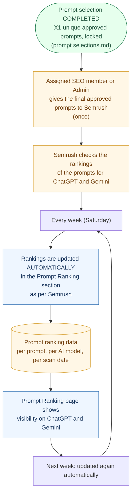
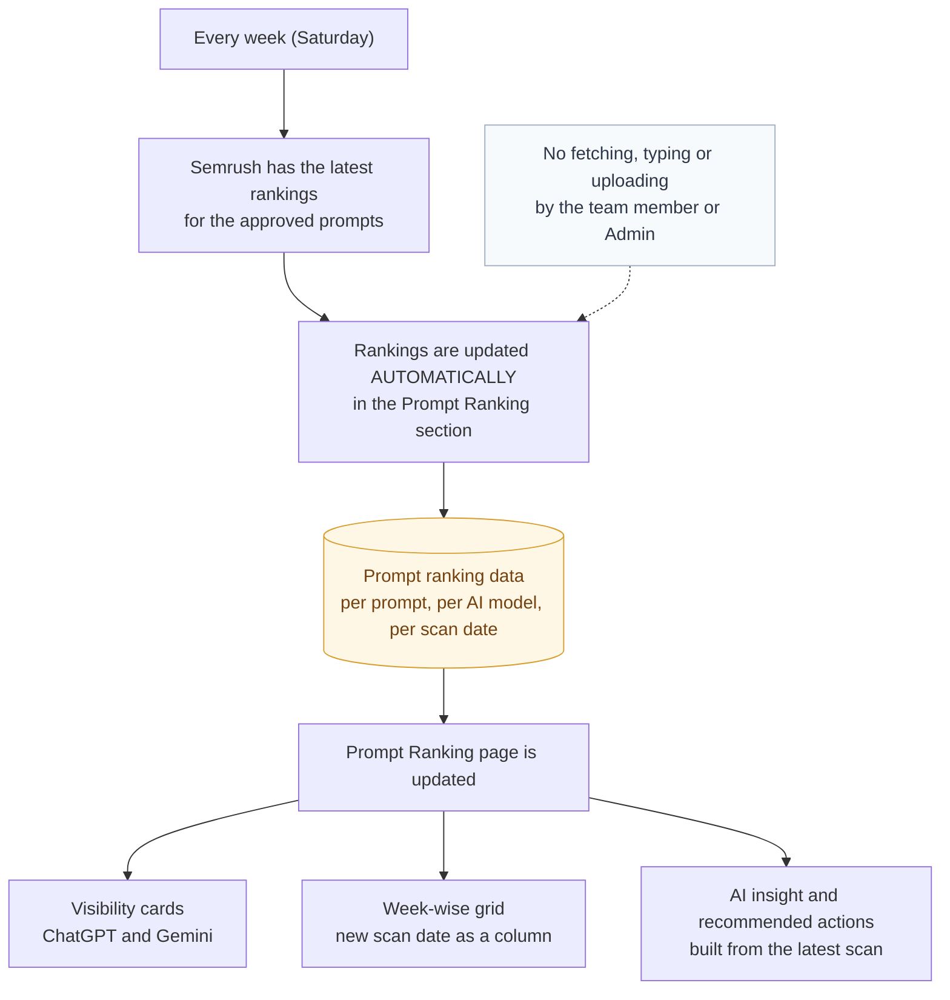

# Prompt Ranking Flow

**Notation:** X1 = prompt limit of the client's subscription package. A **scan date** = the week the rankings belong to. **Visibility** = how often the brand appears in an AI model's answers to the client's prompts, shown for **ChatGPT** and **Gemini**.

**Roles:** the **Client**, the **Assigned SEO team member**, the **Admin**, the **System**, and **Semrush**.

**Starting point:** this flow begins when prompt selection is **Completed**, meaning the client has approved exactly X1 unique prompts and they are locked. How the prompts are selected is in `../../prompt selections.md`.

**Goal:** the assigned SEO team member or the Admin gives the final approved prompts to **Semrush**. After that, the data in the Prompt Ranking section is **updated automatically every week** as per Semrush, and the client sees their visibility on ChatGPT and Gemini. Nobody has to fetch or type in the data.

## Purpose and Access

Prompt ranking shows the client how their brand appears when AI models (ChatGPT and Gemini) answer the client's approved prompts.

- The client sees Prompt Ranking data only after payment and after prompt selection is completed and the prompts are given to Semrush.
- The client can only view the page. The client cannot add or change any ranking data.

## In short

1. **Receive:** the final approved prompts (X1, locked) come from the prompt selection flow.
2. **Give to Semrush:** the assigned SEO team member or the Admin gives those approved prompts to Semrush, once.
3. **Automatic weekly update:** the data in Prompt Ranking is updated every week (Saturday) automatically, as per Semrush. The team member or Admin does **not** fetch or type in any data.
4. **See:** the client sees visibility for ChatGPT and Gemini, a week-wise grid, and the AI insight on the Prompt Ranking page.

## 1. Overall journey

## 2. Automatic weekly update

## System rules

- Prompts are given to Semrush only after **X1** prompts are approved. Rejected prompts are never given to Semrush.
- The **assigned SEO team member or the Admin** gives the approved prompts to Semrush. The client cannot.
- The prompts are given to Semrush once, and the same prompts are used every week.
- The data in Prompt Ranking is **updated automatically every week** as per Semrush. The scan dates seen in the live app are Saturdays.
- **There is no role for the team member or the Admin in fetching, typing in or uploading the ranking data.** Their only action is giving the prompts to Semrush.
- The page shows visibility for **ChatGPT and Gemini**. If no value is available for a model, the page shows `0.00%` for it.
- The client cannot add or change any ranking data.

## Roles and Scope

| Role | What they can do | What they cannot do |
|------|------------------|---------------------|
| **Client** | View the Prompt Ranking page | Cannot give prompts to Semrush. Cannot add or change ranking data. |
| **Assigned SEO team member** | Give the final approved prompts to Semrush | Does not fetch or type in ranking data. |
| **Admin** | Same as the assigned SEO team member for any client | Same limits |
| **System** | Show the automatically updated rankings on the page, build the insight and actions on each page load | – |
| **Semrush** | Holds the prompts given to it, checks their rankings, and the rankings are updated automatically in the Prompt Ranking section | – |

## Data and Storage

| Data | Stored where | Notes |
|------|--------------|-------|
| Approved prompts (input) | `prompts_brandwise` in the page docs | From the prompt selection flow, X1 unique prompts, locked |
| Prompts at the source | Semrush | Given by the assigned SEO member or Admin |
| Prompt rankings | Platform store (`weekly_prompt_ranking` and `monthly_percentage` are named in the page docs) | Updated automatically, per prompt, per AI model (ChatGPT, Gemini), per scan date |
| Insight and actions | Not stored | Generated again on every page load |

## Checked in the live app

The Prompt Ranking page was opened for one brand (Pro User view) and its calls were recorded. This confirms these points:

| Finding | What it shows |
|---------|---------------|
| Scan dates are **Saturdays**, seven days apart (for example 14-Nov-2026, 07-Nov-2026, 31-Oct-2026, back to 23-May-2026) | The weekly cadence. The very first date seen, 18-May-2026, is a Monday. |
| The page shows **ChatGPT** and **Gemini** because both are switched on for the brand (`brand_model_config`: ChatGPT on, Gemini on, Perplexity off, AI Overview off) | The models shown depend on the brand's setup. |
| `get_prompt_selection_access` returns `max_prompts` (X1, **75** for this brand), `is_paid`, `questionnaire_completed`, `has_proposal_rows`, `has_ranking_rows`, `eligible` and `prompts_finalized` | The prompt limit, the payment rule, and whether prompt selection is completed. |
| The tracked prompt list comes from `prompts_brandwise` (22 prompts for this brand) | The approved prompts are what the page tracks. |
| `fetch-prompt-visibility` returns **every prompt** with a `type` (for example non-branded) and a value for **each scan date**: a rank number such as 1 to 5, or empty | The page shows a grid with a value for each prompt on each scan date. |
| `fetch-prompt-weekly-summary` returns a "Ranked Prompts" count per date, for ChatGPT and for Gemini | The ranked-prompt count is worked out from the per-prompt values. |
| The cards show "Visibility %" for Gemini and for ChatGPT | The percentage shown on the cards. |
| The page has **no button or screen** for adding or uploading ranking data, and **Semrush is not mentioned** in the page or its calls | Consistent with the rankings being updated automatically in the background, with no action by the client. Admin screens were not visible to this account, so they were not checked. |

## Runbook: Assigned SEO Team Member (and Admin)

1. Wait until prompt selection is **Completed** (X1 unique approved prompts).
2. Give the final approved prompts to Semrush, once.
3. That is the last manual step. The rankings are then updated automatically every week in the Prompt Ranking section. **Do not fetch or type in any ranking data.**

## Runbook: Client

1. Finish prompt selection (see `../../prompt selections.md`).
2. Open **Analytics → Prompt Ranking** to see your visibility on ChatGPT and Gemini.
3. The page updates automatically every week. A new scan date appears as a new column in the grid.

## Troubleshooting

| Situation | What to check |
|-----------|---------------|
| Nothing to give to Semrush | The client may not have approved X1 prompts yet. Finish prompt selection. |
| No rankings show on the Prompt Ranking page | Check that the approved prompts were given to Semrush. If they were, the update is automatic and there is nothing for the team to fetch, so report it to the product team. |
| A model shows `0.00%` visibility | No value is available for that model this week, or the value is really 0. |
| Someone wants to type in or upload rankings | Not needed and not done. Rankings are updated automatically. |
| The client cannot add data | By design. The client cannot add or change ranking data. |

## Open points

Confirm these with the product team:

| # | Question |
|---|----------|
| 1 | How exactly are the prompts given to Semrush (typed in, imported as a file, or another way)? |
| 2 | Does the weekly Saturday date come from Semrush's own schedule, or from the platform? |
| 3 | What happens if Semrush has no result for some prompts in a week, or if the automatic update fails? Who is told? |
