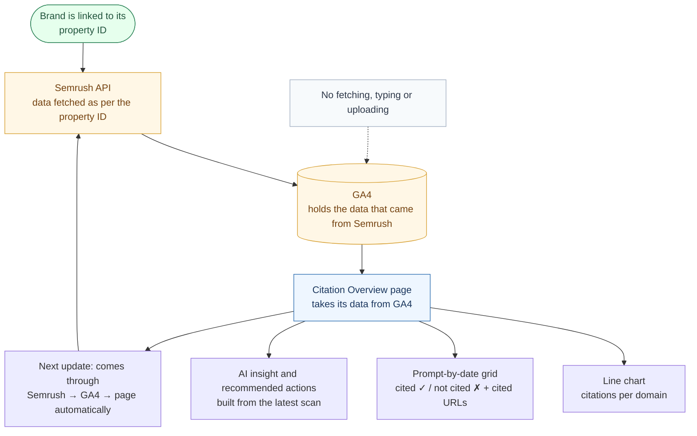

# Citation Overview Flow

**Notation:** A **scan date** = the date a set of citation results belongs to. A **citation** = an AI model (ChatGPT or Gemini) names the brand's website (or a competitor's) as a source in its answer to a tracked prompt. The **property ID** = the ID that links the brand to its data in Semrush and in GA4.

**Starting point:** the approved prompts from `../../prompt selections.md`, tracked in Semrush (see `04_prompt_ranking_flow.md`).

**Goal:** the Citation Overview page shows whether and where AI models cite the brand's website. The page data is taken from **GA4**. GA4 gets its data from **Semrush**, using the **property ID** through the **Semrush API**. Nobody types in or uploads the data, and it keeps updating automatically.

## Purpose and Access

The page (`/analytics/citations`) shows:

1. An AI insight line and recommended actions.
2. A line chart of citation counts per source domain over time (brand vs competitors), for ChatGPT and Gemini.
3. A prompt-by-date grid: for every tracked prompt on every scan date, was the brand's domain cited (✓) or not (✗), with the cited URLs on expand.

The client can only view the page. The client cannot add or change any citation data.

## In short

1. **Link:** the brand is linked to its Semrush property ID.
2. **Semrush → GA4:** the data comes from Semrush into GA4 through the Semrush API, using that ID.
3. **GA4 → page:** the Citation Overview takes its data from GA4.
4. **Automatic update:** the page keeps updating on its own. Nobody fetches, types or uploads data.
5. **See:** the client sees the chart, the grid and the insight.

## 1. Overall journey

## System rules

- The page data is taken from **GA4**.
- GA4 gets the data from **Semrush**, matched by the brand's **property ID**, through the **Semrush API**.
- The same source is used for the Sentiment Overview, the Reddit Overview and the Product Leaderboard (see `07_sentiment_overview_flow.md`, `08_reddit_overview_flow.md`, `10_product_leaderboard_flow.md`).
- The data updates **automatically**. There is no upload, no manual add and no CSV for this page.
- The client cannot add or change any citation data.
- The data is **brand scoped**.
- The two model toggles (chart and grid) are independent of each other.
- **Citation rate** = prompts cited ÷ tracked prompts on the latest scan. **Explicit absence rate** = prompts not cited ÷ tracked prompts.
- The insight line and action cards are generated again on every page load, so the wording can differ.
- A grid row can be expanded only if the brand's domain was cited for that prompt on at least one date.

## Data and Storage

| Data | Stored where | Notes |
|------|--------------|-------|
| Brand ↔ property ID | Brand setup | Set once per brand |
| Source data | Semrush, read through the Semrush API | Matched by property ID |
| Page data | GA4 | Comes from Semrush |
| Chart series (domain, model, date, mentions) | `citation_graph_data` (per the page docs) | Filtered by brand name |
| Prompt grid and cited URLs | `fetch-citation-data` (per the page docs) | Per prompt, per date |
| Cited source lists | `fetch-sources-data` (per the page docs) | By date range |
| Insight and actions | Not stored | Generated again on every page load |

Page details: `doc analytics/06-citation-overview.md`.

## Runbook: Client

1. Finish prompt selection (see `../../prompt selections.md`).
2. Open **Analytics → Citation Overview**.
3. Use the domain filter, date range and ChatGPT / Gemini toggles on the chart. Use the toggle on the grid and click a ✓ row to see the cited URLs.
4. The page updates automatically.

## Troubleshooting

| Situation | What to check |
|-----------|---------------|
| Page shows no data | Check the brand's property ID and that the prompts were given to Semrush. If both are fine, report it to the product team. |
| Every grid cell shows ✗ | No citation for the brand's domain on those scans. This is a real result, not an error. |
| A row has no chevron | The brand's domain was never cited for that prompt. |
| Someone wants to upload citation data | Not needed and not done. |

## Open points

Not in the page docs and not verified in the live app. Confirm with the product team:

| # | Question |
|---|----------|
| 1 | How often does the data move from Semrush into GA4, and from GA4 to the page? |
| 2 | What happens if the Semrush API call fails for a period? Who is told? |
