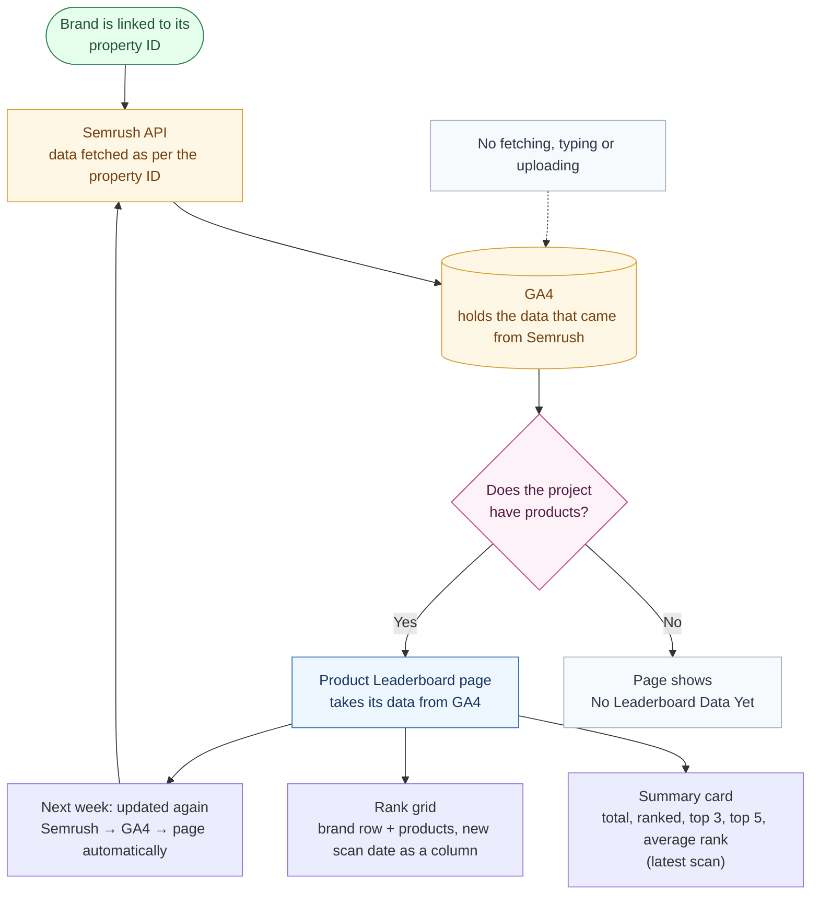

# Product Leaderboard Flow

**Notation:** A **product** = an item sold by the brand. A **scan date** = the week the ranks belong to. The **property ID** = the ID that links the brand to its data in Semrush and in GA4. The page is titled "ChatGPT Shopping Leaderboard".

**Goal:** the page shows where the brand and each of its products rank in ChatGPT Shopping, week by week. The page data is taken from **GA4**. GA4 gets its data from **Semrush**, using the **property ID** through the **Semrush API**. Nobody types in or uploads the data, and it keeps updating automatically.

**Only when the project has products:** the data in the Product Leaderboard is shown only when the project has products. A project without products has no leaderboard data.

## Purpose and Access

The page (`/analytics/product-leaderboard`) shows:

1. A summary card: TOTAL PRODUCTS, RANKED (LATEST), TOP 3, TOP 5, AVG RANK.
2. A rank grid: the brand row first, then every product ever ranked, with a rank (1 to 10, or `-` for not ranked) for each weekly scan date.

If the project has no products (no data), the page shows "No Leaderboard Data Yet". The client can only view the page. There are no filters, no search and no AI insight.

## In short

1. The brand is linked to its Semrush property ID (once).
2. The data comes from Semrush into GA4 through the Semrush API.
3. The page takes its data from GA4, and shows it only if the project has products.
4. The page updates automatically every week.

## 1. Overall journey

## System rules

- The page data is taken from **GA4**.
- GA4 gets the data from **Semrush**, matched by the brand's **property ID**, through the **Semrush API**.
- The leaderboard shows data **only when the project has products**.
- The same source is used for the Citation Overview, the Sentiment Overview and the Reddit Overview.
- The data updates **automatically**. There is no manual add or upload.
- The client cannot add or change any data.
- The data is **brand scoped**.
- The first grid row is the **brand**. Then products ranked in the latest scan (best first), then products ranked only earlier, then products that never ranked recently.
- All summary numbers are for the **latest scan date**. Example: ranks 1, 5 and 9 give RANKED 3, TOP 3 = 1, TOP 5 = 2, AVG RANK = 5.0.

## Data and Storage

| Data | Stored where | Notes |
|------|--------------|-------|
| Brand ↔ property ID | Brand setup | Set once per brand |
| Source data | Semrush, read through the Semrush API | Matched by property ID |
| Page data | GA4 | Comes from Semrush |
| Summary card and grid | `fetch-product-leaderboard` (per the page docs) | `{}` for the signed-in brand, or `{ "brandOverride": "{Brand}" }` |

Page details: `doc analytics/10-product-leaderboard.md`.

## Runbook: Client

1. Open **Analytics → Product Leaderboard**.
2. Read the summary card, then scroll the grid sideways to compare weeks.

## Troubleshooting

| Situation | What to check |
|-----------|---------------|
| "No Leaderboard Data Yet" | The project may have no products. If it should have products, check the property ID, then report it to the product team. |
| Product Leaderboard is not in the sidebar | The page is shown only for brands that have it enabled (per the page docs). |
| A product shows only `-` | It was not ranked on those dates. |
| Someone wants to upload ranks | Not needed and not done. |

## Open points

| # | Question |
|---|----------|
| 1 | Is "the project has products" the same as the sidebar item being enabled for the brand, or are they two separate checks? |
| 2 | Where are the products defined (in Semrush, or in the platform)? |
| 3 | What happens if the Semrush API call fails for a week? Who is told? |
