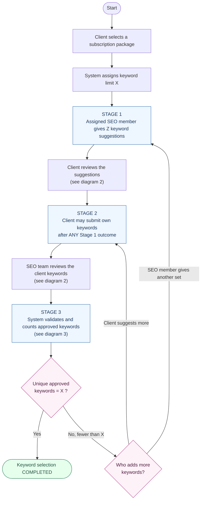
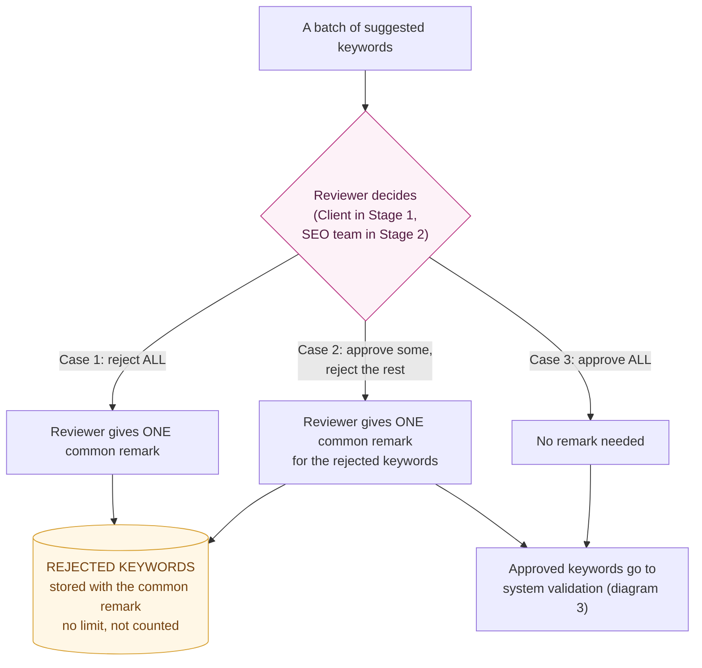
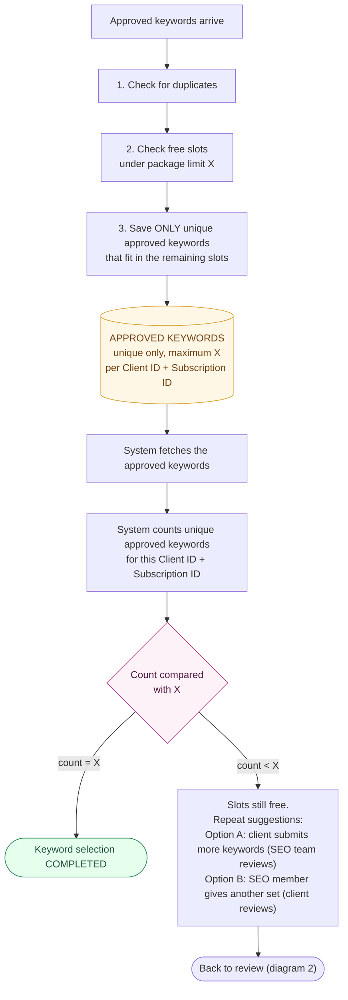

# Keyword Selection Process

**Notation:** X = keyword limit of the client's subscription package. Z = number of keyword suggestions the SEO team gives in one batch.

**Roles:** the **Client**, the **SEO team member** assigned to the client, and the **System**.

**Goal:** the process is complete only when exactly X unique keywords are approved for the client's Client ID and Subscription ID.

The process is shown in three diagrams: the overall journey, how a batch of keywords is reviewed, and how the system validates and counts approved keywords.

## 1. Overall journey

## 2. How a batch of keywords is reviewed (Stage 1 and Stage 2)

The same three outcomes apply in both stages. Only the reviewer changes.

| Stage | Keywords come from | Reviewer |
|---|---|---|
| Stage 1 | Assigned SEO team member | **Client** |
| Stage 2 | Client | **SEO team** |

Notes:
- Case 1 ends with nothing approved, so the count stays the same.
- Stage 1 and Stage 2 have the same cases, but in Stage 2 the order is approve all, approve and reject in bulk, reject all. The logic is identical.

## 3. Validation and count check (Stage 3)

This runs every time keywords are approved.

## Keyword storage

| Storage section | Data stored | Storage limit |
|---|---|---|
| Approved Keywords | Unique approved keywords | Maximum X keywords |
| Rejected Keywords | Rejected keywords with their common rejection remark | No limit |

## System rules

- Approved keywords are stored against the respective **Client ID** and **Subscription ID**.
- Duplicate keywords are never counted twice.
- Rejected keywords are stored separately, with their remarks, and do not count towards the approved total.
- The system checks the available slots before saving approved keywords.
- The client can submit their own suggestions after the initial SEO suggestions, whether they approved or rejected the initial ones.
- The assigned SEO team member keeps providing suggestions whenever required.
- The process ends only when X unique keywords have been approved.
