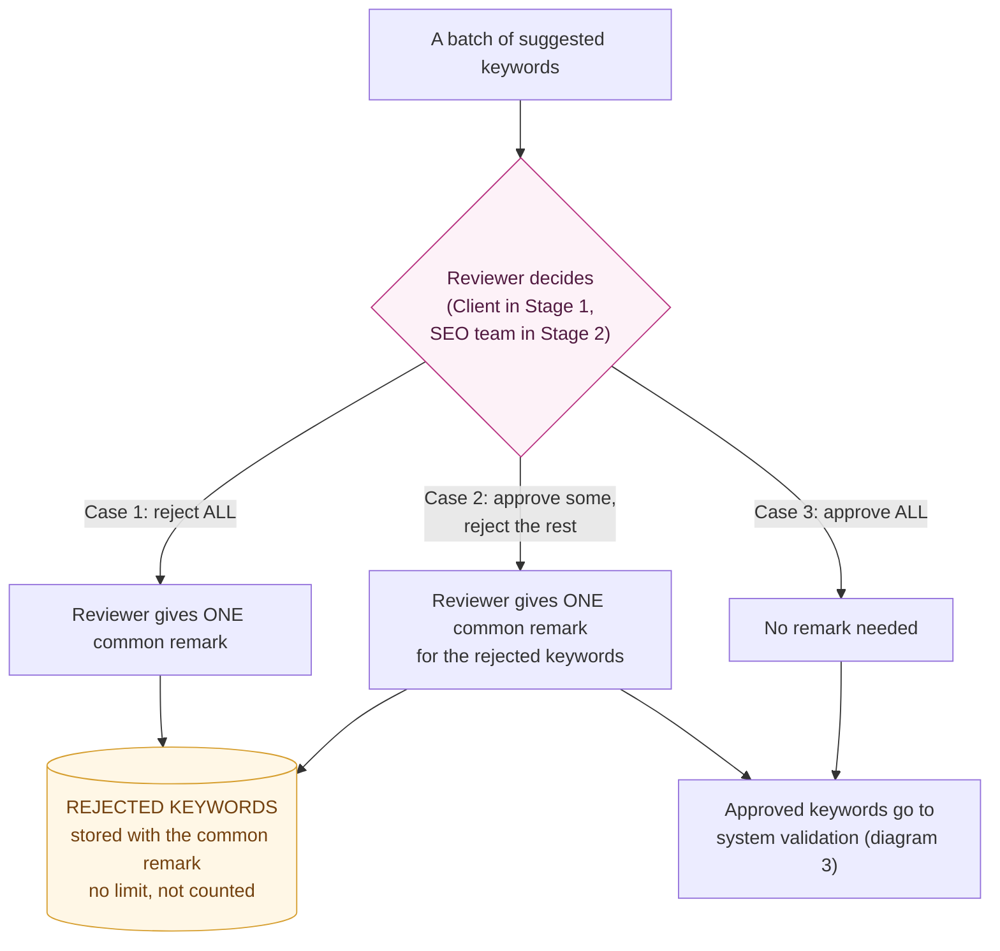

# Keyword Selection Process

**Notation:** X = keyword limit of the client's subscription package. Z = number of keyword suggestions the SEO team gives in one batch.

**Roles:** the **Client**, the **SEO team member** assigned to the client, and the **System**.

**Goal:** the process is complete only when exactly X unique keywords are approved for the client's Client ID and Subscription ID.

The process is shown in three diagrams: the overall journey, how a batch of keywords is reviewed, and how the system validates and counts approved keywords. The sections after the diagrams explain **how the work is carried out**: who does what, in which order, and which rules the system enforces.

## Purpose and Access

Keyword selection decides which X keywords will be tracked for a client. The SEO team suggests keywords, the client approves or rejects them, the client can add their own, and the SEO team reviews those. The system keeps the approved list unique and never lets it grow past X.

**Payment comes first.** Nothing in this process is visible to the client on the platform until the client has **completed the payment** for the subscription package:

- Before payment: the client sees no keyword suggestions, no Approved Keywords or Rejected Keywords sections, and no option to submit keywords.
- After payment: the keyword limit X is assigned from the paid package and the client can see and work on the keyword selection screens.
- The SEO team's suggestions are shown to the client only after payment is complete.

## 1. Overall journey

## 2. How a batch of keywords is reviewed (Stage 1 and Stage 2)

The same three outcomes apply in both stages. Only the reviewer changes.

| Stage | Keywords come from | Reviewer |
|---|---|---|
| Stage 1 | Assigned SEO team member | **Client** |
| Stage 2 | Client | **SEO team** |

Notes:
- Case 1 ends with nothing approved, so the count stays the same.
- Stage 1 and Stage 2 have the same cases, but in Stage 2 the order is approve all, approve and reject in bulk, reject all. The logic is identical.

## 3. Validation and count check (Stage 3)

This runs every time keywords are approved.

## Keyword storage

| Storage section | Data stored | Storage limit |
|---|---|---|
| Approved Keywords | Unique approved keywords | Maximum X keywords |
| Rejected Keywords | Rejected keywords with their common rejection remark | No limit |

## System rules

- Approved keywords are stored against the respective **Client ID** and **Subscription ID**.
- Duplicate keywords are never counted twice.
- Rejected keywords are stored separately, with their remarks, and do not count towards the approved total.
- The system checks the available slots before saving approved keywords.
- The client can submit their own suggestions after the initial SEO suggestions, whether they approved or rejected the initial ones.
- The assigned SEO team member keeps providing suggestions whenever required.
- The process ends only when X unique keywords have been approved.
- Nothing is visible to the client on the platform until the client has completed the payment.
- The total number of approved keywords can never be more than X, including when the client approves all keywords at once (see "Approval limit (X)" below).

## Approval limit (X)

- **No one can approve more than X keywords.** This applies to every way of approving: approving keywords one by one, approving in bulk, and approving **all** keywords at once.
- The limit applies to the **total** of approved keywords, not to one batch. The number a client can still approve is **X minus the keywords already approved**.
- If Z (the keywords suggested) is bigger than the remaining slots, the client cannot approve all of them. They must pick only as many as the remaining slots allow and reject the rest with the common remark.
- The same limit applies when the SEO team approves the client's own keywords in Stage 2.
- The system checks again at save time (diagram 3). It saves only unique approved keywords that fit in the remaining slots, so the approved list can never go past X even if two approvals happen close together.
- Example: X = 20, 15 already approved, 10 new keywords suggested. Only 5 more can be approved. The other 5 must be rejected, and they go to Rejected Keywords with the common remark.

## Roles and Scope

| Role | What they can do | What they cannot do |
|------|------------------|---------------------|
| **Client** | After payment: view the SEO team's suggestions, approve or reject them (with one common remark for rejections), submit their own keywords, view Approved and Rejected Keywords | Cannot see anything before payment. Cannot approve more than X keywords. Cannot reject without a common remark. Cannot review their own submitted keywords. |
| **Assigned SEO team member** | Give keyword suggestions (Z per batch), review the client's own keywords (approve, reject, common remark), give another set whenever required | Cannot approve more than X keywords in total. Cannot reject without a common remark. Cannot make anything visible to the client before payment. |
| **System** | Assign X from the package, validate duplicates and free slots, save approved and rejected keywords, count unique approved keywords, mark the process Completed | – |

Notes:

- Keywords belong to one **Client ID** and one **Subscription ID**.
- The assigned member is a specific person in the client's SEO team.

## Status of a Keyword

Status is set by the review decision. It is not typed in.

| Status | Meaning | Stored in | Counts towards X? |
|--------|---------|-----------|--------------------|
| **Suggested (pending review)** | Given by the SEO member or submitted by the client and waiting for review | – | No |
| **Approved** | Approved, unique and within the free slots | Approved Keywords | Yes |
| **Rejected** | Rejected with the reviewer's common remark | Rejected Keywords | No |

The **process** has two states: **In progress** (fewer than X unique approved keywords) and **Completed** (exactly X unique approved keywords).

## Runbook: Client

1. Complete the payment for the subscription package. The keyword selection screens become visible only after this.
2. Wait for the assigned SEO member's keyword suggestions (Z keywords).
3. Review each suggested keyword. You can approve or reject:
   - **Reject all:** give one common remark explaining why.
   - **Approve some and reject the rest:** give one common remark for the rejected keywords.
   - **Approve all:** no remark is needed, but you cannot approve more than the remaining slots (X minus already approved).
4. Optionally submit your **own** keywords. You can do this after any outcome above, even after rejecting all.
5. The SEO team reviews your keywords. Check Approved Keywords and Rejected Keywords to see the result and any remark.
6. If the approved count is still below X, you can submit more keywords, or the SEO member gives another set. Repeat until X unique keywords are approved.
7. When exactly X unique keywords are approved, the process is marked **Completed**.

## Runbook: Assigned SEO Team Member

1. After the client's payment, give the first batch of Z keyword suggestions.
2. When the client submits their own keywords, review them:
   - **Approve all**
   - **Approve some and reject the rest:** give one common remark for the rejected keywords.
   - **Reject all:** give one common remark explaining the rejection.
3. Do not approve more keywords than the remaining slots (X minus already approved).
4. If the approved count is below X and the client has no more keywords to submit, give another set of suggestions. Keep doing this whenever required.
5. Stop only when the system marks the process **Completed** (X unique approved keywords).

## Data and Storage

The platform keeps, for each Client ID and Subscription ID:

- The keyword limit **X** from the paid package.
- **Approved Keywords:** unique approved keywords, at most X.
- **Rejected Keywords:** rejected keywords with their common remark, no limit.
- The **process state** (In progress or Completed).

Permissions are checked by the platform for every read and write, in line with the roles above.

## Troubleshooting

| Situation | What to do |
|-----------|------------|
| Client cannot see any keywords or sections | Check that the payment is completed. Nothing is shown before payment. |
| Client cannot approve all suggested keywords | The remaining slots are fewer than the suggested keywords. Approve only as many as fit and reject the rest with the common remark. |
| Rejection cannot be submitted | A common remark is required for every rejection. Add it and submit again. |
| An approved keyword was not saved | It was a duplicate of an approved keyword, or there were no free slots left. Duplicates are not counted twice. |
| Approved count is below X | Ask the client for more keywords, or give another set of suggestions. |
| Process is not Completed | The unique approved count is not exactly X yet. |
| Client has rejected everything | The SEO member gives another set. The client can also submit their own keywords. |

> The on-screen wording of messages and the exact point where the platform blocks an approval beyond X are not specified in the source description. Confirm them with the product team.
