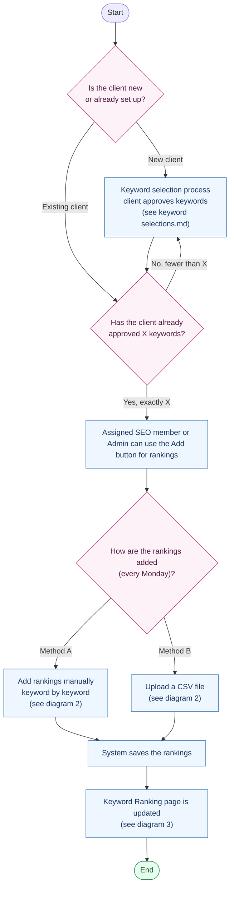
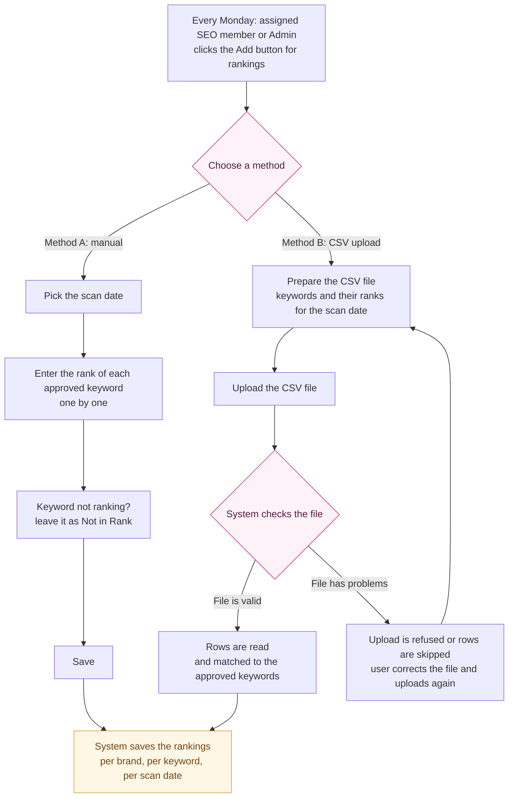
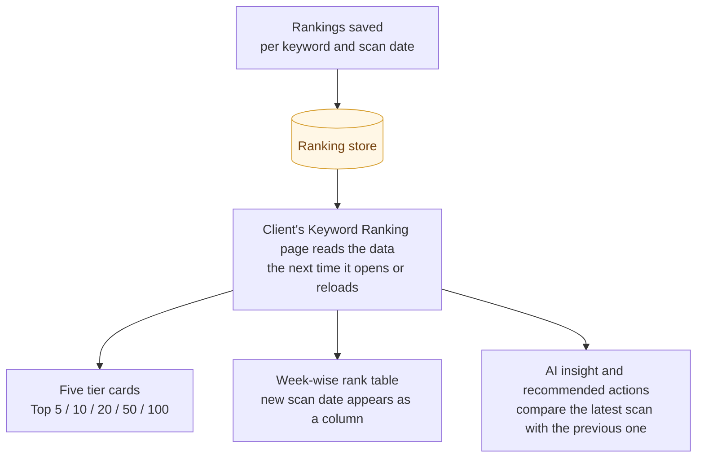

# Keywords Ranking Flow

**Notation:** X = keyword limit of the client's package. A **rank** = the position of the brand's page for a keyword (lower is better). A **scan date** = the week the ranks belong to.

**Roles:** the **Client**, the **Assigned SEO team member** (the SEO team member assigned to the client), the **Admin**, and the **System**. The assigned SEO team member or the Admin adds the rankings. The client never does.

**Goal:** once the client's X keywords are approved, the **assigned SEO team member or the Admin** adds the rank of each keyword (by hand or by CSV) **every Monday**, and the data is reflected on the client's Keyword Ranking page.

This flow comes **after** the keyword selection process. See [keyword selections.md](keyword%20selections.md) for how the X keywords are approved. For how the Keyword Ranking page reads the data, see [Final keyword ranking.md](Final%20keyword%20ranking.md).

The flow is shown in three diagrams: the overall journey for a new and an existing client, the two ways of adding rankings, and what happens after the rankings are saved.

## 1. Overall journey

Plain reading:

- **A new client** always starts with keyword selection. Keywords must be approved first, and the process repeats until exactly X are approved.
- **An existing client** who has already approved X keywords skips keyword selection and goes straight to adding rankings.
- **Only the assigned SEO team member or the Admin adds the rankings.** The client cannot add rankings. The client only sees the result on their Keyword Ranking page.
- **Rankings are updated every Monday**, by either method, by the assigned SEO member or the Admin.
- Rankings are added only once X keywords are approved, because the rankings belong to those approved keywords.

## 2. The two ways of adding rankings

| | Method A: Manual | Method B: CSV upload |
|---|---|---|
| Best for | A few keywords, or a quick correction | Many keywords at once |
| How | Enter the rank of each keyword in the page | Upload one file with all the ranks |
| Result | Same: the rankings are saved for the scan date | Same: the rankings are saved for the scan date |
| Done by | The assigned SEO member or Admin | The assigned SEO member or Admin |
| When | Every Monday | Every Monday |

## 3. After the rankings are saved

- The new scan date becomes a column in the week-wise table. The latest date is the default for the five cards.
- The AI insight and actions are generated again on each load, from the newest data.
- A keyword with no rank for a scan date shows **-** (stored as `Not in Rank`).

## System rules

- Rankings can be added only after the client has approved **X** keywords.
- A **new** client must finish keyword selection first. An **existing** client with X approved keywords can add rankings directly.
- Rankings belong to the **approved keywords** of the client's Client ID and Subscription ID.
- A ranking is stored **per keyword and per scan date**.
- The rankings are updated **every Monday** by the assigned SEO team member or the Admin, whichever method is used.
- Only the **assigned SEO team member** of the client or the **Admin** adds the rankings. The client cannot. There are **two ways**: manually, keyword by keyword, or by uploading a CSV file. Both give the same result.
- The client does not add rankings. The saved rankings are **reflected on the client's Keyword Ranking page**.
- A keyword that does not rank for a date is shown as **-** (`Not in Rank`).
- After saving, the data is updated on the Keyword Ranking page.

## Roles and Scope

| Role | What they can do | What they cannot do |
|------|------------------|---------------------|
| **Client** | Approve keywords (keyword selection). View the Keyword Ranking page, where the rankings added by the assigned SEO member or Admin are reflected. | **Cannot add rankings.** |
| **Assigned SEO team member** | Use the Add button to add rankings manually or by CSV, every Monday. Download the month's rankings (per the page docs). | Cannot add rankings before X keywords are approved. |
| **Admin** | Same as the assigned SEO team member for any client: add rankings manually or by CSV, every Monday. | Cannot add rankings before X keywords are approved. |
| **System** | Check that X keywords are approved, check the CSV, save the rankings, update the page | – |

## Runbook: Adding Rankings (every Monday, by the assigned SEO member or Admin)

1. On Monday, confirm the client has approved exactly **X** keywords. If not, go back to keyword selection.
2. Open **Analytics → Keyword Ranking** for the client's brand.
3. Click the **Add** button for rankings.
4. Choose a method:
   - **Manual:** pick the scan date and enter the rank of each keyword. Leave a keyword unranked if it is not ranking.
   - **CSV upload:** prepare the file and upload it. If the file has problems, correct it and upload again.
5. Save.
6. Open the Keyword Ranking page and check that the new scan date shows in the table and the cards.

## Troubleshooting

| Situation | What to check |
|-----------|---------------|
| The Add button is not available | The client may not have approved X keywords yet, or the account is not the assigned SEO member of this client or an Admin. |
| A keyword is missing from the entry list | It is not an approved keyword yet. Finish keyword selection first. |
| The CSV upload is refused | Check the file format and the keyword names against the approved keywords. |
| Some CSV rows were not added | The keyword may not match an approved keyword, or the rank is not valid. Correct the rows and upload again. |
| New ranks are not on the page | Reload the page. The page reads the saved data when it opens. |
| A keyword shows **-** | It was entered as not ranking, or no rank was added for that date. |

## To confirm

The source description does not say the following. Confirm with the product team:

| # | Question |
|---|----------|
| 1 | What is the exact format of the CSV (columns, one file per scan date or many dates in one file)? |
| 2 | What happens to CSV rows for keywords that are not approved: refused, skipped, or added? |
| 3 | Can a rank for an existing scan date be changed by adding it again (overwrite), or is it blocked? |
| 4 | Is the Add button hidden or disabled until X keywords are approved, and what message is shown? |
| 5 | Is the scan date the Monday of the update? What happens if a Monday is missed, or an update is added late for an earlier Monday? |
